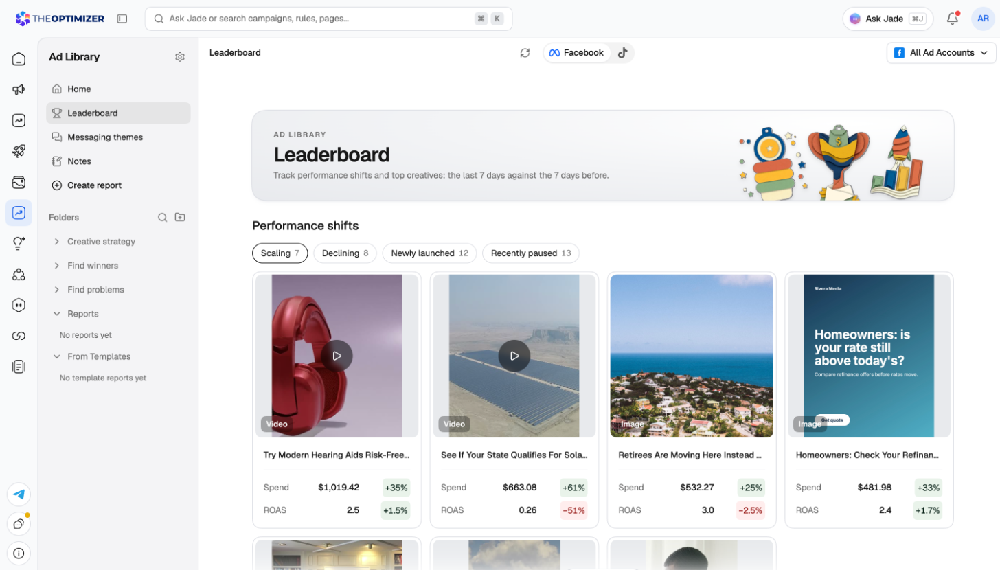
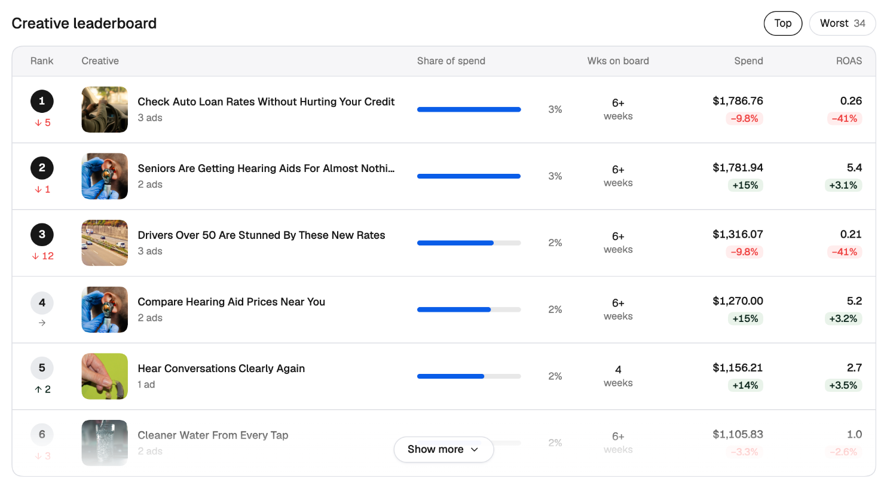
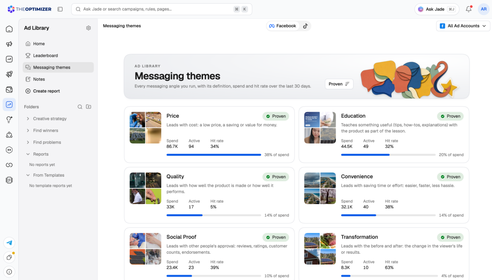

Three pages in the Ad Library sidebar turn your creative data into a weekly routine: the **Leaderboard** for what moved, **Messaging themes** for which ideas work, and **Notes** for what the team learned.

---

## Leaderboard

The Leaderboard tracks performance shifts and top creatives: the **last 7 days against the 7 days before**.

**Performance shifts** at the top sorts your creatives into lifecycle segments — **Scaling**, **Declining**, **Newly launched** and **Recently paused** — with their spend and ROAS and how each changed since last week.

<Frame>
  
</Frame>

The **Creative leaderboard** below ranks creatives in two views:

| View | What it ranks |
| --- | --- |
| **Top** | Your best creatives on your [goal metric](/ad-library/tags-and-settings#goal). |
| **Worst** | Creatives that earned back less than they spent (ROAS below 1), biggest spend first. |

Each row shows the creative's rank and how it moved since last week, its **share of spend**, its **weeks on board**, **spend** and **ROAS**. Click a row to open the creative.

<Frame>
  
</Frame>

---

## Messaging themes

**Messaging themes** lists every messaging angle you run, with its definition, spend and hit rate over the last 30 days.

- **Hit rate** is the share of a theme's delivering ads that cleared your winner bar (ROAS of 1 or more on your goal ROAS).
- Each theme is marked **Proven** or **Testing** by how reliably it produces winners. A theme with fewer than 5 delivering ads isn't rated yet.
- Sort the list by **Proven**, **Spend**, **Active** or **Hit rate**. Themes that didn't run in the window are listed separately as **Not running**.

Click a theme to see its top creatives, how it has run over the last twelve months, and **What's pairing well** — the hooks, personas and other tags that win most often alongside it.

<Frame>
  
</Frame>

<Tip>
  Themes come from the AI's **angle** tag. If the page is empty, turn on [auto-tagging](/ad-library/tags-and-settings#auto-tagging) so your creatives get analysed.
</Tip>

---

## Notes

**Notes** collects what your team learned from its ads, newest first. You write a note from any creative's **Notes** tab in the [creative inspector](/ad-library/creative-inspector#notes); it shows up here with the creative it's about.

Filter the feed by **All**, **Active** or **Archived**. Archive a note when it's no longer relevant; archived notes stay greyed out until you restore them.
