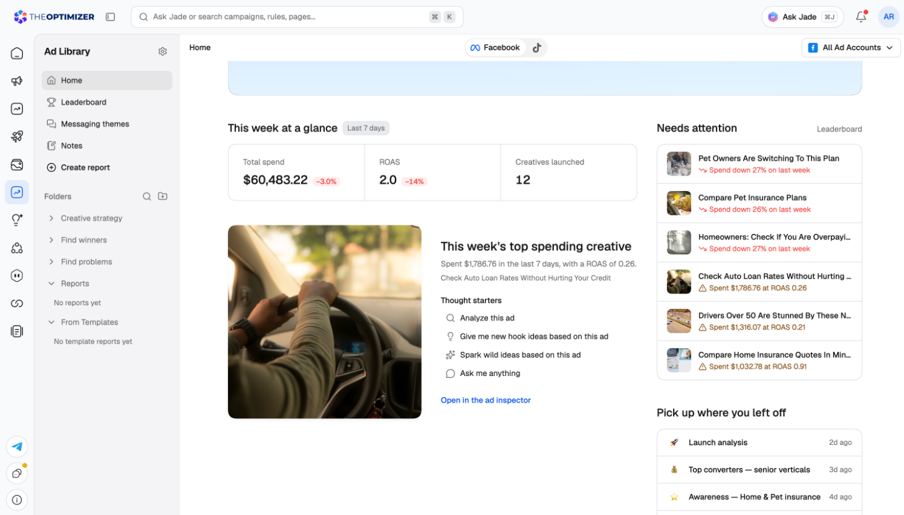

The **Ad Library** is where you read the performance of your own creatives. It collects every ad you run on **Facebook**, **TikTok** and **Snapchat**, groups the ads that share the same creative, and shows how that creative performs across every campaign, ad set and ad account it runs in.

Native ad managers show you an ad inside one campaign. The Ad Library answers the questions a media buyer and a creative team actually ask: which creatives are winning this week, which hooks and angles work, what's dropping, and what you haven't tried yet.

<Note>
  The Ad Library replaces the analytics part of the old Creative Library. Your uploaded images, videos and headlines are still in the **Media Library**. See [Media Library](/creative-library/guide).
</Note>

<Frame>
  
</Frame>

---

## Opening the Ad Library

Click **Ad Library** in the left navigation. It opens on **Home**, with its own sidebar:

| Sidebar item | What it's for |
| --- | --- |
| **Home** | This week's highlights for the platform and accounts you pick. |
| **Leaderboard** | Your top and worst creatives, this week against last week. See [Leaderboard, themes and notes](/ad-library/leaderboard-themes-notes). |
| **Messaging themes** | Every messaging angle you run, with its spend and hit rate. |
| **Notes** | What your team learned from its ads, newest first. |
| **Create report** | Start a new report, blank or from a template. See [Reports](/ad-library/reports). |
| **Folders** | Your saved reports under **Reports**, reports made from templates under **From Templates**, and any folders you create. |
| **Settings** | The gear icon at the top: AI tags, custom tags, naming rules, auto-tagging, the goal metric and shared links. See [Tags and settings](/ad-library/tags-and-settings). |

<Tip>
  Hide the sidebar with the panel icon at its top when you want more room for a report.
</Tip>

---

## Choosing the platform and ad accounts

Every page in the Ad Library reads **one platform at a time**. Use the platform switch in the top-right corner to move between **Facebook**, **TikTok** and **Snapchat**. A platform you haven't connected yet shows **Connect** instead.

Under the top bar, the account bar shows which ad accounts the page reads and when each one last synced. Click **Filter** to narrow it to some of your accounts. On a saved report, the accounts you pick are **saved with the report**.

<Note>
  The Ad Library needs at least one connected Facebook, TikTok or Snapchat ad account. Right after you connect one, the page shows that it's syncing until the first data arrives. See [Ad Networks](/integrations/ad-networks).
</Note>

---

## Home

Home sums up the last 7 days for the platform and accounts you picked.

| Section | What it shows |
| --- | --- |
| **Ask Jade about your ads** | A box to ask [Jade](/jade/overview) about your creatives, with ready prompts grouped by **Featured**, **Analyze**, **Ideate & brief** and more. Jade answers from your own ad data. |
| **This week at a glance** | **Total spend**, **ROAS** (revenue over spend across the accounts, not an average of ad ROAS) and **Creatives launched** (delivered this week and not the week before). |
| **This week's top spending creative** | The creative that spent the most, with **Thought starters** to ask Jade about it and **Open in the ad inspector**. |
| **Needs attention** | Creatives that fell sharply or spent below break-even. **All clear** means nothing did. Click one to open it. |
| **Pick up where you left off** | The reports you opened last. |
| **Messaging themes you're testing right now** | Your themes over the last 14 days, each marked **Just launched**, **Scaling**, **Holding** or **Declining**, with its hit rate. **See all themes** opens the full list. |
| **…you're testing, and what you haven't tried** | For a tag such as hook or angle, the values your ads ran on over the last 30 days, and the values no ad has tried yet. |

Click any creative on Home to open it in the [creative inspector](/ad-library/creative-inspector).

---

## How creatives and metrics work

- **A creative is the asset, not the ad.** When the same video runs in ten ads across five campaigns, the Ad Library shows it once, with the totals of all ten ads. The **Ads** tab of the creative lists each ad.
- **Your goal metric decides the winners.** By default the Ad Library ranks creatives by ROAS from the ad platform. If your tracker sees revenue the platform doesn't, switch the goal to **ROAS (tracker)** in [Settings → Goal](/ad-library/tags-and-settings#goal).
- **AI tags describe what's in each creative** — its hook, angle, persona, format, style and more — so you can compare performance by idea, not just by ad. See [Tags and settings](/ad-library/tags-and-settings).

---

## Next steps

<CardGroup cols={2}>
  <Card title="Reports" icon="table" href="/ad-library/reports">
    Rank, compare and follow launches with templates or your own reports.
  </Card>
  <Card title="Creative inspector" icon="magnifying-glass" href="/ad-library/creative-inspector">
    Everything about one creative: performance, ads, transcript, AI analysis and notes.
  </Card>
  <Card title="Tags and settings" icon="tags" href="/ad-library/tags-and-settings">
    AI tags, custom tags, naming rules, auto-tagging and the goal metric.
  </Card>
  <Card title="Inspiration" icon="lightbulb" href="/inspiration/overview">
    Other brands' ads, to find ideas for your next creatives.
  </Card>
</CardGroup>
