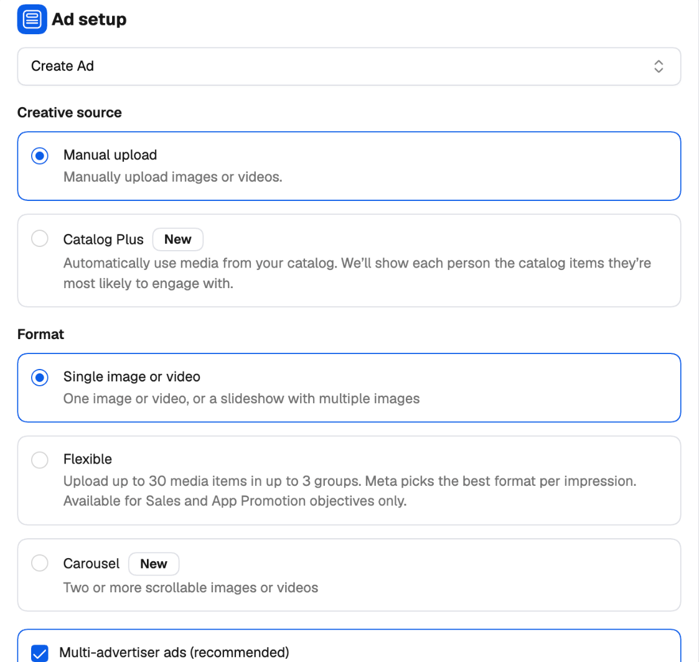
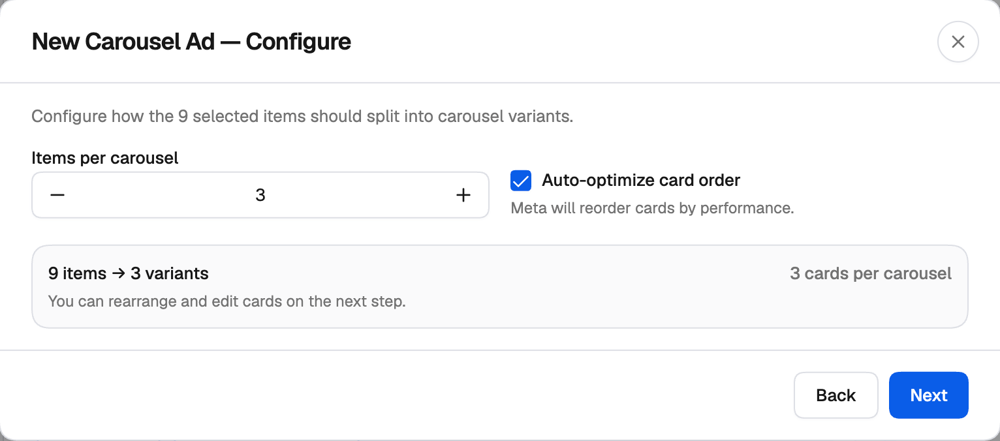
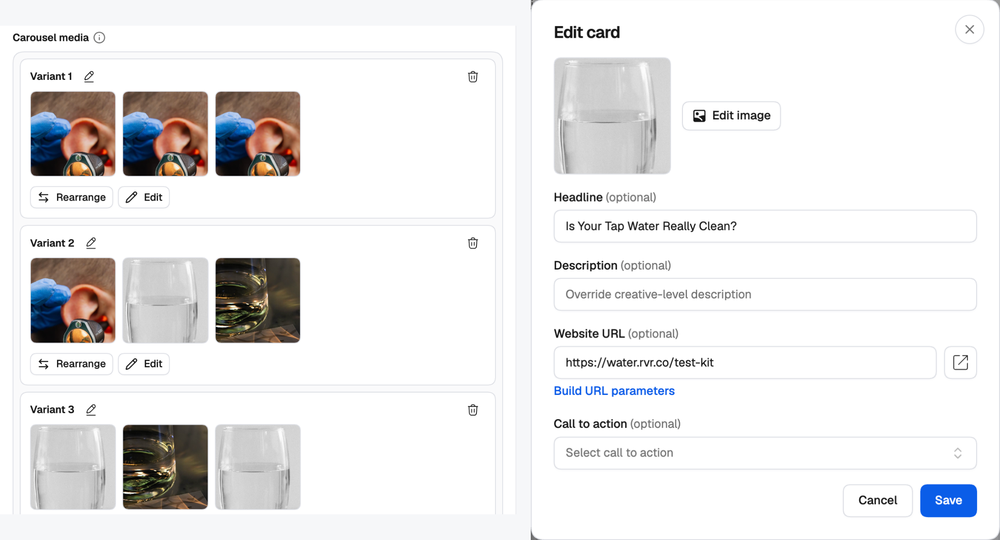
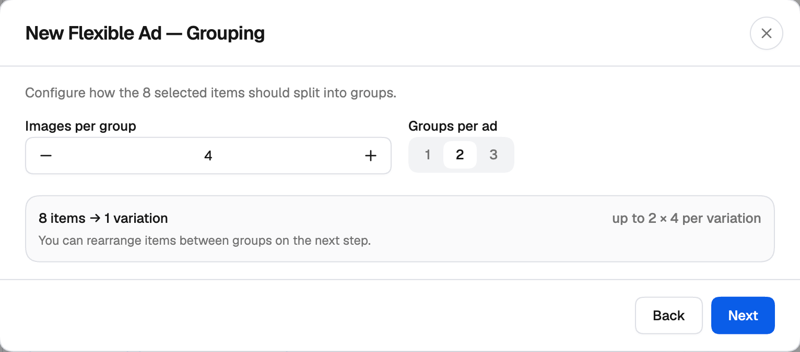
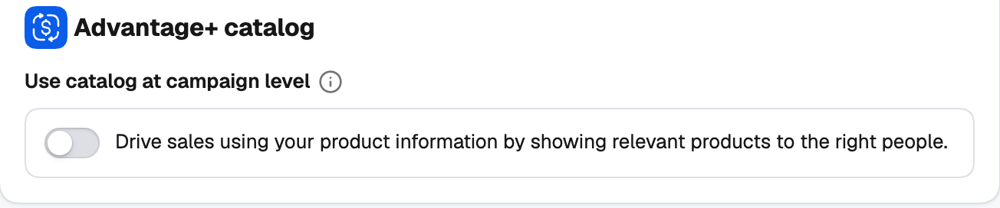

You choose an ad's format on the **Ad** level, in the **Ad setup** card. What you pick there decides what the **Ad creative** card below asks for.

<Frame>
  
</Frame>

---

## At a glance

| Ad setup | Creative source | Format | What one ad holds | Available for |
| --- | --- | --- | --- | --- |
| **Create Ad** | Manual upload | [Single image or video](#single-image-or-video) | One image or video | Every objective |
| **Create Ad** | Manual upload | [Carousel](#carousel) | 2–10 scrollable cards | Every objective |
| **Create Ad** | Manual upload | [Flexible](#flexible) | Up to 3 groups of up to 10 media — Meta picks the format per impression | Sales and App Promotion |
| **Create Ad** | **Catalog Plus** | [Carousel (catalog)](#catalog-ads) | Products from your catalog | Sales |
| **Use existing post** | — | The post's own format | An already-published post | Every objective |

<Tip>
  Whatever the format, the Campaign Creator does the multiplying for you. Add a big pool of media once and the creator splits it into as many ads as it takes — something Ads Manager makes you do one ad at a time. Combine that with [groups and variations](/ad-networks/facebook/campaign-uploader/variations) on the ad set and ad levels, and a single launch tests formats, creatives and audiences together.
</Tip>

---

## Single image or video

The classic format: one image or one video per ad.

Click **+ Add Media** to pick from your existing creatives, upload new ones or generate images with AI. **Every image or video you add becomes its own ad** — add ten videos and you get ten ads, all sharing the same copy, destination and ad set. Per image you can also **Customize by Placement** (a different crop for Stories, say). See [Creating a simple campaign](/ad-networks/facebook/campaign-uploader/simple-campaign#ad-creative) for the full walkthrough.

---

## Carousel

Two or more images or videos people swipe through, each card with its own link.

<Frame>
  
</Frame>

<Steps>
  <Step title="Add carousel">
    With **Carousel** selected, click **+ Add carousel** in the **Carousel media** card. The **New Carousel Ad** window opens.
  </Step>
  <Step title="Select media">
    Click **Add images** and/or **Add videos** and pick everything you want to use — up to 200 items.
  </Step>
  <Step title="Configure">
    Set **Items per carousel** (2 to 10, 3 by default). Leave **Auto-optimize card order** on to let Meta reorder the cards by performance. The summary shows how your pool splits — for example *9 items → 3 variants*.
  </Step>
  <Step title="Arrange">
    Drag cards to reorder them, or move them from one carousel to another. Each carousel needs at least two cards. Click **Save**.
  </Step>
</Steps>

**Each carousel variant is one ad.** Nine items at three cards per carousel make three carousel ads, ready to A/B test against each other. You don't have to build each carousel by hand.

Each variant in the **Carousel media** card has **Rearrange** and **Edit**, and you can rename it. Click a card to customize it: **Edit image**, and an optional **Headline**, **Description**, **Website URL** and **Call to action** that override the ad's own for that card only.

<Frame>
  
</Frame>

---

## Flexible

Give Meta several media items and let it choose the best format — single image, video or carousel — for each person and placement.

<Frame>
  
</Frame>

<Steps>
  <Step title="Add flexible media">
    With **Flexible** selected, click **+ Add flexible media**. The **New Flexible Ad** window opens.
  </Step>
  <Step title="Select media">
    Click **Add images** and/or **Add videos** and pick your media.
  </Step>
  <Step title="Grouping">
    Set **Images per group** (1 to 10) and **Groups per ad** (1 to 3).
  </Step>
  <Step title="Arrange">
    Drag items between groups, or **Add empty group**. Click **Save**.
  </Step>
</Steps>

**A large pool is split into several flexible ads** (*Flexible Variation 1, 2…*), each holding up to 3 groups of up to 10 items. Each variation has **Rearrange** and **Edit**, and you can rename it.

<Note>
  Flexible is only offered for **Sales** and **App Promotion** campaigns — the objectives Meta supports it for.
</Note>

---

## Catalog ads

Show products from your Meta product catalog — Meta picks the products each person is most likely to engage with. Catalog ads are always carousels.

There are two ways to set them up.

### Per ad: Catalog Plus

On a **Sales** campaign, pick **Catalog Plus** as the **Creative source** on the ad. The format switches to **Carousel**, and the **Ad creative** card asks for:

- **Catalog** — the product catalog this ad promotes.
- **Preferences** — **Show all products**, or **Only certain products** and then pick a **Product set**.

Each ad can use its own catalog and product set, so one launch can test product sets against each other.

### For the whole campaign: Advantage+ catalog

On the **Campaign** level, turn on **Use catalog at campaign level** in the **Advantage+ catalog** card and select the **Catalog**. Then:

- Every ad in the campaign becomes a catalog carousel — the creative source and format are locked.
- Each ad set picks what it promotes in the **Promoted products** card: **Show all products** or **Only certain products** (with a **Product set**).

Turn it off to go back to choosing the catalog per ad.

<Frame>
  
</Frame>

<Note>
  The catalogs listed are the ones in the ad account you're launching in. No catalog yet? Connect one in Meta Commerce Manager first.
</Note>

### Product details in your copy

In catalog mode, the **Primary text**, **Headline** and **Description** fields get a macro picker. Insert the product's **Name**, **Price**, **Brand** or **Description**, and Meta fills it in for each product shown.

{/* SCREENSHOT: fb-catalog-macros.png — Primary text field in catalog mode with the macro picker open (Name, Price, Brand, Description). */}

---

## Existing posts

Choose **Use existing post** in **Ad setup** to run an already-published Facebook or Instagram post as the ad, keeping its likes, comments and shares. The post keeps its own format. See [Using existing posts](/ad-networks/facebook/campaign-uploader/existing-posts).

---

## Other options

- **Multi-advertiser ads (recommended)**, in the **Ad setup** card — lets the ad appear alongside ads from other businesses when people are in a shopping mindset, which can increase its reach.
- **Advantage+ creative enhancements**, in the **Ad creative** card — Meta's automatic creative tweaks. Available for single image or video and carousel ads (not for flexible or catalog ads). The count shows how many you have on; click it to choose.

---

## Related

<CardGroup cols={2}>
  <Card title="Creating a simple campaign" icon="hammer" href="/ad-networks/facebook/campaign-uploader/simple-campaign">
    Every setting on the campaign, ad set and ad levels.
  </Card>
  <Card title="Generate campaign variations" icon="layer-group" href="/ad-networks/facebook/campaign-uploader/variations">
    Multiply your setup into many campaigns, ad sets and ads.
  </Card>
</CardGroup>
