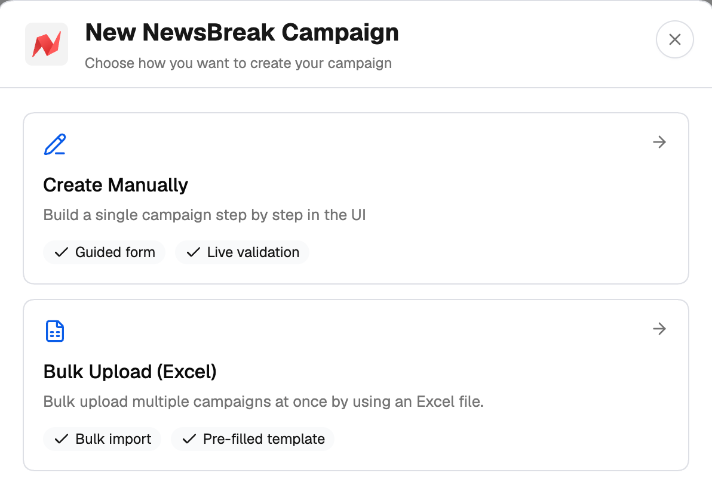
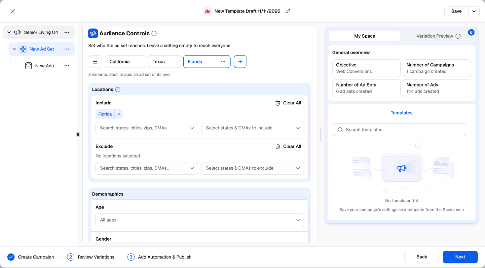

The NewsBreak Campaign Launcher is TheOptimizer's guided creator for NewsBreak. You build a campaign, its ad sets and their ads in one tree, add [groups](/campaign-creator/groups-and-variations) to the settings you want to test, and the launcher creates every combination on NewsBreak in one go.

<Note>
  The NewsBreak Campaign Launcher is in **Beta**. It's fully usable, and we're still adding to it — tell us in the in-app chat if something you need is missing.
</Note>

---

## Why launch from TheOptimizer instead of NewsBreak Ads Manager

<CardGroup cols={2}>
  <Card title="Groups generate your ad sets" icon="layer-group" href="/ad-networks/newsbreak/campaign-uploader/variations-and-publish">
    Add Budget, Audience, Bidding and Placement groups to an ad set, and every combination becomes its own ad set — no rebuilding the same ad set ten times. Creative and Destination groups do the same for ads.
  </Card>
  <Card title="Every creative × every headline" icon="images" href="/ad-networks/newsbreak/campaign-uploader/build-a-campaign#creatives">
    Add several images or videos, headlines and descriptions once; each combination becomes its own ad.
  </Card>
  <Card title="Naming templates on every level" icon="tag" href="/campaign-creator/naming-templates">
    Campaigns, ad sets and ads are named from the date, objective, group name, format and creative number — so hundreds of ads stay readable.
  </Card>
  <Card title="Checks NewsBreak doesn't show you" icon="shield-check" href="/ad-networks/newsbreak/campaign-uploader/build-a-campaign#optimization--bidding">
    Minimum bids, which objectives each bid type works with, required events, and the purchase history value bids need — all checked before you publish.
  </Card>
</CardGroup>

On top of that: a **Review Variations** step where you switch off any campaign, ad set or ad; reusable [templates](#templates-and-drafts); automation rules attached at publish; AI-written headlines and descriptions; and media uploaded to NewsBreak for you from the Media Manager.

Before you start, [connect your NewsBreak account](/ad-networks/newsbreak/integration/connect).

---

## Opening the launcher

Click **Campaign Creator** in the left navigation, then the **NewsBreak** card — or click **Create** on the NewsBreak tab of the Campaign Manager. Choose how you want to create your campaign:

- **Create Manually** — the guided Campaign Launcher described here.
- **Bulk Upload (Excel)** — the [Excel uploader](/ad-networks/newsbreak/campaign-uploader/excel-upload). You can also have AI prepare the file with the [Bulk Upload AI Skill](/ad-networks/newsbreak/campaign-uploader/ai-campaign-builder).

<Frame>
  
</Frame>

---

## How the launcher is laid out

<Frame>
  
</Frame>

**Left — the tree.** Campaign → **Ad Set** → **Ads**. Click a row to edit it. The **⋯** menu on each row lets you build out the launch:

| Row | Menu options |
| --- | --- |
| **Campaign** | Create New Campaign, Duplicate Campaign, Create Ad Set, Copy All Ad Sets, Paste Ad Sets, Rename, Delete (or **Start Over** for the only campaign) |
| **Ad Set** | Create Ads, Duplicate Ad Set, Copy Ad Set, Paste Ads, Rename, Delete (or **Reset Ad Set**) |
| **Ads** | Duplicate Ads, Copy Ads, Rename, Delete (or **Reset Ads**) |

**Middle — the settings** for the row you selected. Hover the **ⓘ** next to a field for what it does on NewsBreak.

**Right — My Space and Variation Preview.**

- **My Space** shows a **General overview** (objective, number of campaigns, ad sets and ads) and your saved **Templates**.
- **Variation Preview** lists the variations of the level you're on — one per combination of its groups. Switch one off and it isn't created.

---

## The three steps

1. **Create Campaign** — set up the campaign, ad set and ads levels (use **Next** to move down through them). See [Build a campaign](/ad-networks/newsbreak/campaign-uploader/build-a-campaign).
2. **Review Variations** — everything that will be created, with a switch on every row. See [Variations and publishing](/ad-networks/newsbreak/campaign-uploader/variations-and-publish#review-variations).
3. **Add Automation & Publish** — attach rules and publish.

When you click **Next**, the launcher checks the level you're on. Fields that need attention are marked, and so are the tree rows and group tabs they're in.

---

## Templates and drafts

**Drafts.** Your work is kept in this browser as you go. Open the launcher again and it asks whether to **Continue** or **Start New**.

**Templates.** The name at the top (for example *New Template Draft 10/11/2026*) is the template name — click to rename it. Use **Save**, or the menu next to it:

- **Save** / **Save As** — save the whole setup, groups included.
- **Browse Templates** — search, **Apply template**, rename or remove your NewsBreak templates.

Applying a template replaces everything in the launcher and starts again at the campaign. Optimization events belong to an ad account, so they only carry over when you use the template in the same account.

You can also save a template in the **Final Check** when you publish.

---

## Next steps

<CardGroup cols={2}>
  <Card title="Build a campaign" icon="hammer" href="/ad-networks/newsbreak/campaign-uploader/build-a-campaign">
    Every setting on the campaign, ad set and ads levels.
  </Card>
  <Card title="Variations and publishing" icon="layer-group" href="/ad-networks/newsbreak/campaign-uploader/variations-and-publish">
    Groups, Review Variations and Publish.
  </Card>
</CardGroup>
