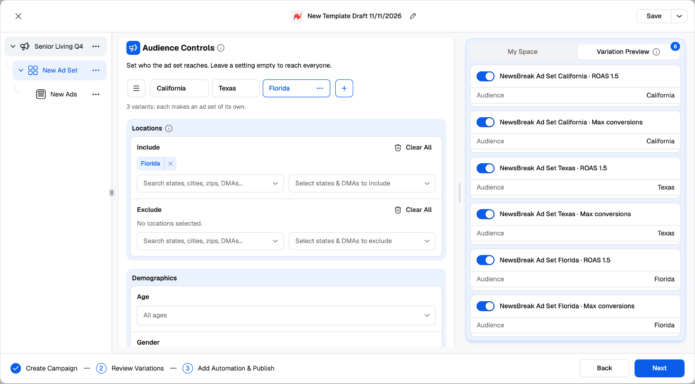
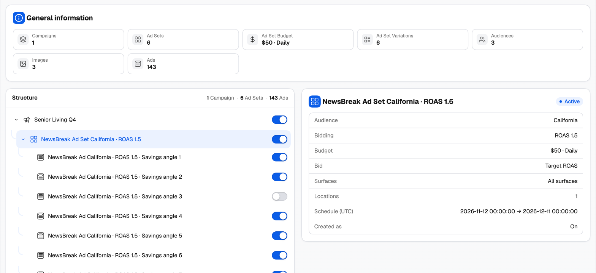
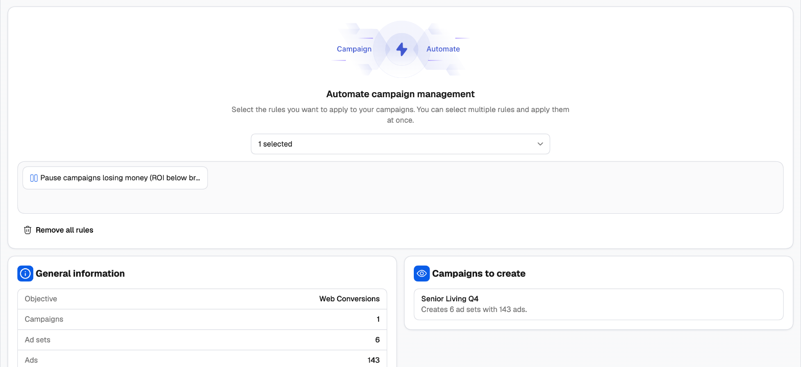

This is where the NewsBreak Campaign Launcher does what NewsBreak Ads Manager can't: you describe the variations you want to test once, and the launcher builds every combination for you.

---

## Groups on NewsBreak

Six cards can hold [groups](/campaign-creator/groups-and-variations):

| Level | Card | Group tabs | What each group holds |
| --- | --- | --- | --- |
| Ad Set | **Budget & Schedule** | Budget 1, 2… | Budget type and amount |
| Ad Set | **Audience Controls** | Audience 1, 2… | Locations, demographics, interests, devices, manufacturers and carriers |
| Ad Set | **Optimization & bidding** | Bidding 1, 2… | Bid type, bid or ROAS, optimization event, conversion counting, delivery |
| Ad Set | **Placements** | Placement 1, 2… | Surfaces and premium partners |
| Ads | **Creatives** | Creative 1, 2… | Media, headlines, descriptions, call to action, brand name and logo |
| Ads | **Destination** | Destination 1, 2… | Landing page |

**On the ad set, every combination of groups becomes its own ad set** — all inside the same campaign. Once a card has two or more groups, the launcher tells you: *"2 variants: each makes an ad set of its own."*

**On the ads, every creative group × destination makes its own ads** in that ad set. Inside each creative group, every creative still runs with every headline and description.

### A worked example

One campaign. On the ad set: **3 Audience groups** (California, Texas, Florida) × **2 Bidding groups** (CPC $0.25, Maximize conversions). On the ads: **2 Creative groups**, each with 2 images × 2 headlines × 1 description, and **1 destination**.

- Ad sets: 3 × 2 = **6 ad sets**
- Ads per ad set: 2 creative groups × (2 × 2 × 1) × 1 destination = **8 ads**
- Total: **48 ads**, built and named in one launch.

In NewsBreak Ads Manager, that's six ad sets and 48 ads set up by hand.

<Frame>
  
</Frame>

### Working with groups

- Click **+** next to the tabs to add a group. It starts as a copy of the open one.
- Double-click a tab (or click the pen icon) to rename it. Its **⋯** menu has **Rename**, **Clone** and **Delete** (available once a card has two or more groups).
- **☰ Manage variants** opens the full list once a card has two groups: search, drag to reorder, and clone, rename or delete in bulk.
- A group with an error is marked on its tab, so nothing gets missed.

### How generated ad sets and ads are named

Group names go into the names of what they generate (for example *Budget 2 · Audience 1*). Add **Group name** to a [naming template](/campaign-creator/naming-templates) to decide where it appears — if your template doesn't include it, the group names are added at the end, joined with the template's separator. Rename your groups (*California*, *CPC 0.25*) and the names explain themselves.

### Switching combinations off

**Variation Preview**, on the right, lists the variations of the level you're on — one per combination of its groups. Switch one off and it isn't created.

### More campaigns in one launch

Use **Create New Campaign** or **Duplicate Campaign** in the tree's **⋯** menu to add campaigns — each with its own objective, ad sets and ads. **Copy All Ad Sets** / **Paste Ad Sets** and **Copy Ad Set** / **Paste Ads** move work between them.

---

## Review Variations

The second step shows everything the launch will create before anything reaches NewsBreak.

<Frame>
  
</Frame>

- **General information** — totals for campaigns, ad sets, ad set budget, ad set variations, audiences, videos and images, and ads.
- **Structure** — every campaign, ad set and individual ad, each with a switch. Switch a row off and it isn't created. You need at least one active campaign, ad set and ad.
- **Details** — select a row to check it:
  - Campaign: objective, created as on/off, tags.
  - Ad set: the groups it was made from (audience, bidding…), budget, bid, surfaces, locations and schedule (UTC).
  - Ad: format, media, status, headline, description, brand name, link URL and call to action.

---

## Add Automation & Publish

<Frame>
  
</Frame>

<Steps>
  <Step title="Attach automation rules">
    Under **Automate campaign management**, pick a NewsBreak rule or rule group. It starts managing what you launch from the first impression. See [Automation rules](/automation/rules-guide).
  </Step>
  <Step title="Check the summary">
    **General information** shows the objective and how many campaigns, ad sets, ads and rules will be created. Hover a campaign under **Campaigns to create** to see its ad sets and ads.
  </Step>
  <Step title="Publish">
    Click **Publish**. In the **Final Check**, you can tick **Would you like to save your settings as a template?** and name it. Click **Confirm**.
  </Step>
</Steps>

### After you publish

Campaigns are created in the background — **one task per campaign** in the Campaign Creator queue. TheOptimizer uploads your media to NewsBreak and creates the campaign, its ad sets and ads. Check each campaign's status in the queue.

<Tip>
  Save the launch as a template before you publish. Next time, **Browse Templates → Apply template** brings back every group, creative and setting — change what's new and launch again.
</Tip>

---

## Related

<CardGroup cols={2}>
  <Card title="Groups and variations" icon="layer-group" href="/campaign-creator/groups-and-variations">
    How groups work across every network in the Campaign Creator.
  </Card>
  <Card title="Naming templates" icon="tag" href="/campaign-creator/naming-templates">
    Build names from the date, objective, group name, format and creative number.
  </Card>
</CardGroup>
