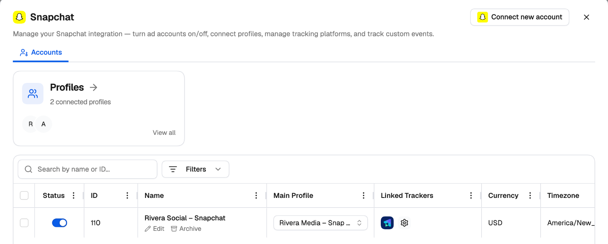

Snapchat uses OAuth: you log in with your Snapchat account and grant TheOptimizer access to the ad accounts it can see. There are no API keys to copy.

<Steps>
  <Step title="Open the Integrations page">
    In the left navigation, go to **Connections → Integrations**. Find the **Snapchat** card and click **Connect →**. If Snapchat is already connected, open the card and click **Connect new account** to add another login.
  </Step>
  <Step title="Name the profile">
    Give the connection (the profile) a name you'll recognize, for example the name of the Snapchat login you're about to use.
  </Step>
  <Step title="Authorise access">
    You're sent to Snapchat's login page. Sign in with the Snapchat account that has access to the ad accounts you want to manage, and approve the access TheOptimizer asks for.
  </Step>
  <Step title="Wait for the first sync">
    Back in TheOptimizer, your Snapchat ad accounts are listed under the integration. Campaigns, ad squads and ads appear after the first sync.
  </Step>
</Steps>

<Frame>
  
</Frame>

---

## What TheOptimizer asks for

TheOptimizer asks for access to the **Snapchat Marketing API** — to read your campaigns, ad squads, ads and their stats, and to make the changes you or your rules ask for (status, budgets, bids, names, URLs, clones and new campaigns) — and to your **Snapchat public profiles**, which Snapchat ads need to show.

---

## Profiles and ad accounts

Open the **Snapchat** card to manage the connection. The table lists each ad account with its status toggle (turn an account on or off), ID, name, **Main Profile**, linked trackers, currency and time zone. If several profiles can reach the same ad account, pick the one TheOptimizer uses in **Main Profile**, and switch to another if one stops working or loses access. **Profiles** at the top lists every Snapchat login you've connected. See [Ad Networks](/integrations/ad-networks) for how profiles work across networks.

---

## Tracking parameters

Snapchat fills in these macros in your URLs, so your tracker can pass the IDs back to TheOptimizer:

| Level | Macro |
| --- | --- |
| Campaign | `{{campaign.id}}` |
| Ad squad | `{{adSet.id}}` |
| Ad | `{{ad.id}}` |

Snapchat adds its own click ID (`ScCid`) to the landing page URL. Link the ad account with your tracking platform from its **Linked Trackers** column.

---

## Next steps

<CardGroup cols={2}>
  <Card title="Snapchat overview" icon="ghost" href="/ad-networks/snapchat/overview">
    What you can do with Snapchat in TheOptimizer.
  </Card>
  <Card title="Snapchat Campaign Creator" icon="rocket" href="/ad-networks/snapchat/campaign-uploader/campaign-creator">
    Launch Snapchat campaigns with every variation built for you.
  </Card>
</CardGroup>
