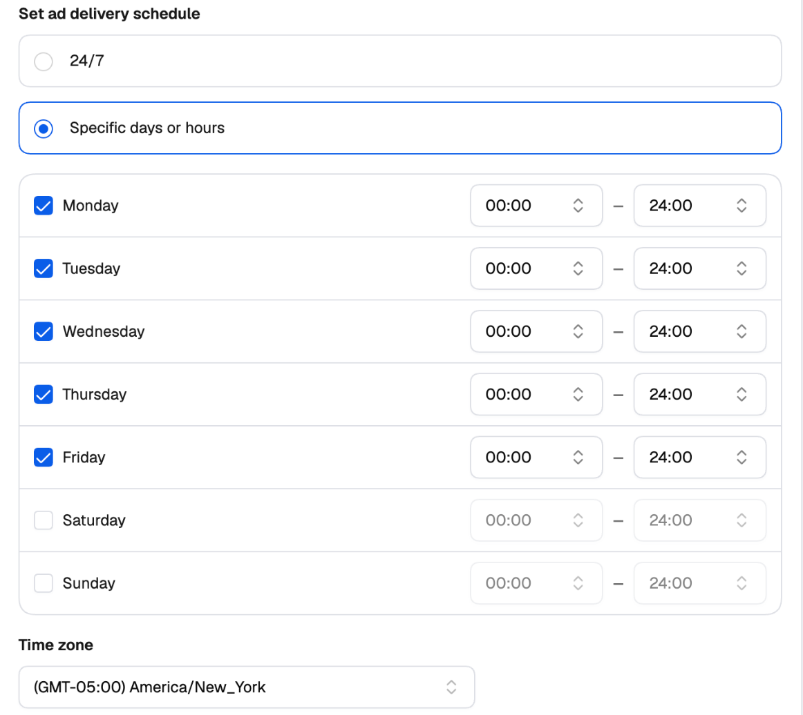
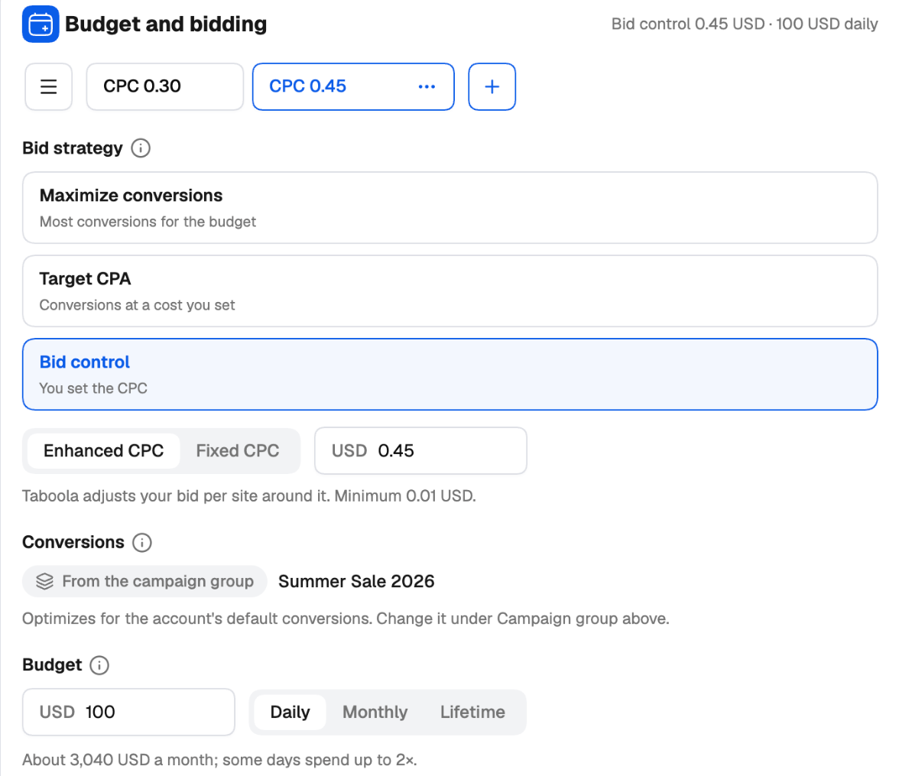
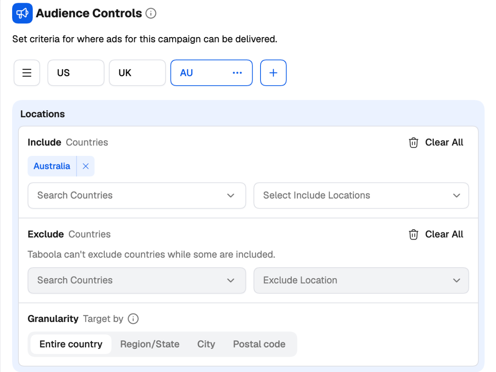
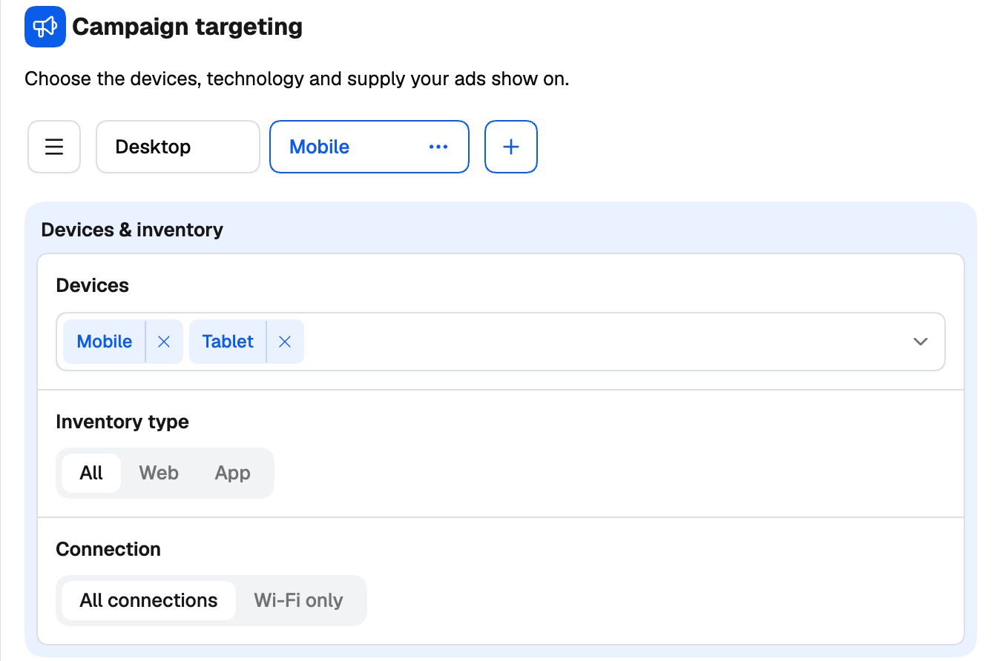
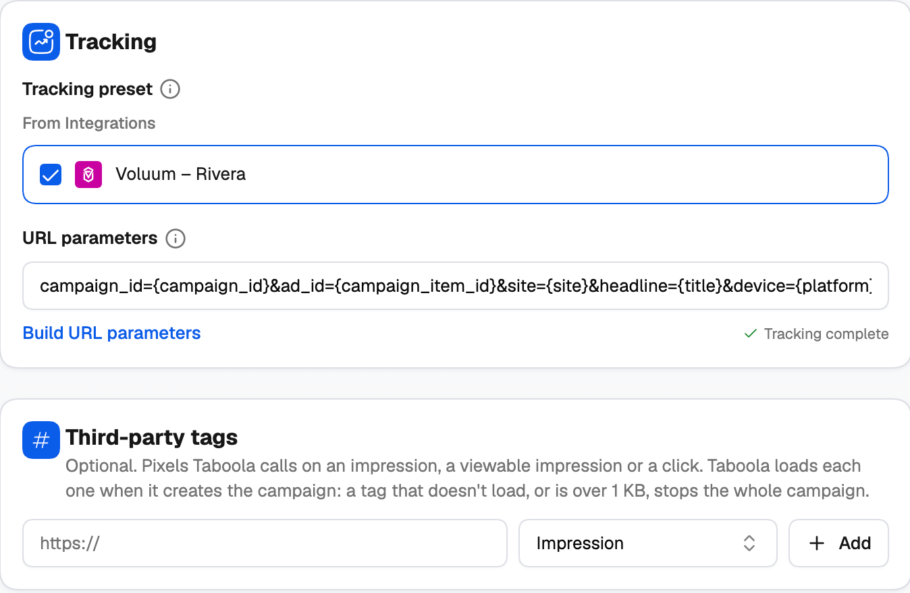
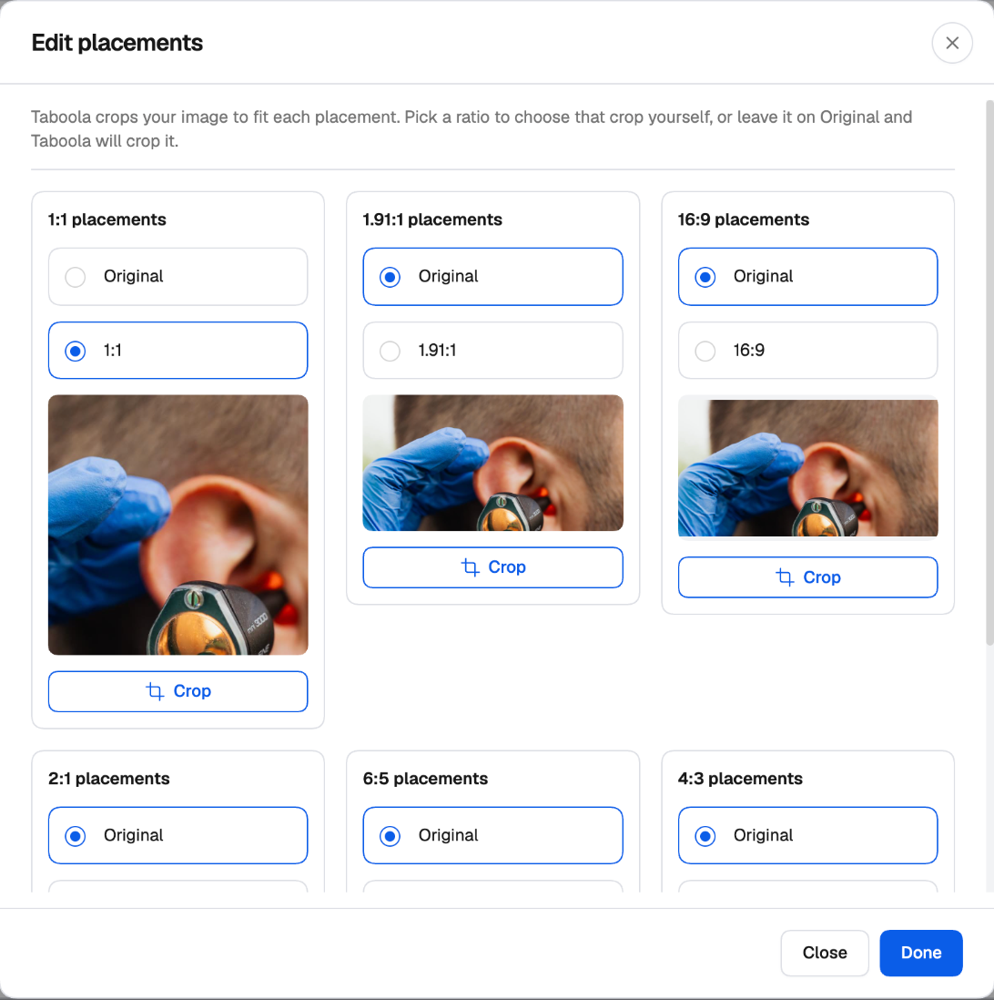
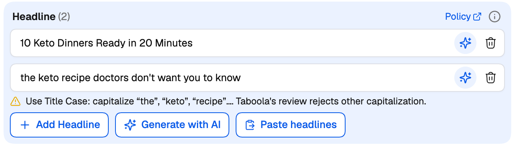

This page covers the **Settings** and **Ads** steps of the [Taboola Campaign Launcher](/ad-networks/taboola/campaign-uploader/campaign-launcher). Five cards can hold several [groups](/ad-networks/taboola/campaign-uploader/variations-and-publish): **Budget and bidding**, **Audience Controls** and **Campaign targeting** on the Settings step generate campaign variations; **Ad creative** and **Click-through and delivery** on the Ads step generate ad variations. Everything else is shared by all the campaigns a setup generates.

---

## Settings step

### Campaign setup

- **Name your campaign** — up to 200 characters. Use **Create Naming Template** to build it from the date, objective, countries, campaign number and more. See [Naming templates](/campaign-creator/naming-templates).
- **Brand name** — shown with your ads as the advertiser's name (up to 25 characters).
- **Campaign objective** — **Reach**, **Engagement**, **Leads**, **Online purchases** or **App promotion**.

### Set campaign schedule

- **Start** (today by default) and **End** (or no end date).
- **Set ad delivery schedule** — **24/7**, or **Specific days or hours**: turn each day on or off, set its hours, and pick the time zone.
- **Status** — **Active** (the default) or **Paused**. A paused campaign is created and reviewed by Taboola, but doesn't spend until you activate it.

<Frame>
  
</Frame>

### Budget and bidding

This card can hold several **Budget Groups** — see [Variations](/ad-networks/taboola/campaign-uploader/variations-and-publish).

**Bid strategy**

| Strategy | What it does |
| --- | --- |
| **Maximize conversions** | The most conversions for the budget. |
| **Target CPA** | Conversions at a cost you set. Not available for Reach or Engagement campaigns. |
| **Bid control** | You set the CPC: **Enhanced CPC** (Taboola adjusts the bid per site around it) or **Fixed CPC** (Taboola bids exactly this on every site). The launcher shows Taboola's minimum CPC for the account. |

<Warning>
  Conversion-based bidding needs conversions that have actually received events. If none of the account's active conversions has, the launcher warns you that Taboola will refuse the strategy — fire a conversion first, or choose **Bid control**.
</Warning>

**Conversions** — with a [campaign group](/ad-networks/taboola/campaign-uploader/campaign-groups), they come from the group. With **No campaign group**, pick them here, or create a [new conversion](#creating-a-conversion).

**Budget** — **Daily**, **Monthly** or **Lifetime**. With a daily budget, the launcher shows roughly what that means per month (some days can spend up to twice the daily budget). When the campaign group auto-allocates its budget, the campaign has no budget of its own.

**Spending limit** (daily budgets) — **None**, **Monthly** or **Lifetime**. The campaign stops once it's reached; the daily budget can be at most half of it.

**Ad delivery** — **Best ads first**, or **Evenly (A/B test)** with an A/B test end date 3 to 30 days after the start (not available with Target CPA).

**SpendGuard** — on or off: stops bidding on sites that spend without converting.

<Frame>
  
</Frame>

### Audience Controls

This card can hold several **Audience Groups** — the easiest way to create one campaign per country.

- **Locations** — include or exclude countries (or pick a country group). To target by **Region/State**, **DMA**, **City** or **Postal code**, include exactly one country; DMAs are for the United States.
- **Marketplace audiences** — include audiences; use **AND** when people must match an audience from every list.
- **Lookalike audiences** — with a similarity level. Lookalikes are made in Realize, from a pixel or a customer list.
- **Custom audiences** — include or exclude. Audiences of people who already converted are excluded to start with, as Realize does; remove them to reach those people too.
- **Upload a customer list** — create a first-party audience without leaving the launcher. See [Uploading a customer list](#uploading-a-customer-list).

<Frame>
  
</Frame>

### Campaign targeting

This card can hold several **Targeting Groups** — for example *Desktop* and *Mobile*, to run each device in a campaign of its own.

<Frame>
  
</Frame>

- **Devices & inventory** — Desktop, Mobile, Tablet; inventory type (All, Web, App); connection (All connections, Wi-Fi only).
- **Operating systems** and **Browsers** — include or exclude.
- **Advanced options**:
  - **Where should your ads run?** — all Taboola publishers and placements, or a selection from Taboola's supply list.
  - **Site exclusion** — search sites, or **Paste a list** of site names; pasted names are checked against Taboola before they're added.
  - **Brand safety** — DoubleVerify or Integral Ad Science, the segments to avoid, and a risk level for each.

### Contextual targeting

Target people by the topics they read — include or exclude topics.

### Tracking

- **Tracking preset** — start from a tracker you've connected in [Integrations](/integrations/tracking-platforms), or from one of your own saved presets.
- **URL parameters** — appended to every landing page (`utm_source=taboola&utm_medium=referral` by default). Use **Build URL parameters** to add Taboola's tokens such as `{site}`, and **Save as preset** to reuse them.
- **Checks** — the card shows **Tracking complete**, or the warnings it found, each with a one-click fix:
  - fields your tracker expects that are missing — **Add** or **Add all**;
  - no `{click_id}` — without it, your tracker can't send conversions back to Taboola for conversion bidding. **Add click_id**.

**Third-party tags** (optional) — pixels Taboola calls on an impression, a viewable impression or a click. Each tag is fetched and checked before it's added, because a tag that doesn't load, or is over 1 KB, stops the whole campaign.

<Frame>
  
</Frame>

### Creating a conversion

Click **+ New conversion** wherever conversions are picked. Set:

- **Conversion name** and **Category**;
- **Conversion type** — **Event based** (the event name your Taboola pixel sends) or **URL based** (the page URL contains …);
- an optional **Value**, the **Click-through** and **View-through** windows, and whether to **include it in total conversions** (used in bidding and reports).

The conversion is created on the Taboola ad account right away and is ready to pick. Taboola can only archive a conversion, not delete it.

### Uploading a customer list

Click **Upload a customer list** in Audience Controls. Give the audience a name, paste emails or mobile device IDs (or upload a CSV or TXT file), set how many days people stay in it, and choose whether to exclude these people from every campaign in the account.

The audience is created on the Taboola ad account and can't be changed afterwards. Taboola recommends at least 1,000 people, and matching takes 1 to 3 days.

---

## Ads step

### Ad name and status

Use **Create Naming Template** to give **each creative its own name in Taboola**, built from the headline, media name, format or creative number — so Realize's reports tell you exactly which headline and image you're looking at. **Status** sets how each ad starts once Taboola approves it.

### Ad creative

This card can hold several **Creative Groups** — each with its own format, media, headlines, descriptions and call to action — to test whole creative sets against each other in the same campaign. See [Creative and Click-through groups](/ad-networks/taboola/campaign-uploader/variations-and-publish#groups-that-make-ads-creative-and-click-through).

**Format** — **Standard** (horizontal or square images and videos) or **Vertical** (static images only).

**Media** — 1 to 10 images or videos (Taboola recommends at least 2). Images up to 5 MB, videos up to 50 MB. **Each one runs with every headline.** Use **Add Media** to add an image, a video (Standard format only, with a fallback image), **Stock images (Getty)**, or media from a URL. **Generate with AI** is available if AI image generation is enabled on your account.

Every image is checked as you add it: the minimum size (600 × 400; 1000 × 600 recommended) and whether its shape suits the format. Open **Customize placements** on an image to choose each crop yourself, or leave it on **Original** and let Taboola crop it.

<Frame>
  
</Frame>

### Headlines

Up to 100 characters each. **Each headline runs with every image.** Add them one by one, **Paste headlines** (one per line), or generate and enhance them with AI.

The launcher checks every headline against the rules Taboola's review enforces, and warns you — without blocking — when a headline:

- isn't in **Title Case** (Taboola rejects other capitalization);
- has **all-caps words**;
- reads like **placeholder or test copy**;
- uses **repeated punctuation** such as *!!* or *?!*.

When you paste a list, tick **Fix capitalization while adding** and each line is fixed, skipped (too long, duplicate, already added) or flagged before it's added.

<Frame>
  
</Frame>

**Description** (optional, up to 250 characters), **Call to action**, and the **AI content** box (*These ads contain AI-generated or AI-modified content*) complete the creative.

### Click-through and delivery

This card can hold several **Click-through Groups**, each with its own landing page and flight dates — the way to test landing pages.

- **Landing page** — where the ads lead. Tracking tokens such as `{site}` go in the [Tracking](#tracking) section, not here.
- **Flight dates** (optional) — **Schedule these ads** with a start and end date and time, in a time zone you pick or each viewer's own. Times are on the quarter hour.
