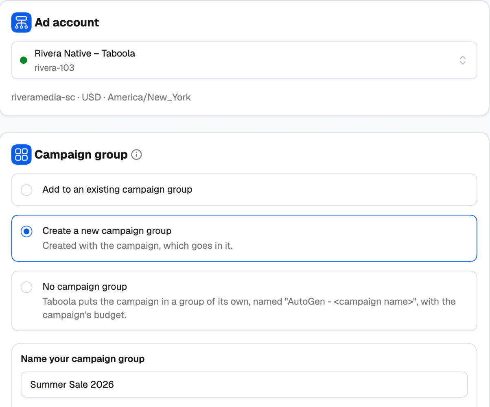
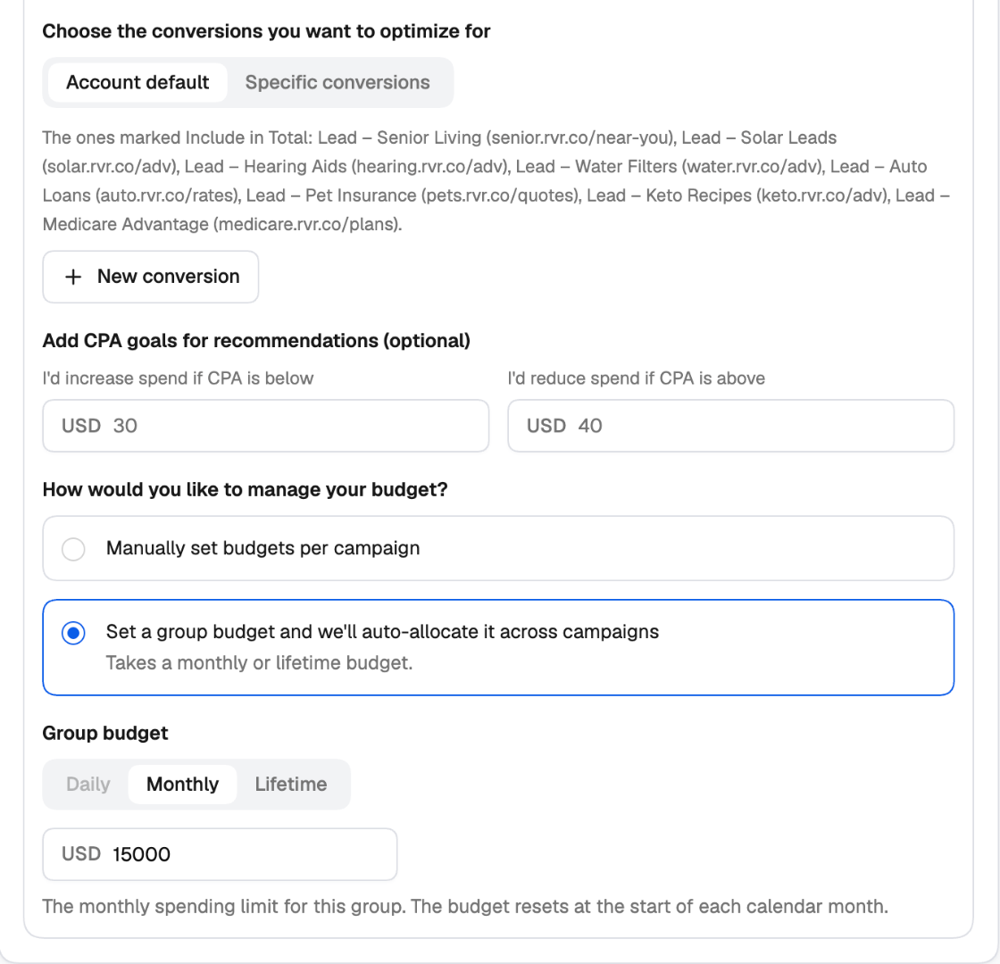

A Taboola **campaign group** is a folder for campaigns working toward the same goal. Campaigns in a group can share a budget that Taboola auto-allocates across them, and you see their combined results.

In Realize, a group has to exist before you can use it: you create the group, save it, then create each campaign and assign it to the group. **The Taboola Campaign Launcher does it all in one go.** On the first step you define the group — its objective, success metric, conversions and budget — and the launch creates the group and every campaign in it, with their ads, together.

<Frame>
  
</Frame>

---

## Choosing the ad account

The **Ad account** card lists your Taboola accounts (inactive ones are greyed out); the first active account is picked for you. Under the list you see the account's ID, currency and time zone.

Pick the account first: the group options, conversions, audiences and sites you see later all come from it.

---

## Three ways to group your campaigns

Under **Campaign group**, choose one:

| Option | What happens |
| --- | --- |
| **Add to an existing campaign group** | Pick a group from **Assign to campaign group**. The new campaigns go into it and use its settings. |
| **Create a new campaign group** | Define a new group here. It's created with the campaigns, which all go in it. |
| **No campaign group** | Taboola puts each campaign in a group of its own, named *AutoGen - [campaign name]*, with the campaign's budget. |

One launch has one campaign group: every campaign in the tree goes into it.

---

## Creating a new campaign group

<Steps>
  <Step title="Name your campaign group">
    Up to 200 characters. The group is named with plain text — it's created once per launch.
  </Step>
  <Step title="Pick the group objective">
    **Brand awareness**, **Website engagement**, **Lead generation**, **Online purchases** or **App promotion**.
  </Step>
  <Step title="Choose your success metric">
    The KPI Taboola's algorithms optimize toward. The choices depend on the objective:

    | Objective | Success metrics |
    | --- | --- |
    | Brand awareness | CPM, CTR, CPC |
    | Website engagement | CPC, CTR, CPA |
    | Lead generation | CPL, CPA, CTR, ROAS, CPC |
    | Online purchases | ROAS, CPA, CTR, CPC |
    | App promotion | CPI, CPA, CTR, CPC |
  </Step>
  <Step title="Pick the conversions to optimize for">
    **Account default**, or **Specific conversions** from the account. Need one that doesn't exist yet? Click **+ New conversion** and create it right here — see [New conversion](/ad-networks/taboola/campaign-uploader/build-a-campaign#creating-a-conversion).
  </Step>
  <Step title="Add KPI goals (optional)">
    Tell Taboola where you'd act — *I'd increase spend if CPA is below …* and *I'd reduce spend if CPA is above …* — so its recommendations match your targets.
  </Step>
  <Step title="Decide how to manage the budget">
    - **Manually set budgets per campaign** — each campaign keeps its own budget, set on the Settings step.
    - **Set a group budget and we'll auto-allocate it across campaigns** — Taboola spreads one budget across the group's campaigns. This needs a **Monthly** or **Lifetime** group budget.

    Then enter the **Group budget**: Daily, Monthly or Lifetime, and the amount.
  </Step>
</Steps>

<Frame>
  
</Frame>

---

## What's set on the group, and what's set on the campaigns

| Set on the **group** | Set on each **campaign** |
| --- | --- |
| Name, objective, success metric and KPI goals | Name, brand name, campaign objective, schedule and status |
| Conversions (with a new or existing group) | Bid strategy and bid |
| Budget distribution and group budget | Its own budget — unless the group auto-allocates |
| | Audience, targeting, contextual targeting, tracking, ads |

On the campaign's **Settings** step:

- **Conversions** show *From the campaign group* when the campaign is in a group. To change them, change them on the group — on the **Group** step for a new group, or in Realize for an existing one. With **No campaign group**, each campaign picks its own conversions.
- **Budget** shows that the group auto-allocates its budget, when it does, and the campaign has no budget field of its own.

---

## Why this matters for bulk launches

Combined with [Budget, Audience and Targeting Groups](/ad-networks/taboola/campaign-uploader/variations-and-publish), a single launch can create, for example, a new group for an offer with one shared monthly budget **and** one campaign per country inside it — all optimizing toward the same conversion. In Realize that's a group, then each campaign one by one, then checking that every campaign points at the right group and conversion.

<Tip>
  Save the setup as a [template](/ad-networks/taboola/campaign-uploader/campaign-launcher#templates-and-drafts). The group settings come with it when you reuse the template in the same ad account.
</Tip>
