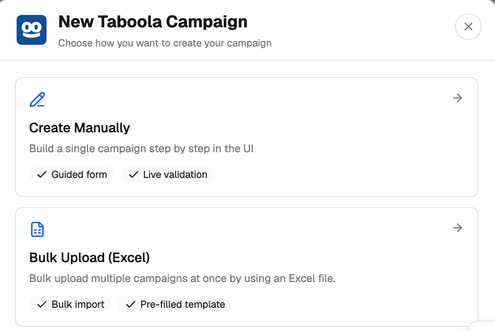
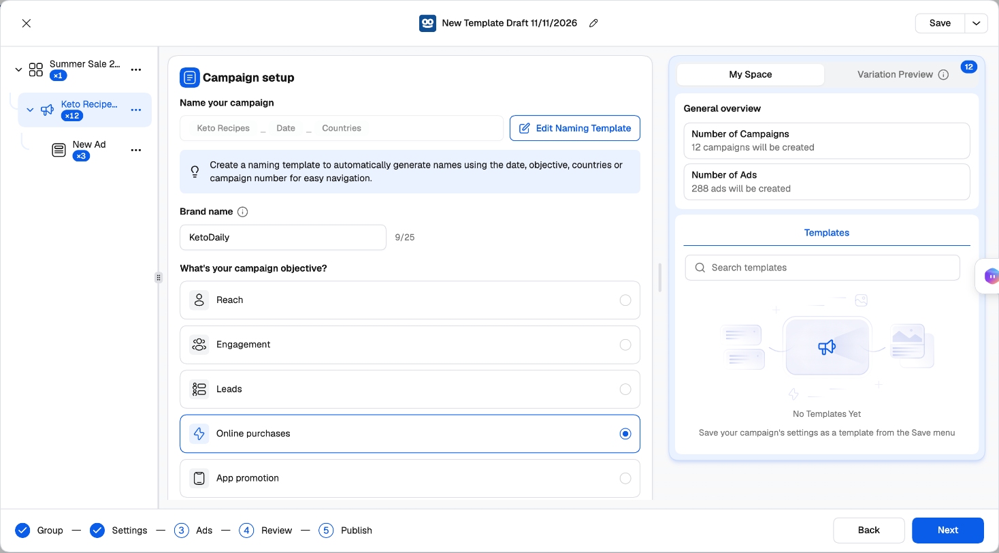

The Taboola Campaign Launcher is TheOptimizer's guided creator for Taboola. It builds a **campaign group, its campaigns and their ads in a single launch**, sends them to Taboola through its API, and adds the new campaigns to your automation rules on the way.

---

## Why launch from TheOptimizer instead of Realize

Realize is built to create one campaign at a time, and expects the pieces to exist before you start. The launcher removes those steps:

<CardGroup cols={2}>
  <Card title="Campaign groups in one go" icon="folder-tree" href="/ad-networks/taboola/campaign-uploader/campaign-groups">
    In Realize you create the campaign group first, then come back to add campaigns to it. Here you create the group — its objective, KPI, conversions and shared budget — together with all of its campaigns, in the same launch.
  </Card>
  <Card title="Groups generate your variations" icon="layer-group" href="/ad-networks/taboola/campaign-uploader/variations-and-publish">
    Add **Budget**, **Audience** and **Targeting Groups** and every combination becomes its own campaign — three countries × two bids is six campaigns from one setup. **Creative** and **Click-through Groups** do the same for ads.
  </Card>
  <Card title="Naming templates" icon="tag" href="/campaign-creator/naming-templates">
    Name campaigns from the date, objective, countries or campaign number — and give **every creative** its own name in Taboola, from its headline, media or creative number.
  </Card>
  <Card title="Create what's missing without leaving" icon="wand-magic-sparkles" href="/ad-networks/taboola/campaign-uploader/build-a-campaign">
    Create a new conversion, upload a customer list as an audience, pick Getty stock images or paste a list of sites to block — right inside the form.
  </Card>
  <Card title="Fewer rejected ads" icon="shield-check" href="/ad-networks/taboola/campaign-uploader/build-a-campaign#headlines">
    Headlines are checked against Taboola's review rules as you type (Title Case, all-caps, placeholder copy, repeated punctuation), and images against its size and crop requirements.
  </Card>
  <Card title="Tracking that works first time" icon="link" href="/ad-networks/taboola/campaign-uploader/build-a-campaign#tracking">
    Start from your tracker's parameters in Integrations or a saved preset, and get warned when the click ID your tracker needs for conversion bidding is missing.
  </Card>
</CardGroup>

On top of that: several campaigns per launch with copy, paste and duplicate; a **Review** step where you switch off any combination; [templates](#templates-and-drafts) that save the whole setup; and [automation rules](/automation/rules-guide) attached before the campaigns go live.

<Info>
  Prefer spreadsheets, or generating launches programmatically? The [Excel bulk uploader](/ad-networks/taboola/campaign-uploader/excel-upload) is still available.
</Info>

Before you start, [connect your Taboola account](/ad-networks/taboola/integration/connect).

---

## Opening the launcher

Click **Campaign Creator** in the left navigation, then the **Taboola** card — or click **Create** on the Taboola tab of the Campaign Manager. Choose how you want to create your campaign:

- **Create Manually** — the guided Campaign Launcher described here.
- **Bulk Upload (Excel)** — the [Excel uploader](/ad-networks/taboola/campaign-uploader/excel-upload).

<Frame>
  
</Frame>

---

## How the launcher is laid out

<Frame>
  
</Frame>

**Left — the tree.** Your launch has three levels: the **campaign group**, its **campaigns**, and each campaign's **ads**. Click a row to edit it. The **×N** badge on each row shows how many of it the launch will create — on a campaign, how many campaigns its groups generate; on an ad, how many images and videos it runs (each one with every headline).

The **⋯** menu on each row lets you build out the launch by hand:

| Row | Menu options |
| --- | --- |
| **Campaign group** | Create New Campaign, Paste Campaign |
| **Campaign** | Create Ad, Create New Campaign, Duplicate Campaign, Copy Campaign, Copy All Ads, Paste Ads, Delete, Delete Other Campaigns |
| **Ad** | Rename, Clone Ad, Copy Ad, Delete, Delete Other Ads |

**Middle — the settings** of the step and row you're on. Hover the **ⓘ** next to a field for what it does on Taboola.

**Right — My Space and Variation Preview.**

- **My Space** shows a **General overview** (number of campaigns and ads) and your saved **Templates**.
- **Variation Preview** lists the campaigns your groups generate — or, on the Ads step, the ads. Switch one off and it isn't created.

---

## The five steps

The footer shows where you are:

1. **Group** — pick the ad account and decide the campaign group: an existing one, a new one, or none. See [Campaign groups](/ad-networks/taboola/campaign-uploader/campaign-groups).
2. **Settings** — the campaign: objective, schedule, budget and bidding, audience, targeting, contextual targeting and tracking. See [Build a campaign](/ad-networks/taboola/campaign-uploader/build-a-campaign).
3. **Ads** — names, creatives, headlines and landing pages. See [Build a campaign › Ads](/ad-networks/taboola/campaign-uploader/build-a-campaign#ads-step).
4. **Review** — everything that will be created, with a switch on every campaign and ad. See [Variations and publishing](/ad-networks/taboola/campaign-uploader/variations-and-publish#review).
5. **Publish** — attach rules and send the launch to Taboola.

Click **Next** to move on. The launcher checks the step you're leaving: if something needs fixing, it says so and opens the first campaign with a problem, and the tree marks the rows with errors.

<Note>
  If you leave **Settings** without picking a country, the launcher asks whether you really want to **target all countries** — the campaign would run worldwide.
</Note>

---

## Templates and drafts

**Drafts.** Your work is kept in this browser as you go. Close the launcher and open it again, and it asks whether to **Continue** where you left off or **Start new**.

**Templates.** The name at the top of the launcher (for example *New Template Draft 10/11/2026*) is the template name — click it to rename. Then use **Save**, or the menu next to it:

- **Save** — save the current setup.
- **Save As** — save it under a new name. Everything is saved, groups included.
- **Browse Templates** — search your Taboola templates and **Use template** to load one.

Saved templates are also listed under **My Space**.

<Note>
  Campaign groups, conversions and audiences belong to an ad account, so they only carry over when you use the template in the **same ad account**. Using it in another account clears them and tells you what was cleared.
</Note>

---

## Next steps

<CardGroup cols={2}>
  <Card title="Campaign groups" icon="folder-tree" href="/ad-networks/taboola/campaign-uploader/campaign-groups">
    Create or pick the group, its goal and its budget.
  </Card>
  <Card title="Build a campaign" icon="hammer" href="/ad-networks/taboola/campaign-uploader/build-a-campaign">
    Every setting on the Settings and Ads steps.
  </Card>
  <Card title="Variations and publishing" icon="layer-group" href="/ad-networks/taboola/campaign-uploader/variations-and-publish">
    Budget and audience groups, Review, and Publish.
  </Card>
  <Card title="Excel bulk upload" icon="upload" href="/ad-networks/taboola/campaign-uploader/excel-upload">
    Launch from a spreadsheet instead.
  </Card>
</CardGroup>
