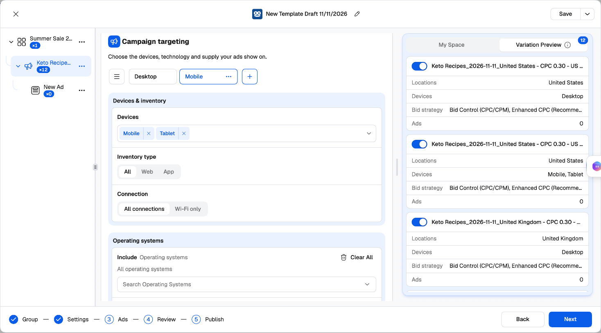
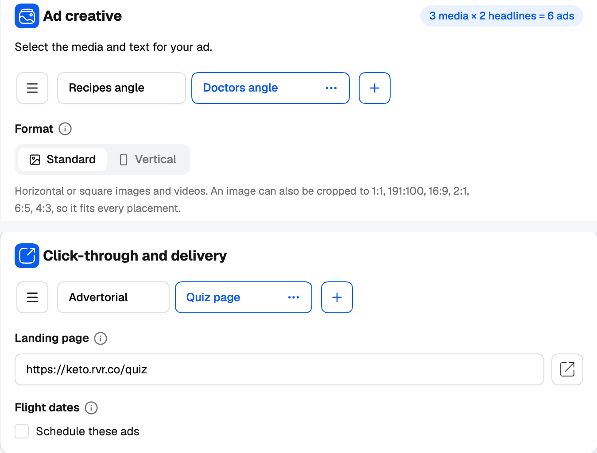
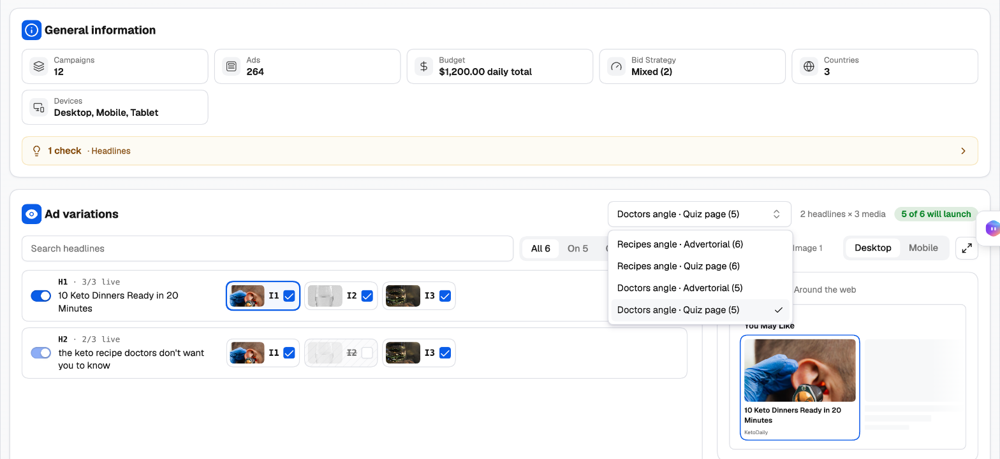
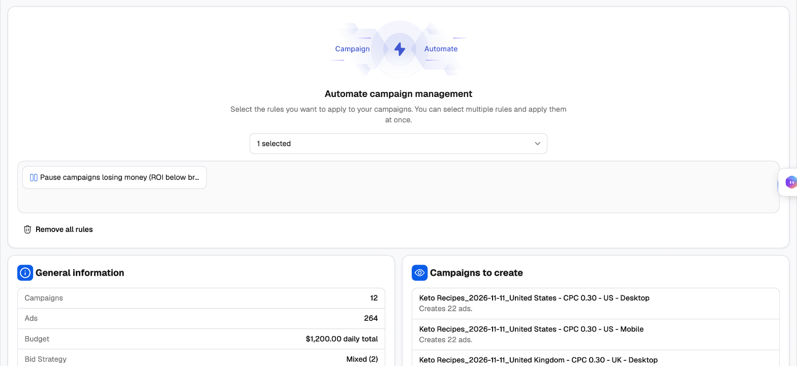

## Groups that make campaigns: Budget, Audience and Targeting

Three cards on the **Settings** step can hold [groups](/campaign-creator/groups-and-variations), and **every combination of them becomes its own campaign**:

| Card | Groups | What each group holds |
| --- | --- | --- |
| **Budget and bidding** | *Budget Group 1, 2…* | Bid strategy and CPC or target CPA, conversions, budget type and amount, spending limit, ad delivery, SpendGuard |
| **Audience Controls** | *Audience Group 1, 2…* | Locations, marketplace audiences, lookalike and custom audiences |
| **Campaign targeting** | *Targeting Group 1, 2…* | Devices and inventory, connection, operating systems, browsers, supply, site exclusion and brand safety |

Everything else — the campaign setup, schedule, contextual targeting, tracking and ads — is shared by all of them.

For example: three Audience Groups for the US, the UK and Australia × two Budget Groups with different CPCs × two Targeting Groups (*Desktop*, *Mobile*) make **12 campaigns**, all in the same [campaign group](/ad-networks/taboola/campaign-uploader/campaign-groups). In Realize, that's twelve campaigns built and kept in sync by hand.

<Frame>
  
</Frame>

## Groups that make ads: Creative and Click-through

Two cards on the **Ads** step can hold groups too:

| Card | Groups | What each group holds |
| --- | --- | --- |
| **Ad creative** | *Creative Group 1, 2…* | Format, media, headlines, descriptions, call to action, the AI-content label, and any changes made to its single ads |
| **Click-through and delivery** | *Click-through Group 1, 2…* | Landing page and flight dates |

**Every creative group × click-through group makes ads of their own, in the same campaign.** Inside each pair, every image still runs with every headline. Two creative sets × two landing pages is four sets of ads — a full creative and landing-page test in one campaign.

<Frame>
  
</Frame>

## Working with groups

- Click **+** next to the tabs to add a group. It starts as a copy of the open one, ready to rename.
- A group's **⋯** menu has **Rename**, **Clone**, **Delete other groups** and **Delete**.
- **Manage groups** opens the full list: search, drag to reorder, clone, rename or delete — and rename many at once with a prefix or suffix.
- An error in a group you're not looking at is shown on the card with the group's name, so nothing gets missed.

## How generated campaigns are named

Each generated campaign is named after its groups: the campaign name, then the name of each group that has siblings — for example *Summer Sale - Budget Group 2 - US*. Rename your groups (*US*, *CPC 0.45*) and the names explain themselves. Add a [naming template](/campaign-creator/naming-templates) for a fixed convention on top.

## Switching combinations off

**Variation Preview**, on the right, lists every campaign your groups generate. Switch one off and it isn't created. You need at least one campaign switched on to launch.

---

## More campaigns in one launch

Groups vary budget, audience, targeting, creatives and landing pages. To launch campaigns that differ in anything else — another objective, another schedule, other tracking — add more campaigns to the tree:

- **Create New Campaign** on the campaign group row starts a fresh one.
- **Duplicate Campaign** on a campaign makes a copy to change.
- **Copy Campaign** / **Paste Campaign**, **Copy All Ads** / **Paste Ads** move work between campaigns.

All of them go into the same campaign group, and each can have its own groups.

---

## Review

The **Review** step shows everything the launch will create before anything is sent.

<Frame>
  
</Frame>

- **General information** — campaigns, ads, budget, bid strategy, countries and devices.
- **Checks** — a summary of anything worth a second look (countries, conversions, headlines, media, ads, status), each with a **Fix** link that takes you to it. Checks don't block the launch.
- **Ad variations** — the ads as rows: each headline with the images it runs with. When the ads have several Creative or Click-through Groups, a second picker lists every creative × click-through pair with how many of its ads launch; pick one to see and edit those ads. Filter by **All**, **On**, **Off** or **Edited**, and use **Launch this ad** to leave any single ad out.
- **Per-ad overrides** — give one ad its own **Landing page URL** or **Status** without touching the others. Edited ads are badged.
- **Preview** — see the ad in a Desktop or Mobile *You May Like* widget.

When it looks right, click **Add Automation and Publish**.

---

## Publish

<Steps>
  <Step title="Attach rules (optional)">
    Under **Automate campaign management**, pick rules or rule groups from **Select a rule or rule group**. The new campaigns are added to them as soon as they're created — protected from the first impression. See the [Rules guide](/automation/rules-guide) and [Popular Taboola rules](/ad-networks/taboola/automation/popular-rules).
  </Step>
  <Step title="Check the summary">
    **General information** totals the launch, and **Campaigns to create** lists each campaign with its number of ads.
  </Step>
  <Step title="Publish">
    Click **Publish**. The launch is sent to the [Campaign Creation Queue](/campaign-creator/overview#the-campaign-creation-queue) and created in the background; the launcher closes and your draft is cleared.
  </Step>
</Steps>

<Frame>
  
</Frame>

### After you publish

- When you create a **new campaign group**, the whole launch is one task in the queue, so the group is created once with all its campaigns. Otherwise each campaign is its own task.
- New ads go to Taboola's review before they serve. Track progress in the queue, and find the campaigns in the Campaign Manager's Taboola tab once they're created.

<Tip>
  Use **Save As** before you publish, so your next launch for this offer starts from this setup. See [Templates and drafts](/ad-networks/taboola/campaign-uploader/campaign-launcher#templates-and-drafts).
</Tip>
