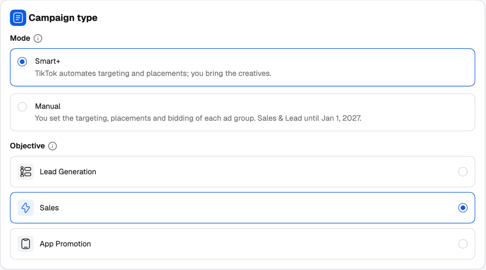
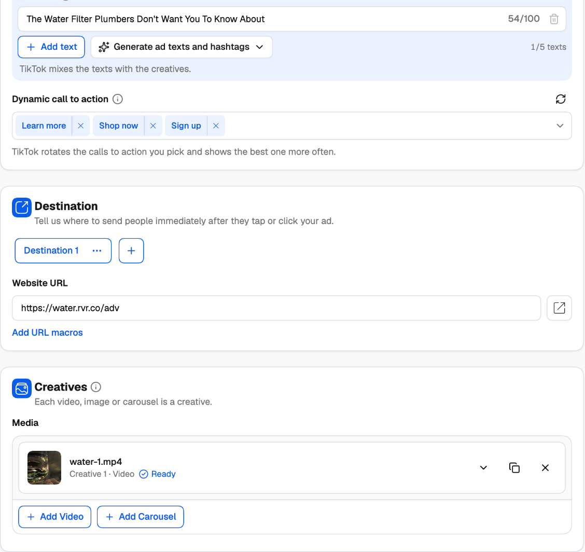
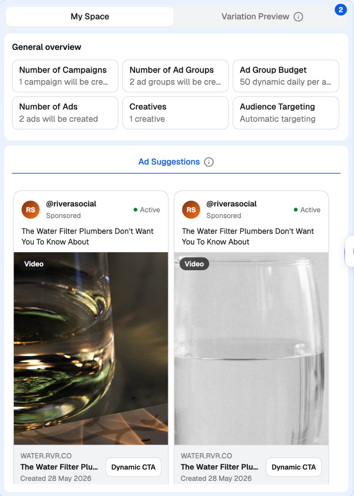

A TikTok campaign in the creator has three levels — **campaign**, **ad group** and **ad** — just as in TikTok Ads Manager. Click a level in the tree on the left to edit it, or use **Next** to move down through them. This page covers each level's settings. To multiply them into many ad groups, ads or campaigns, see [Variations](/ad-networks/tiktok/campaign-uploader/variations).

Every field has an **ⓘ** next to its label that explains what it does on TikTok, so this page focuses on the choices that matter most.

---

## Campaign level

### Ad account

Pick the TikTok ad account to launch in under **Select Ad Account**. Below it, choose:

- **Create new campaign** — build a new campaign from scratch (the default).
- **Use existing campaign** — add new ad groups and ads to a campaign already on TikTok. See [Adding to a campaign that's already on TikTok](/ad-networks/tiktok/campaign-uploader/publish-and-templates#adding-to-a-campaign-thats-already-on-tiktok).

### Basic info

- **Campaign name** — type a name, or leave it empty and one is generated. Click **Create Naming Template** to build the name from parts such as the date, the objective and the mode, so every campaign follows the same convention.
- **Status** — **Active** or **Paused** once it's created.
- **Tags** — added to the campaign in TheOptimizer once it's created, so you can filter by them in the Campaign Manager and use them in rules.

### Campaign type

<Frame>
  
</Frame>

**Mode** decides how much TikTok automates:

| Mode | What it means | Objectives |
| --- | --- | --- |
| **Smart+** | TikTok automates targeting and placements; you bring the creatives. This is the default. | Lead Generation, Sales, App Promotion |
| **Manual** | You set the targeting, placements and bidding of each ad group. | Lead Generation, Awareness, Traffic, Sales |

<Note>
  TikTok is ending the creation of **Manual** Sales and Lead Generation campaigns on **January 1, 2027**. The creator shows a reminder when you pick one. Smart+ keeps working for both after that date.
</Note>

**Objective** is what the campaign optimizes for. It decides which optimization goals, destinations and placements are offered on the levels below:

- **Lead Generation** — collect leads on your website or an instant form.
- **Sales** — drive conversions on your website, tracked by a pixel. With Smart+, the sales destination is your website.
- **App Promotion** (Smart+) — **App install** finds new users; **App retargeting** brings back people who already installed the app.
- **Awareness** (Manual) — show your ads to as many people as possible.
- **Traffic** (Manual) — send people to your website.

### Budget

**Budget level** decides where the money sits:

- **Campaign budget (CBO)** — one budget for the campaign, which TikTok spreads across its ad groups. You set the budget mode and amount here.
- **Ad group budget (ABO)** — each ad group spends its own budget, set on the ad group level.

**Budget mode** is **Dynamic daily** (a day's spend can vary around the budget), **Daily** (each day is capped) or **Lifetime** (the budget is spent between a start and an end date). Budgets must meet TikTok's minimum for the account's currency.

---

## Ad group level

### Basic info

**Ad Group name** works like the campaign name: type one, leave it empty, or use **Create Naming Template** to build it from the date, the objective or the copy number. Set the **Status** and any **Tags**.

### Promotion and lead destination

Depending on the objective, you also choose what the ads promote — a **Website**, an **App (Android)**, an **App (iOS)** or a **Lead Generation** form — and, for lead generation, where leads are collected: an **Instant form** on TikTok, or a form on your **Website**. For app promotion, pick the app from the ad account's apps.

### Targeting

**Audience Targeting** has three modes:

| Mode | What TikTok does |
| --- | --- |
| **Automatic** | Finds the audience within your locations, languages and minimum age. |
| **Automatic with suggestions** | Also uses the ages, gender and interests you suggest, though it may reach beyond them. |
| **Custom** | Shows the ads only to the audience you set. This may limit delivery. |

Then set **Locations**, **Languages** (leave empty for every language), the **Minimum age** (18+ or 25+) or age ranges, gender, interests and interest keywords, and **Operating system** (Smart+ targets one at most).

### Placements

Choose where the ads show: **TikTok** (the TikTok app's feeds), **Pangle** (TikTok's partner apps) and the **Global App Bundle**. With Manual campaigns you can also leave it on **Automatic** and let TikTok decide. Some objectives only take placements picked by hand.

### Optimization & bidding

- **Optimization goal** — the result TikTok delivers the ads for, such as conversions, value, clicks, landing page views, leads, reach, app installs or in-app events. It also sets what you're billed for.
- **Pixel** and **Optimization event** — for goals tracked on your website, the TikTok pixel and the event that counts as a conversion (for example *Purchase (complete payment)*, *Add to cart* or *Lead (form submission)*). For in-app goals, the in-app event.
- **Bid Strategy** — **Maximum delivery** gets the most results for the budget; **Cost cap** keeps the average cost per result near your bid and needs a dynamic daily budget. Click **Get recommendation** for TikTok's suggested bid.
- For value goals, **Highest value** or **Minimum ROAS** (with a ROAS target), and the value window (**Day 7** or **Day 0**).

### Budget & schedule

With **Ad group budget (ABO)**, set the budget mode and **Amount** here. Under **Schedule**, add a **Start date** to start later (otherwise it starts right away) and an **End date** to stop on a set date. Times are in **UTC**. A lifetime budget always runs between a start and an end; without an end it stops after 30 days.

Manual campaigns also offer **Pacing** — **Standard** spreads the budget evenly, **Accelerated** spends it as fast as possible (it needs a cost cap) — and, for Awareness, a frequency cap.

---

## Ad level

<Frame>
  
</Frame>

### Ad details and identity

- **Ad name** — type one, leave it empty, or build it with **Create Naming Template** from the date, the format or the creative number. With one ad per creative, each ad gets its own name.
- **Status** and **Tags**, as on the other levels.
- **Identity (TikTok account)** — the TikTok account the ads show as. Tick **Only show as ads** to publish the posts as ads only, not on your TikTok profile. Some formats also take a **Display name** (the brand name shown on the ad).

### Ad copy

- **Ad texts** — up to 5 texts of 100 characters each. TikTok mixes the texts with the creatives. Click **Generate ad texts and hashtags** to have TikTok suggest texts and hashtags from your keywords.
- **Call to action** — the button on the ad, or a **Dynamic call to action**: pick several and TikTok rotates them, showing the best one more often. Smart+ ads take a dynamic call to action only.

### Destination

Tell TikTok where to send people after they tap your ad: a **Website URL** (use **Add URL macros** to add tracking parameters), an **Instant form** for leads, or an **Instant page** hosted by TikTok.

### Creatives

Each video, image or carousel is a creative.

- **Add Video** or **Add Image** (depending on the format the objective allows) — from the **TikTok library** (the ad account's own videos or images) or the **Media Manager** (your uploads in TheOptimizer, sent to TikTok when the campaign is created).
- **Add Carousel** — several images (or, in Manual campaigns, images or videos) with music. Pick a track from your music, search TikTok's carousel music, or upload an audio file.

Videos need a cover. If a video doesn't fit TikTok's requirements, **Fix video for TikTok** re-renders it at the right ratio; images are resized for TikTok automatically.

When you add several creatives, choose how they're turned into ads: **One ad with every creative** (TikTok rotates them in one ad) or **One ad per creative** (each creative becomes an ad of its own).

---

## Reusing your recent ad groups and ads

The right-hand panel saves you from re-entering settings you've used before:

- At the **ad group** level, **Suggestions** lists your recent ad groups in this ad account for the same mode and objective. Click **Apply** to copy one's targeting, placements, optimization, budget and bid.
- At the **ad** level, **Ad Suggestions** lists your recent ads. Click **Use This Ad** to copy its creatives, texts, call to action, identity and landing page.

<Frame>
  
</Frame>

If a setting can't be copied — for example because this campaign picks its own placements — a note at the top of the level says which one was skipped and why.

---

## Next steps

- [Variations](/ad-networks/tiktok/campaign-uploader/variations) — turn one setup into many ad groups, ads or campaigns.
- [Publish, templates and existing campaigns](/ad-networks/tiktok/campaign-uploader/publish-and-templates)
