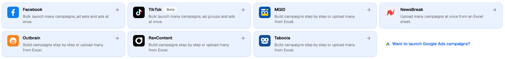
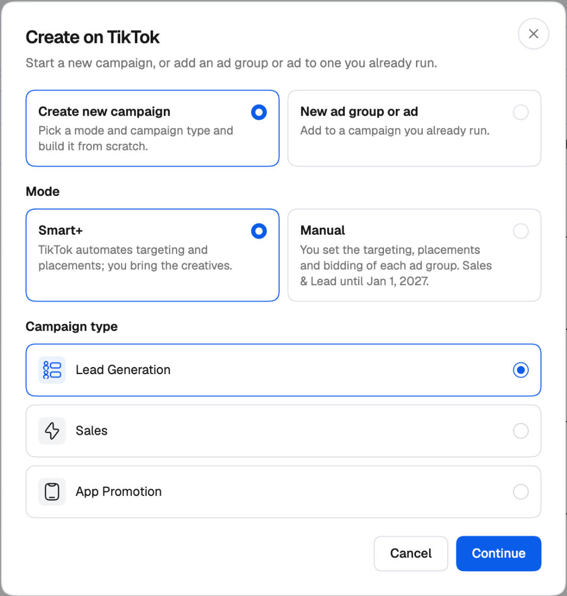
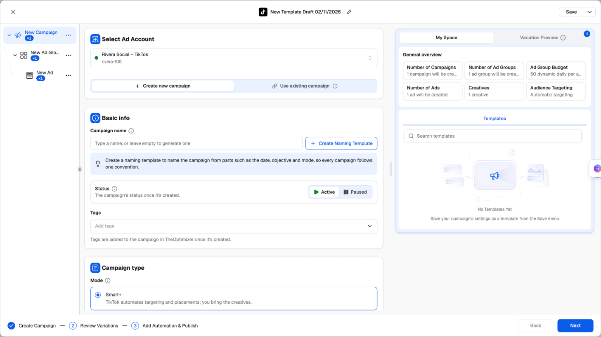

The TikTok Campaign Creator lets you build TikTok campaigns in TheOptimizer and launch many of them at once — every combination of audiences, budgets, placements and destinations you set up becomes its own ad group, ad or campaign. It talks to TikTok through its API, so you never have to open TikTok Ads Manager to launch.

<Note>
  The TikTok Campaign Creator is in **Beta**. It's fully usable, and we're still adding to it — tell us in the in-app chat if something you need is missing.
</Note>

---

## Why launch from TheOptimizer instead of TikTok Ads Manager

<CardGroup cols={2}>
  <Card title="Groups generate your ad groups" icon="layer-group" href="/ad-networks/tiktok/campaign-uploader/variations">
    Add Budget, Audience, Placement and Destination groups, and every combination becomes its own ad group, ad or campaign — 3 audiences × 2 budgets is 6 ad groups, set up once.
  </Card>
  <Card title="Naming templates on every level" icon="tag" href="/campaign-creator/naming-templates">
    Campaigns, ad groups and ads are named from the date, objective, mode, group name, format and creative number — consistent names you can filter and run rules on.
  </Card>
  <Card title="Add to what's already running" icon="plus" href="/ad-networks/tiktok/campaign-uploader/publish-and-templates#adding-to-a-campaign-thats-already-on-tiktok">
    Load existing campaigns and ad groups beside new ones and add ad groups or ads to them in the same launch.
  </Card>
  <Card title="Templates, drafts and rules" icon="bookmark" href="/ad-networks/tiktok/campaign-uploader/publish-and-templates#templates">
    Save a whole setup as a template, pick up drafts where you left off, and attach automation rules before the first impression.
  </Card>
</CardGroup>

On top of that: TikTok's bid suggestion, AI-written ad texts and hashtags, country groups for locations, a URL-parameter builder with TikTok macros, and suggestions from your recent ad groups and ads.

Before you start, [connect your TikTok ad account](/ad-networks/tiktok/integration/connect).

---

## Opening the creator

There are two ways in:

**From the Campaign Launcher.** Click **Campaign Creator** in the left navigation, then the **TikTok** card. The creator opens in a side sheet with a new, empty campaign.

<Frame>
  
</Frame>

**From the Campaign Manager.** Open the TikTok tab under **Campaigns** and click **Create**. The **Create on TikTok** dialog asks where to start:

- **Create new campaign** — pick the **Mode** (Smart+ or Manual) and the **Campaign type**, then click **Continue**. The creator opens with those already set.
- **New ad group or ad** — add to a campaign you already run. See [Adding to a campaign that's already on TikTok](/ad-networks/tiktok/campaign-uploader/publish-and-templates#adding-to-a-campaign-thats-already-on-tiktok).

<Frame>
  
</Frame>

---

## How the creator is laid out

<Frame>
  
</Frame>

**Left — the campaign tree.** Your campaign, its ad groups and their ads. Click a level to edit it. The **×N** badge on each level shows how many will be created once your variations are multiplied out. The **⋯** menu on each item lets you create, duplicate, copy, paste, rename or reset it. See [Variations](/ad-networks/tiktok/campaign-uploader/variations).

**Middle — the settings** for the level you selected. Hover the **ⓘ** next to any field for a short explanation of what it does on TikTok.

**Right — My Space and Variation Preview.**

- **General overview** counts what will be created: campaigns, ad groups, ads, creatives, the budget and the targeting.
- Below it, a panel that changes with the level: **Templates** at the campaign level, **Suggestions** (your recent ad groups) at the ad group level, and **Ad Suggestions** (your recent ads) at the ad level. See [Reusing your recent ad groups and ads](/ad-networks/tiktok/campaign-uploader/build-a-campaign#reusing-your-recent-ad-groups-and-ads).
- **Variation Preview** lists the variations of the level you're on.

---

## The three-step flow

The footer shows where you are:

1. **Create Campaign** — set up the campaign, ad group and ad levels, and any variations. Use **Next** to move from level to level. See [Build a campaign](/ad-networks/tiktok/campaign-uploader/build-a-campaign).
2. **Review Variations** — see every campaign, ad group and ad that will be created, and switch off any you don't want. See [Reviewing variations](/ad-networks/tiktok/campaign-uploader/variations#reviewing-variations).
3. **Add Automation & Publish** — attach rules and publish. See [Publish, templates and existing campaigns](/ad-networks/tiktok/campaign-uploader/publish-and-templates).

When you click **Next**, the creator checks the level you're on. Fields that need attention are marked, and the tree shows which level they're on.

---

## Your work is kept as a draft

The creator keeps your work in this browser as you go. If you close the sheet and open the TikTok creator again, it asks whether to **Continue** where you left off or **Start New**.

The name at the top of the sheet (for example *New Template Draft 02/11/2026*) is the name your settings are saved under when you save them as a template. Click the pencil to rename it. See [Templates](/ad-networks/tiktok/campaign-uploader/publish-and-templates#templates).

---

## Next steps

<CardGroup cols={2}>
  <Card title="Build a campaign" icon="hammer" href="/ad-networks/tiktok/campaign-uploader/build-a-campaign">
    Every setting at the campaign, ad group and ad level.
  </Card>
  <Card title="Variations" icon="layer-group" href="/ad-networks/tiktok/campaign-uploader/variations">
    Test audiences, budgets, placements and destinations in one launch.
  </Card>
  <Card title="Publish, templates and existing campaigns" icon="paper-plane" href="/ad-networks/tiktok/campaign-uploader/publish-and-templates">
    Attach rules, publish, save templates, and add to campaigns already running.
  </Card>
</CardGroup>
