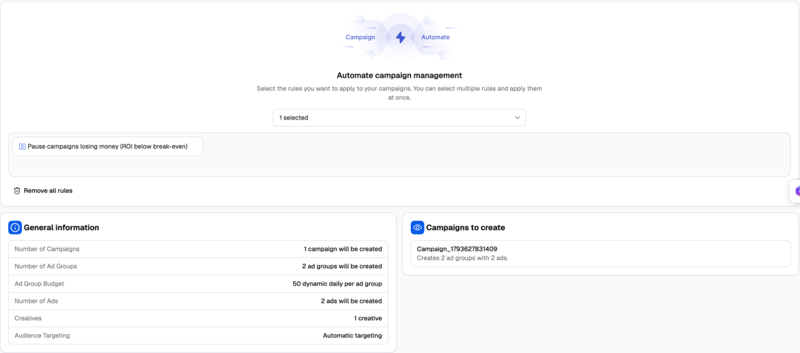
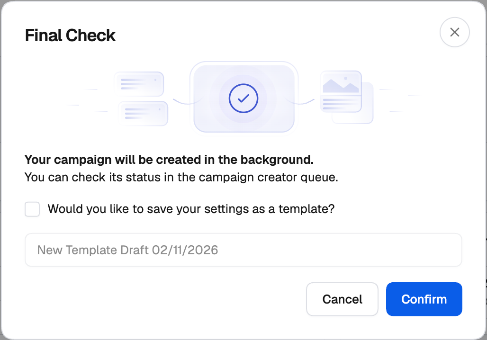
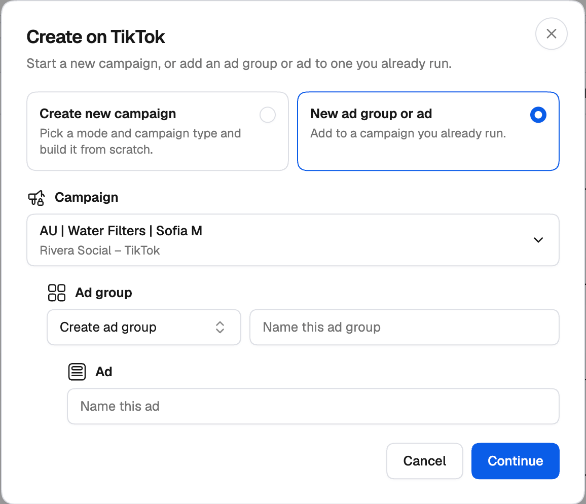
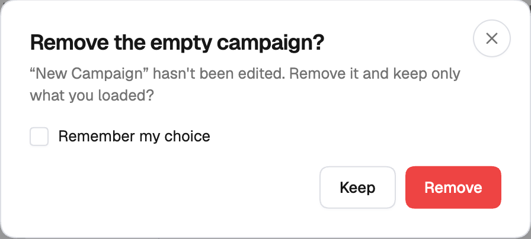
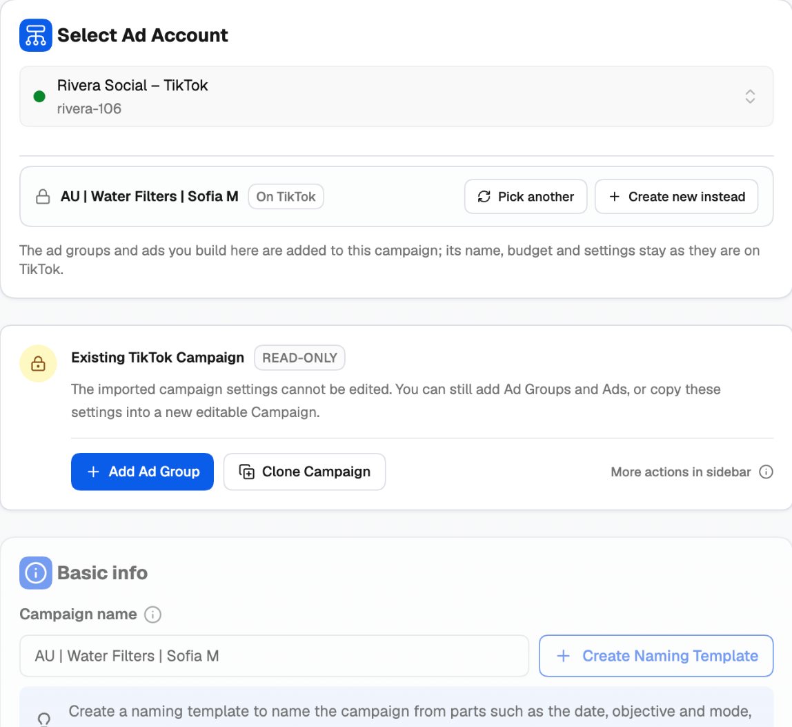

## Add Automation & Publish

The last step of the creator attaches rules and sends everything to TikTok.

<Frame>
  
</Frame>

<Steps>
  <Step title="Attach rules (optional)">
    Under **Automate campaign management**, pick one or more rules or whole rule groups from **Select a rule or rule group**. The new campaigns are added to those rules as soon as they're created, so they're protected from the first impression. **Remove all rules** clears the selection. See the [Rules guide](/automation/rules-guide) and [Popular TikTok rules](/ad-networks/tiktok/automation/popular-rules).
  </Step>
  <Step title="Check what will be created">
    **General information** lists the totals — campaigns, ad groups, budgets, ads, creatives and targeting. **Campaigns to create** lists each campaign; hover one to see its ad groups and ads.
  </Step>
  <Step title="Publish">
    Click **Publish**. The **Final Check** dialog confirms that the campaigns will be created in the background, and that you can check each one's status in the Campaign Creation Queue. Tick **Would you like to save your settings as a template?** to keep the setup for next time, then click **Confirm**.

    <Frame>
      
    </Frame>
  </Step>
</Steps>

### After you publish

Campaigns are created in the background and sent to TikTok in order. Follow their progress in the **Campaign Creation Queue** on the Campaign Creator page — see [The Campaign Creation Queue](/campaign-creator/overview#the-campaign-creation-queue). Once created, they appear in the Campaign Manager's TikTok tab with the tags you set.

You can open a launch from the queue in the creator again. Creating from it sends it as a **new** campaign; the one in the queue stays as it is.

---

## Templates

A template saves your whole setup — campaign, ad groups, ads, variants and rules — so the next launch only needs new creatives or a different budget.

**Saving.** The name at the top of the creator is the template's name; click the pencil to change it. Then use the **Save** button at the top right, or its menu:

- **Save** — save the current setup under its name.
- **Save As** — save a copy under a new name.
- **Browse Templates** — open your saved templates.

You can also tick **Would you like to save your settings as a template?** in the Final Check when you publish.

Identities, pixels, apps, instant pages and media from the TikTok library belong to an ad account, so they only carry over when you use the template in the same ad account.

**Reusing.** On the campaign level, the **Templates** panel on the right lists your saved TikTok templates. Search by name, then click **Apply template** to load one. You can also rename or remove templates from the list.

<Tip>
  Build a template per offer or per campaign type — for example *US Smart+ sales* — with your usual audiences, budgets and rules. Launching then becomes: apply the template, swap the creatives, publish.
</Tip>

---

## Adding to a campaign that's already on TikTok

You don't need a new campaign to test new ads. You can add new ad groups and ads to a campaign that's already running on TikTok, or new ads to one of its ad groups. Its name, budget and settings stay as they are on TikTok — only what you build in the creator is added.

**From the Campaign Manager.** On the TikTok tab, click **Create**, choose **New ad group or ad**, and pick the **Campaign**. Then either **Create ad group** (and name it) or use an existing ad group, name the ad, and click **Continue**. The creator opens on the new ad group or ads.

<Frame>
  
</Frame>

**From inside the creator.** On the campaign level, under **Select Ad Account**, click **Use existing campaign** and pick a campaign already on TikTok with the same mode and objective. The existing campaign is **added beside** the one you're building in the tree, and opens. Once a campaign is on TikTok, its ad groups offer **Use existing ad group** in the same way, to add new ads to an ad group that's already running.

<Frame>
  
</Frame>

If the campaign (or ad group) you started with is still untouched, the creator asks **Remove the empty campaign?** — **Remove** keeps only what you loaded, **Keep** leaves both. Tick **Remember my choice** to skip the question from then on in this browser.

On a level that's already on TikTok, **Pick another** swaps it for a different one, and **Create new instead** turns it back into a new level.

### Existing levels are read-only

<Frame>
  
</Frame>

A campaign or ad group loaded from TikTok shows an **Existing TikTok Campaign** (or **Existing TikTok Ad Group**) banner with a **Read-only** tag. Its settings are shown, greyed out, so you can see what you're adding to — but they can't be changed, and the ad account is locked while it's selected. From the banner you can:

- **Add Ad Group** / **Add Ad** — build something new inside it. (Smart+ ad groups run one ad, so they don't offer **Add Ad**.)
- **Clone Campaign** / **Clone Ad Group** — make a new, editable copy of its settings.

Existing levels can't hold variants. On Review Variations they're marked **On TikTok**, so it's always clear what will be created and what will be added to.
