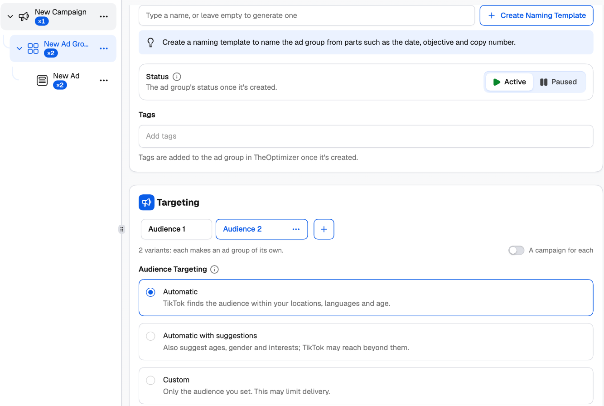
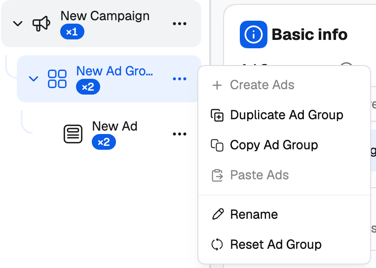
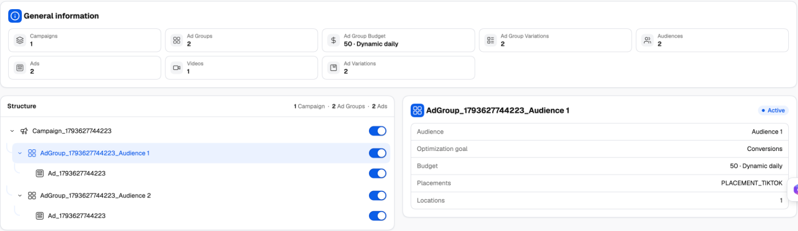

The point of the TikTok Campaign Creator is launching many ad groups and ads at once. You don't build each one by hand: you add **variants** to a setting, and the creator multiplies them out. Two audiences and two budgets on one ad group become four ad groups. (How groups work across every network: [Groups and variations](/campaign-creator/groups-and-variations).)

---

## Adding variants

Some sections have a row of variant tabs at the top — **Audience 1**, **Budget 1**, **Placement 1**, **Destination 1**. Click **+** next to the tabs to add a variant, then fill in its settings. Each tab holds its own values; click a tab to edit it.

<Frame>
  
</Frame>

| Level | What you can vary |
| --- | --- |
| **Campaign** | **Budget** (with a campaign budget, CBO) |
| **Ad group** | **Budget** (with ad group budgets, ABO), **Audience** (targeting), **Placement** |
| **Ads** | **Destination** (landing page) |

Under the tabs, a line tells you what the variants will make — for example *2 variants: each makes an ad group of its own*. **Campaign budget** variants each make a campaign of their own.

- **+** adds a variant that starts as a copy of the open one.
- A tab's **⋯** menu has **Rename**, **Clone** and **Delete**. Double-click a tab to rename it.
- **☰ Manage variants** (left of the tabs, once there are two) opens the group manager: search, drag to reorder, rename, clone or delete one — or select several and **Clone**, **Rename** (add a prefix or suffix) or **Delete** them at once.
- A tab whose variant has an error is marked, so you can find it without opening every tab.

{/* SCREENSHOT: tiktok-group-manager.png — Manage variants window with 4 audience variants, two selected, and the bulk Clone / Rename / Delete actions. */}

Variants on the same level multiply: 3 audiences × 2 budgets gives 6 ad groups. The **×N** badges in the tree and the **General overview** on the right update as you go, so you always know how much you're about to create.

<Tip>
  Name your variants (double-click a tab, or **⋯ → Rename**) — for example *US 18-34* and *US 35+*. The names fill the **Group name** part of your [naming template](/campaign-creator/naming-templates) — or are added at the end of the generated names if the template has no Group name part — so you can tell the results apart in the Campaign Manager.
</Tip>

### A campaign for each variant

By default, ad group variants become ad groups inside one campaign. Switch on **A campaign for each** next to the variant tabs to give each variant a campaign of its own instead — useful when you want separate campaign budgets or cleaner reporting per audience.

Campaigns and ad groups that are already on TikTok can't hold variants, and **A campaign for each** only shows for a campaign the creator is making.

### Smart+ and destinations

Smart+ runs one ad per ad group, so in a Smart+ campaign each **Destination** variant makes an ad group of its own. In a Manual campaign, destination variants make separate ads inside the same ad group.

### More creatives, more ads

On the ad level, choose **One ad per creative** to turn every creative into its own ad — ten videos become ten ads. **One ad with every creative** keeps them in a single ad that TikTok rotates.

---

## Working with the tree

<Frame>
  
</Frame>

The **⋯** menu on each item in the tree lets you build out the structure by hand:

| Level | Menu options |
| --- | --- |
| **Campaign** | **Create New Campaign**, **Duplicate Campaign**, **Create Ad Group**, **Copy All Ad Groups**, **Paste Ad Groups**, **Rename**, **Delete** (or **Start Over** for the only campaign) |
| **Ad group** | **Create Ads**, **Duplicate Ad Group**, **Copy Ad Group**, **Paste Ads**, **Rename**, **Delete** (or **Reset Ad Group** for the only one) |
| **Ads** | **Duplicate Ads**, **Copy Ads**, **Rename**, **Delete** (or **Reset Ads** for the only one) |

- **Duplicate** makes a copy right next to the original, which you can then change.
- **Copy** and **Paste** move an ad group into another campaign, or ads into another ad group.
- **Delete** removes a level and everything under it. When it's the only one of its kind, you get **Reset** instead, which puts it back to its defaults; **Start Over** resets everything except the ad account.

---

## Reviewing variations

Click **Review Variations** at the bottom of the creator to see everything that will be created.

<Frame>
  
</Frame>

- **General information** totals what you're about to launch: campaigns, ad groups, budgets, audiences, ads, videos, images and variations.
- **Structure** lists every campaign, ad group and ad with its generated name. Click a row to see its settings on the right — mode, objective and budget for a campaign; audience, optimization goal, budget, placements and locations for an ad group.
- Use the toggle on a row to **leave it out**. Switched-off combinations aren't created. You need to keep at least one active campaign, ad group and ad.

When everything looks right, click **Add Automation and Publish**. See [Publish, templates and existing campaigns](/ad-networks/tiktok/campaign-uploader/publish-and-templates).
