import { ArcadePopoutModal } from '/snippets/arcade-popout-modal.mdx';

import { ArcadeVideoButton } from '/snippets/arcade-video-button.mdx';

Automation rules are the engine behind TheOptimizer's optimization capabilities. Instead of logging in every few hours to pause underperformers or scale winners, you define the logic once and let the platform act for you around the clock. There are three core reasons to use them: they **free up your time** by handling repetitive tasks so you can focus on higher-leverage work like creative testing and landing page improvements; they provide **24/7 coverage** so a campaign going over budget at 3am or a winner hitting its limit overnight gets handled automatically; and they **eliminate human error** by executing exactly what you define, every single time.

---

## 1. The Rules page

Go to **Automation** in the left navigation. The page opens on **Rules**; **Smart Lists** sits next to it in the title.

<Frame>
  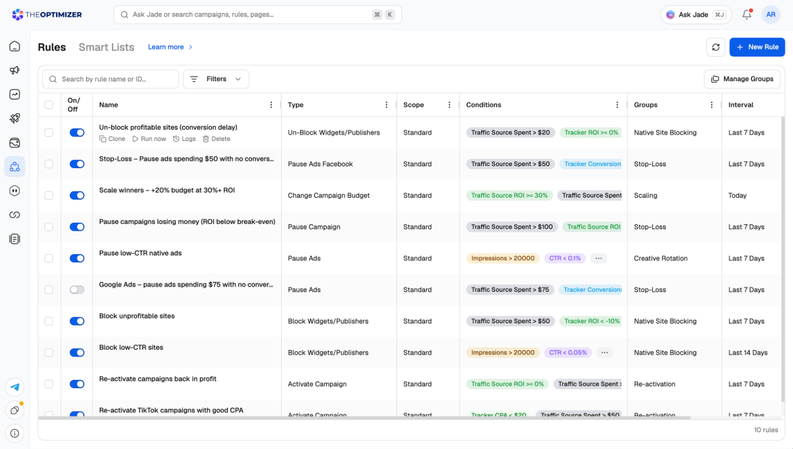
</Frame>

- **New Rule** (top right) starts a new rule — see Section 2 below.
- **Search by rule name or ID** and **Filters** narrow the list.
- **Manage Groups** organizes rules into folders. Groups also let you assign a whole set of rules to a campaign at once, saving time as your rule library grows.
- Hover a rule's name for **Clone**, **Run now**, **Logs** and **Delete**.

### Standard rules vs. Global rules

Every rule has a **Rule scope**, and it decides what happens when you launch a new campaign:

| Scope | Shown in the list as | What it covers |
| --- | --- | --- |
| **Specific campaigns** | Standard | Only the campaigns you pick. New campaigns must be added to the rule by hand. |
| **Whole ad accounts** | Global | Every campaign in the ad accounts you pick, **new ones included**. |

With a Standard rule, a campaign you forget to add is completely unprotected. With a Global rule, any campaign you launch in the selected accounts is covered from day one.

<Tip>
  For stop-loss and scaling rules you want applied consistently, choose **Whole ad accounts**. Keep **Specific campaigns** for logic that should only touch a curated subset.
</Tip>

<Note>
  **Whole ad accounts** is available on plans that include Global Rules. If yours doesn't, the option asks you to upgrade.
</Note>

### One rule, several ad networks

A rule can run on more than one ad network at once. If your stop-loss logic is the same for Facebook, Taboola and TikTok, create one rule and pick all three, instead of maintaining three copies. See [Where the rule runs](#where-the-rule-runs).

### Platform terminology: Widget & Content

Sometimes you might encounter these terms throughout the platform (especially if you are working with native ad networks):

| Platform term | What it means |
| --- | --- |
| **Widget** | A site (on <a href="/ad-networks/taboola/integration/connect" target="_blank" rel="noopener noreferrer">Taboola</a>) or publisher (on <a href="/ad-networks/outbrain/integration/connect" target="_blank" rel="noopener noreferrer">Outbrain</a>) — the placement level below the ad. |
| **Content** | An ad or creative. "Content rules" are ad-level rules. |

---

## 2. Creating a rule

Click **New Rule**. Instead of a long list of rule types, you get one starting point with three ways in:

<Frame>
  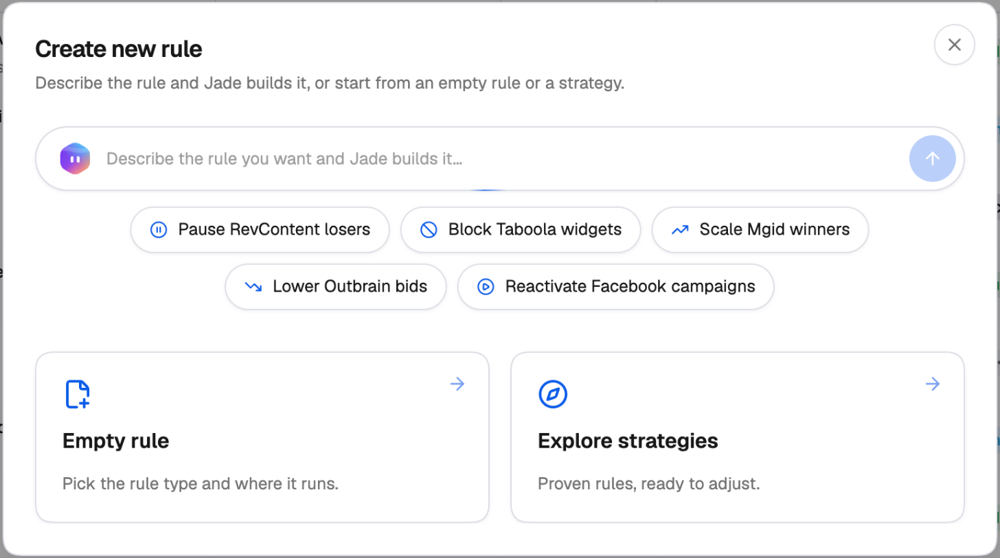
</Frame>

| Start from | What happens |
| --- | --- |
| **Describe it to Jade** | Type the strategy you want in the box at the top (or click one of the suggestions) and Jade builds the rule for you. See [Creating a rule with Jade](#creating-a-rule-with-jade). |
| **New rule** | Opens a blank rule. You pick the rule type and where it runs yourself. |
| **Explore strategies** | Opens a library of proven rules with their conditions filled in. Pick one and it opens in the rule form for you to adjust. See [Rule templates](/automation/rule-templates). |

Whichever you choose, the rule opens in a side sheet over the Rules page, so your list stays in view.

<Frame>
  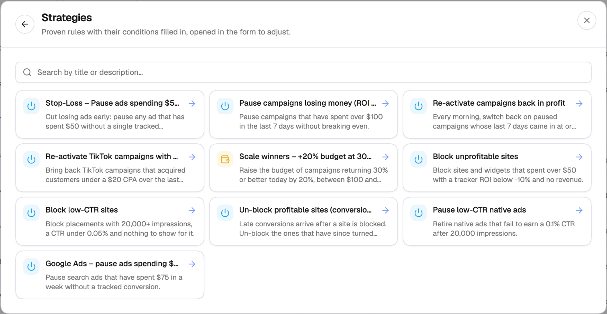
</Frame>

<Warning>
  If you start from a strategy, always review and adjust the values before saving. Strategy values are starting points — they are almost never the right numbers for your specific account and offers.
</Warning>

### Creating a rule with Jade

Explain in plain English what you want to achieve — for example, *"Pause any Facebook or TikTok campaign that has spent $100 today with ROI below -30%, and raise the budget by 20% on campaigns above 50% ROI"*. [Jade](/jade/overview) turns it into one or more rules that match your strategy. Each one appears in the chat as a **Generated rule** card — a draft, not a live rule. Click **Review and save** to open it in the rule form with everything filled in, check the settings, and click **Save**. Nothing is created until you save.

Ask Jade to change an existing rule and the card offers **Review changes** instead, opening that rule with the edits applied for you to save.

You can do the same from any Jade chat — press **⌘J** / **Ctrl+J** and describe the rule.

### The rule form

The rule form is one page of sections, top to bottom:

1. **Rule details** — name, group, default data interval and excluded days.
2. **Where the rule runs** — ad networks, level, rule scope and the campaigns or ad accounts it checks.
3. **Rule type** — what the rule does.
4. **Rule conditions** — when it acts. See Section 3 below.
5. **Rule action** — what it changes. See Section 4 below.
6. Filtering — include or exclude specific items. See Section 5 below.
7. **Auto tag** — add or remove tags on the items the rule acts on.
8. **Schedule rule** — how often it runs, whether it acts or only alerts, and where alerts go. See Sections 6 and 7 below.

Click **Save** at the bottom of the sheet when you're done. If you close the sheet with unsaved changes, you're asked whether to discard them.

### Rule details

<Steps>
  <Step title="Name your rule">
    Use a name that describes the logic, not just the type. `Pause Ads – Spend > $50 & 0 Conv` tells you everything at a glance; `Rule 1` tells you nothing. As your rule library grows, self-explanatory names save a lot of scrolling.
  </Step>
  <Step title="Assign a Rule group (optional)">
    Assign the rule to a group to keep your list tidy and to bulk-assign rules to campaigns later without selecting them one by one. Use **New group** to create one on the spot.
  </Step>
  <Step title="Set the Default data interval">
    The time window the system looks at when evaluating all conditions. Options range from **Today** and **Yesterday** to **Last 3 Days**, **Last 7 Days**, all the way to **Last 90 Days**. Every condition in the rule uses this interval unless you override it individually (see Section 3).
  </Step>
  <Step title="Configure Exclude days from default interval (optional)">
    Removes specific recent days from the evaluation window. If your revenue data arrives with a 24-hour delay — common in Search Arbitrage — excluding **Today** prevents the rule from making decisions based on spend with no corresponding revenue yet. You can exclude up to the last 3 days.
  </Step>
</Steps>

### Where the rule runs

<Frame>
  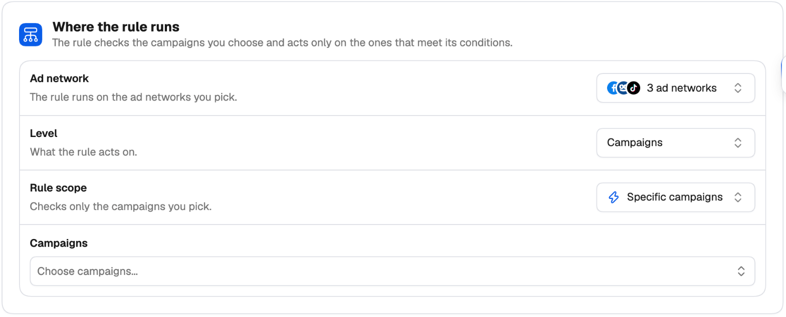
</Frame>

| Setting | What it sets |
| --- | --- |
| **Ad network** | The ad networks the rule runs on. Pick one or several — only connected networks are listed. |
| **Level** | What the rule acts on: campaigns, ad sets, ads, or (on native networks) widgets/sites. |
| **Rule scope** | **Specific campaigns** or **Whole ad accounts**. See [Standard rules vs. Global rules](#standard-rules-vs-global-rules). |
| **Campaigns** / **Ad accounts** | The campaigns, or the ad accounts, the rule checks. |

### Rule type

The **Rule type** list shows only what the selected ad networks can **all** do at the chosen level, so picking more networks can narrow the list. For example, a campaign-level rule on Facebook, Taboola and TikTok offers **Pause or Activate**, **Change Budget** and **Day Parting**.

<Frame>
  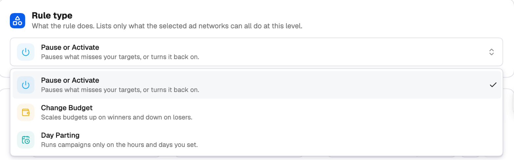
</Frame>

Choose the type first, then set the **Rule action** below the conditions — for **Pause or Activate**, that's a **Pause** / **Activate** switch.

<Note>
  Once a rule is saved, it keeps its ad networks, level and rule type. To change any of them, clone the rule and edit the copy.
</Note>

---

## 3. Rule Logic: Conditions & Time Frames

The **Conditions** section is the brain of your automation. Conditions define the exact criteria that must all be true for the rule to execute. Each condition has three parts: a **Metric**, an **Operator**, and a **Value**.

<Frame>
  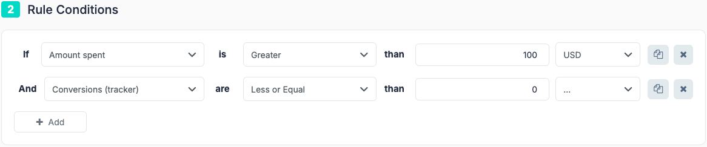
</Frame>

### Adding Conditions

<Steps>
  <Step title="Click Add Condition">
    Click **Add Condition** (or the `+` button) to open a new condition row.
  </Step>
  <Step title="Select a metric">
    Use the search bar in the dropdown to find metrics quickly.
  </Step>
  <Step title="Select an operator">
    Choose Greater Than, Less Than, Greater or Equal, Less or Equal, etc.
  </Step>
  <Step title="Enter a value">
    Enter the number you're comparing against.
  </Step>
</Steps>

**Example logic:**

```text
IF Amount Spent > 50
AND Conversions ≤ 0
```

### Understanding Metric Categories

Metrics in the dropdown are organized into three categories:

<Frame>
  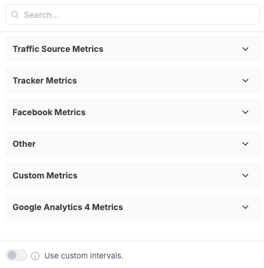
</Frame>

| Category | Source |
| --- | --- |
| **Traffic Source Metrics** | Data pulled directly from your ad network (Amount Spent, Impressions, Clicks from Facebook or TikTok). |
| **Tracker Metrics** | Data from your connected <a href="/integrations/tracking-platforms" target="_blank" rel="noopener noreferrer">tracking platform</a> (conversions, revenue, EPC from <a href="/tracking-platforms/voluum/connect" target="_blank" rel="noopener noreferrer">Voluum</a>, <a href="/tracking-platforms/binom/connect" target="_blank" rel="noopener noreferrer">Binom</a>, etc.). |
| **Custom Metrics** | Metrics you define yourself by writing a formula inside TheOptimizer — useful for KPIs that combine data from multiple sources. |

### Duplicating a Condition

When you need two conditions that are very similar — for example, checking that spend is both greater than $50 and less than $200 — use the **duplicate button** on the right side of any condition row. This clones the condition so you only need to change the operator or value, rather than rebuilding from scratch.

### Advanced Logic: Percentage Comparisons

Instead of comparing a metric to a fixed number, you can compare it to another metric. Click the `$` icon next to the value field to switch modes:

<Frame>
  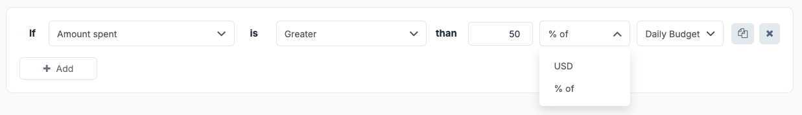
</Frame>

| Mode | Description |
| --- | --- |
| **\$ (Fixed Value)** | Default. Compare against a specific number (e.g., Spend \> \$50). |
| **% of Campaign** | Compare against a campaign-level metric. Example: "Spend is greater than 20% of Campaign Daily Budget." |
| **% of** | Compare against another metric at the same level. Example: "Spend is greater than 50% of Revenue" — an ROI threshold without a fixed number. |

### Custom Time Frames (Per Condition)

All conditions use the Default Data Interval by default, but you can override this on a per-condition basis — allowing you to build rules that look at different time windows simultaneously.

<Frame>
  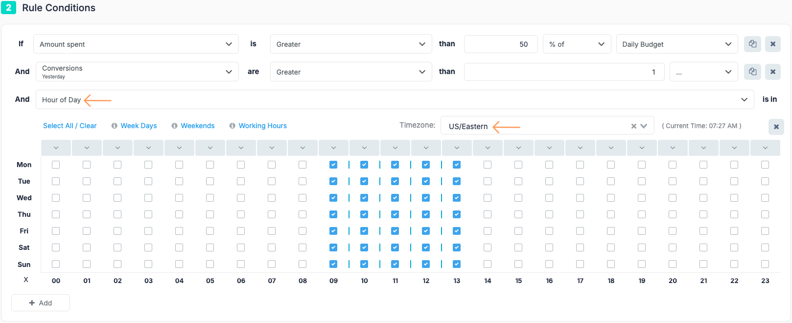
</Frame>

<Frame>
  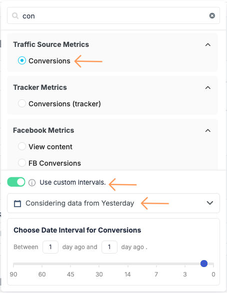
</Frame>

To do this, toggle **Use Custom Interval** inside the condition row and select a time range. The condition will display a small label showing its custom interval. You can also define fully custom date ranges — for example, "between 10 days ago and 6 days ago" — for advanced use cases where you need to analyze performance in a specific historical window.

<Tip>
  **Mixed time frames example:** Check whether an ad has spent money _Today_, while also checking its ROI over the _Last 7 Days_. Set the global interval to Last 7 Days, then give the Spend condition a custom interval of Today.
</Tip>

### Hour of Day Condition

The Hour of Day condition restricts **when** a rule is allowed to act, independently of whether the other conditions are met. If you only select Monday 9am–5pm, the rule will not take any action outside those hours — even if all other conditions are true.

<Frame>
  
</Frame>

<Steps>
  <Step title="Add the Hour of Day metric">
    Find it under the "Other" category, or search for it directly.
  </Step>
  <Step title="Configure the grid">
    A grid appears with days on the vertical axis and hours on the horizontal axis. Click individual cells, or use the shortcuts: **Weekdays**, **Weekends**, **Working Hours**, **Select All**, and **Clear All**. You can also click an hour header to select that hour across all days, or click a day label to select all hours for that day.
  </Step>
  <Step title="Set the Timezone">
    Defaults to UTC. Change this if your team or traffic operates in a specific timezone.
  </Step>
</Steps>

<Note>
  If you use an Hour of Day condition, set the rule's execution frequency to **Every 1 Hour**. Running it every 10 minutes is redundant and clutters your execution logs.
</Note>

### Created Date Condition

The **Created date** condition lets a rule act on ad sets and ads based on how recently they were created. Use it to target items by age — for example, hold off on brand-new ad sets that are still in the learning phase, or run a cleanup rule only on older ad sets and ads. Add a condition and select **Created date** from the metric dropdown, then choose an operator and a date or age threshold.

---

## 4. Rule Actions

The **Rule Actions** section defines what the rule does when all conditions are met. There are four main action types.

### 1. Status Actions (Pause / Activate)

The simplest action type. When conditions are met, the entity (ad, adset, or campaign) is paused or activated. No further configuration is needed — the action is fully defined by the rule type you selected.

### 2. Budget & Bid Adjustments

For change-budget and change-bid rule types, configure the action in the **Rule Action** section:

<Frame>
  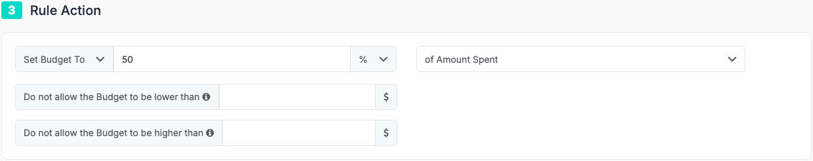
</Frame>

| Action | Description |
| --- | --- |
| **Set To** | Forces the budget or bid to an exact value — a fixed number or a percentage of another metric. |
| **Increase By** | Adds to the current value by a fixed amount or a percentage. Useful for incremental scaling. |
| **Decrease By** | Subtracts from the current value by a fixed amount or a percentage. Useful for gradually pulling back on underperformers. |

#### Budget Safety Rails: Floor & Ceiling

When using **Increase By** or **Decrease By**, you can set a minimum and maximum budget value to prevent the rule from adjusting beyond safe limits:

- **Min Budget (Floor)** — The rule will never reduce the budget below this value, even if the decrease amount would go lower.
- **Max Budget (Ceiling)** — The rule will never increase the budget above this value, even if the increase amount would go higher.

<Warning>
  Budget floors and ceilings are optional but strongly recommended for all scaling rules. Without them, a single rule execution can accidentally push a budget to an extreme value if something unexpected happens in your account.
</Warning>

### 3. Cloning Actions

Cloning rules automatically duplicate a campaign, adset, or ad when conditions are met. Two additional fields appear:

<Frame>
  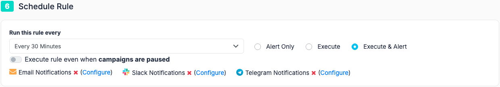
</Frame>

<Frame>
  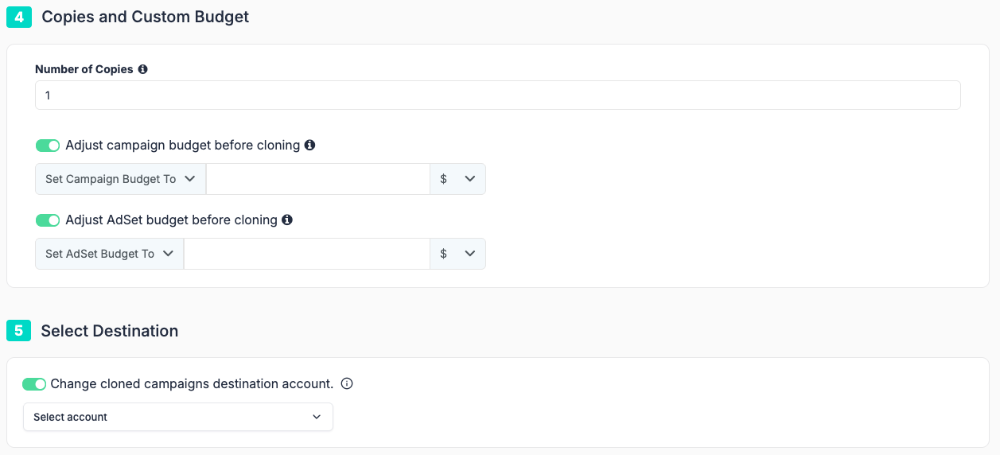
</Frame>

- **Number of Copies** — How many clones to create each time the rule fires.
- **Adjust budget before cloning** — Optionally set the budget on the cloned copy to a specific value at creation time, rather than inheriting the original's current budget.
- **Destination** — By default, clones land in the same campaign. Enable **Change Cloned Ad Destination** to redirect them to a specific adset, campaign, or a different ad account. For campaign cloning rules you can now select **multiple destination ad accounts** in a single rule, so one rule replicates a winning campaign across your whole portfolio instead of needing a separate rule per account.
- **Set start time** — For campaign cloning rules, choose when the cloned campaigns should start. Instead of going live the instant they're created, clones can be scheduled to begin at a specific time — useful for lining up automated launches with budget resets or peak-traffic hours.

### 4. Dayparting

Dayparting rules let you schedule exactly when a campaign runs.

<Note>
  Dayparting is only available at the **campaign level**. It cannot be applied to ads or adsets.
</Note>

The rule combines a grid (where you select hours and days) with an action:

| Action | Description |
| --- | --- |
| **Pause on selected hours, otherwise do nothing** | Pauses during selected hours only. Outside those hours, the campaign is left in its current state. |
| **Pause on selected hours, otherwise start** | The most commonly used option. Pauses during selected hours and actively ensures the campaign is running at all other times. |

<Tip>
  **Example:** Select all hours on Saturday and Sunday, then choose "Pause on selected hours, otherwise start." The campaign will automatically pause on Friday night and resume Monday morning — no manual intervention needed.
</Tip>

---

## 5. Scope and Filtering

Once the logic and action are defined, you control exactly which entities the rule monitors and acts on.

### Filtering: Include or Exclude Specific Items

The filter section lets you narrow or exclude specific items within your selected campaigns:

| Mode | Behavior |
| --- | --- |
| **Include** | Overrides the campaign selection scope. Even if you have 100 campaigns selected, the rule will only act on the specific items you list here. |
| **Exclude** | The rule applies to everything across all selected campaigns, _except_ the items you list. Use this to protect specific ads (e.g., those with "DO NOT TOUCH" in the name) while automating everything else. |

You can populate either list by searching for specific items manually, or by using bulk filtering to select all items matching a naming pattern at once.

### Select Campaigns

Every rule — regardless of whether it acts on ads, adsets, or campaigns — needs to know which campaigns it monitors. You choose them in **Where the rule runs** (see Section 2). The rule evaluates entities within those campaigns only.

- **Manual Selection** — Search for specific campaigns and check them one by one.
- **Smart Filtering** — Use the filter sidebar to auto-select all campaigns matching a naming pattern (e.g., all campaigns containing "US\_2026").

<Warning>
  **Specific campaigns: don't forget new campaigns.** A campaign not in this list is completely invisible to the rule. Every time you launch a new campaign under a Standard rule, you must come back and add it here. This is the key reason to choose **Whole ad accounts** for broad automations.
</Warning>

<Note>
  If the rule scope is **Whole ad accounts** (a Global rule), you select **Ad Accounts** instead of individual campaigns.
</Note>

---

## 6. Scheduling & Frequency

This setting controls how often TheOptimizer evaluates your conditions and potentially fires the rule.

<Frame>
  
</Frame>

| Frequency | Best For |
| --- | --- |
| **Every 10 min – Every 1 Hour** | Stop-loss rules where you need to react quickly to bad performance. |
| **As Soon as Conditions Are Met** | Time-sensitive actions. The system continuously checks and fires the moment all conditions become true. |
| **Once Daily / Daily at Specific Time** | Budget resets or full-day performance reviews. You can set the exact time (e.g., 8:00am UTC). |
| **Weekly** | Rules that only need to run once a week — e.g., reviewing and adjusting budgets every Monday morning. |

<Note>
  If your rule includes an **Hour of Day** condition, set the frequency to **Every 1 Hour**. Running it every 10 minutes is redundant — the rule won't act outside the specified hours regardless — and it clutters your execution logs.
</Note>

---

## 7. Notifications & Alerts

The final step controls whether the rule acts, notifies you, or both.

### Execution Modes

| Mode | Description |
| --- | --- |
| **Execute & Alert** | The rule makes the change **and** sends you a notification listing all items that triggered it. |
| **Execute Only** | The rule makes the change silently. No notification is sent. Use for well-established automations you trust completely. |
| **Alert Only** | Sends a notification but makes **no changes** whatsoever. The rule becomes a monitoring and alerting tool. |

<Tip>
  **Building a pure monitoring rule:** You can turn any rule type into a monitoring-only rule by selecting **Alert Only**. The rule type itself doesn't matter — what matters is the level (campaign, ad, adset) and the conditions. Create a **Pause or Activate** rule, define your conditions, set it to **Alert Only**, and you'll be notified when matches occur without anything actually being paused.
</Tip>

### Notification Channels

Notifications can be sent via **Email**, **Slack**, or **Telegram**. You can configure multiple accounts for each — for example, alert multiple Slack channels or multiple team members by email simultaneously.

To configure channels, go to **Profile icon → Settings → Notifications** tab. Channels must be set up there before they can be selected inside a rule.

### Run on Paused Campaigns

By default, rules only evaluate entities within **active** campaigns. Paused campaigns are completely invisible to the rule — this is intentional, as in most cases you don't want automations touching campaigns you've deliberately stopped.

Toggle **Run on Paused Campaigns** to **ON** only when you specifically need a rule to monitor paused entities — for example, a rule that reactivates an ad if late conversions arrive after it was paused.