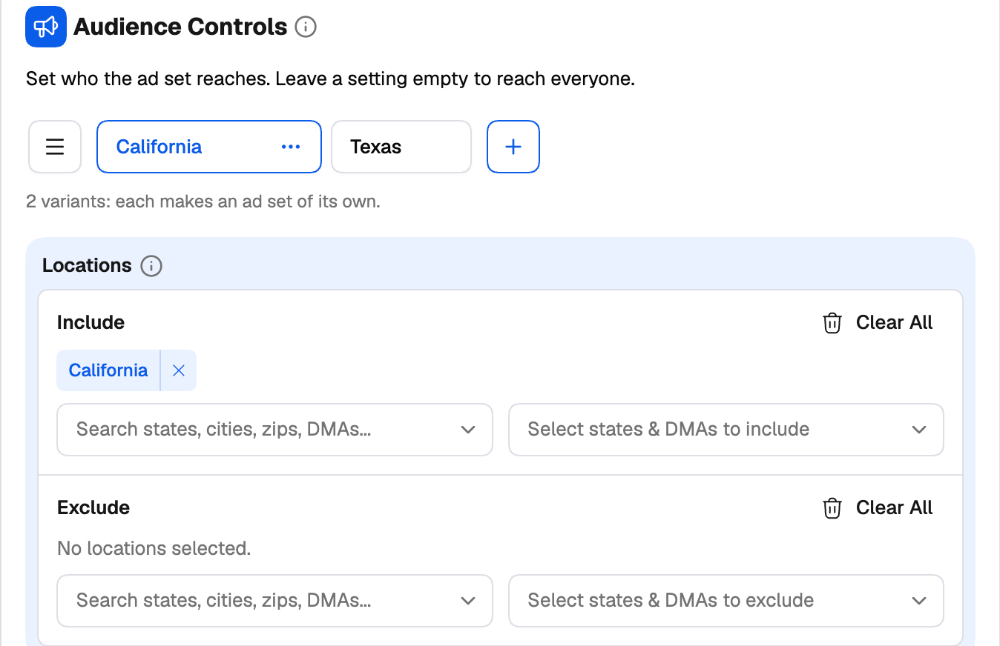
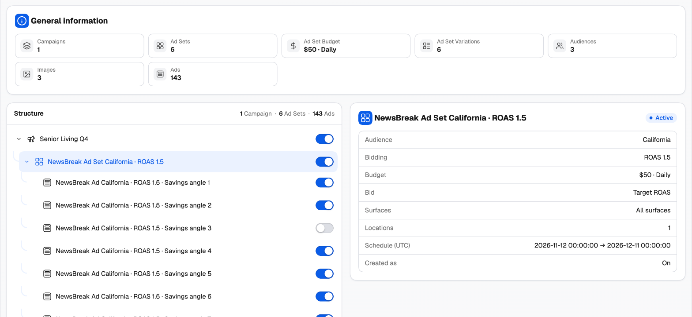

Groups are the heart of TheOptimizer's Campaign Creator, and the main reason it's faster than any native ad manager.

In a native ad manager, testing three audiences against two budgets means building six ad sets (or campaigns) by hand, one field at a time. In TheOptimizer you set up **one** campaign, add three audience groups and two budget groups, and the creator generates all six for you — named, structured and ready to publish.

<Frame>
  
</Frame>

---

## How a group works

Some settings cards have a row of **group tabs** at the top: **Audience 1**, **Budget 1**, **Budget Group 1**, **Audience Group 1**, and so on. Each tab holds its own values for that card — its own locations, its own budget, its own bid.

- **Add a group** with **+** next to the tabs. The new group starts as a copy of the one you're on, so you only change what's different.
- **Switch groups** by clicking a tab. The card's fields show that group's values.
- **Rename** a group by double-clicking its tab, or from its **⋯** menu. Give groups names that mean something — *US 18-34*, *Budget $50*, *Desktop only* — because group names flow into your [naming templates](/campaign-creator/naming-templates) and into the names of everything that's generated.
- **Clone** or **Delete** a group from its **⋯** menu.
- **Manage groups** with the **☰** button next to the tabs (it's enabled once there are two or more). The manager lets you search, drag to reorder, and select several groups to clone, rename (add a prefix or suffix) or delete them in one go.

A tab with an error in it is marked, so you can find a problem in a group you're not looking at.

---

## How combinations multiply

Groups on the same level multiply. Each **combination** of groups becomes its own item:

> 3 audience groups × 2 budget groups = **6** ad groups (or campaigns, depending on the network)

Creatives multiply ads in the same way. On every network the creator can turn each image or video — and on some, each headline — into its own ad.

<Warning>
  Combinations grow fast: three groups in each of three cards is 27 items. Check the counts (below) before you move on.
</Warning>

### Keeping track of what you're about to create

- **×N badges** in the tree show how many of each item the launch will create (Facebook, TikTok and Taboola).
- **General overview** on the right counts campaigns, ad sets/ad groups, ads and creatives as you go.
- **Variation Preview** lists the combinations of the level you're on. Switch one off and it isn't created.
- **Review Variations** — the second step of every guided creator — shows the full tree of what will be created, with a switch on every row. Leave out any combination you don't want.

<Frame>
  
</Frame>

---

## What you can group, network by network

<Tabs>
  <Tab title="Facebook">
    Facebook has the most complete group system: Budget, Audience, Placement, Identity and Creative groups, plus **Campaign Restructuring** to decide which groups become separate campaigns or ad sets.

    See [Generate campaign variations](/ad-networks/facebook/campaign-uploader/variations).
  </Tab>
  <Tab title="TikTok">
    | Level | Groups | Each combination makes |
    | --- | --- | --- |
    | Campaign | **Budget** (with a campaign budget, CBO) | A campaign |
    | Ad group | **Budget**, **Audience**, **Placement** | An ad group — or, with **A campaign for each** switched on, a campaign |
    | Ads | **Ad copy**, **Destination** | Separate ads (Manual) or a separate ad group (Smart+, which runs one ad per ad group) |

    Creatives: **One ad per creative** turns every video or image into its own ad.

    See [TikTok variations](/ad-networks/tiktok/campaign-uploader/variations).
  </Tab>
  <Tab title="Taboola">
    | Card | Groups | What each group holds |
    | --- | --- | --- |
    | **Budget and bidding** | **Budget Group 1, 2…** | Bid strategy and CPC or target CPA, conversions, budget type and amount, spending limit, ad delivery, SpendGuard |
    | **Audience Controls** | **Audience Group 1, 2…** | Locations, marketplace audiences, lookalike and custom audiences |
    | **Campaign targeting** | **Targeting Group 1, 2…** | Devices, connection, operating systems, browsers, supply, site exclusion, brand safety |
    | **Ad creative** | **Creative Group 1, 2…** | Format, media, headlines, descriptions, call to action |
    | **Click-through and delivery** | **Click-through Group 1, 2…** | Landing page and flight dates |

    Every budget × audience × targeting group combination becomes **its own campaign**. For example, three audience groups for the US, the UK and Australia, with one budget and one targeting group, give three campaigns — one per country.

    Every creative group × click-through group makes **its own ads** in the same campaign — and inside each, every image or video runs with every headline.

    See [Taboola variations](/ad-networks/taboola/campaign-uploader/variations-and-publish).
  </Tab>
  <Tab title="NewsBreak">
    | Level | Groups | Each combination makes |
    | --- | --- | --- |
    | Ad set | **Budget**, **Audience**, **Bidding**, **Placement** | An ad set, inside the same campaign |
    | Ads | **Creative**, **Destination** | Separate ads in the ad set |

    Creatives: every creative runs with every headline and description, and each combination is its own ad.

    See [NewsBreak variations](/ad-networks/newsbreak/campaign-uploader/variations-and-publish).
  </Tab>
</Tabs>

---

## A worked example

You're launching a new offer on Taboola and want to test three countries at two bid levels:

<Steps>
  <Step title="Build one campaign">
    Set up the campaign once: objective, schedule, tracking, devices, and the ads.
  </Step>
  <Step title="Add audience groups">
    In **Audience Controls**, rename **Audience Group 1** to *US* and target the United States. Click **+** twice, rename the copies *UK* and *AU*, and change only their country.
  </Step>
  <Step title="Add budget groups">
    In **Budget and bidding**, rename **Budget Group 1** to *CPC 0.30*, click **+**, rename the copy *CPC 0.45* and raise its CPC.
  </Step>
  <Step title="Check the count">
    The tree and the overview now show **6 campaigns**: *US / UK / AU* × *CPC 0.30 / CPC 0.45*, each named after its groups.
  </Step>
  <Step title="Review and publish">
    On **Review**, switch off any combination you don't want, attach your rules, and publish. All six are created in one launch.
  </Step>
</Steps>

Doing the same in Realize means creating six campaigns by hand and keeping their settings in sync yourself.
