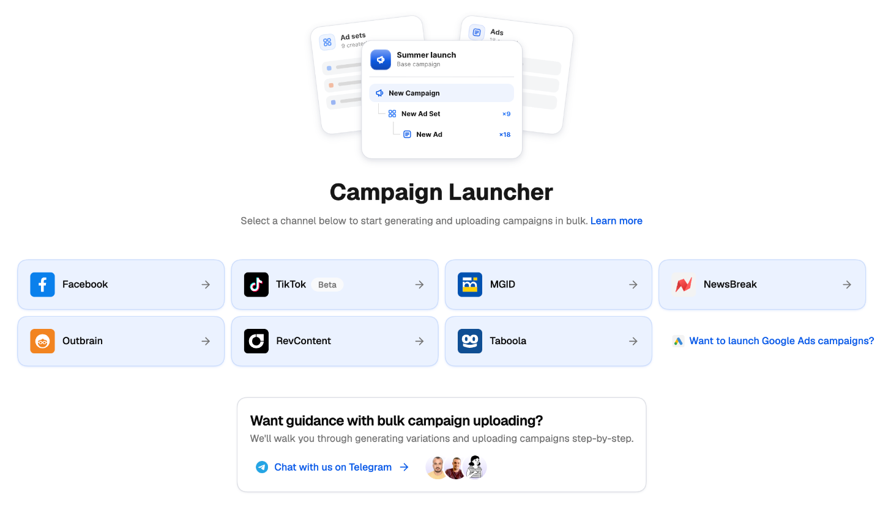
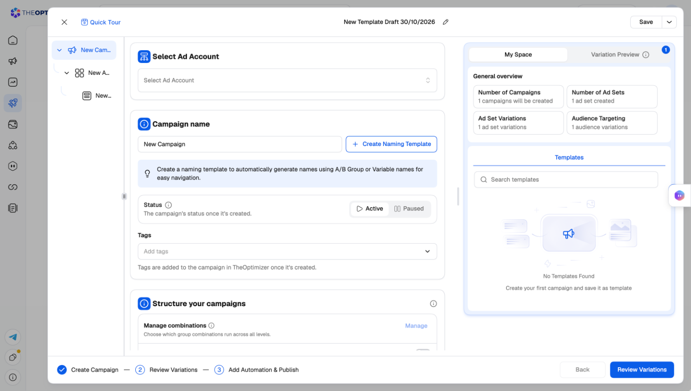

import { ArcadePopoutModal } from '/snippets/arcade-popout-modal.mdx';

import { ArcadeVideoButton } from '/snippets/arcade-video-button.mdx';

The Campaign Creator lets you build and launch campaigns on your connected ad networks directly from TheOptimizer — without switching to each native ad manager. Configure targeting, set bids and budgets, upload creatives from a shared media library, and launch everything in one place. This page covers how Campaign Creator is structured, which networks and creation methods are supported, and how the Campaign Creation Queue and Creative Library fit into your workflow.

## Why Use Campaign Creator

You can already create campaigns directly inside each ad network, so why use TheOptimizer's Campaign Creator? Three reasons:

**Everything in one place.** You already use TheOptimizer for campaign management, automation, and optimisation. Having campaign creation here too means you never need to jump between the ad network for launching and TheOptimizer for everything else. One tool, one workflow.

**Mass campaign creation.** Every ad network has a limit on how quickly you can set up campaigns through its native interface. TheOptimizer removes that limit. You can launch 100 campaigns in just a few minutes — something no ad network allows you to do natively. Whether through the interactive interface or the Excel uploader, bulk creation is built into every traffic source we support.

**Speed.** TheOptimizer's campaign creation UI is built with speed in mind. Since we use each network's API rather than replicating their front-end flow, every step — from uploading images and videos to navigating between options — is noticeably faster than doing it in the native dashboard.

---

## What makes TheOptimizer's Campaign Creator different

Native ad managers are built to create **one** campaign at a time: you fill in a campaign, then an ad set or ad group, then an ad — and to test five audiences against three budgets, you repeat that fifteen times. TheOptimizer's guided creators (Facebook, TikTok, Taboola and NewsBreak) are built around a different idea: **you describe the variations once, and the creator builds every combination for you.** The same building blocks work the same way on every network.

<CardGroup cols={2}>
  <Card title="Groups generate your variations" icon="layer-group" href="/campaign-creator/groups-and-variations">
    Add several budgets, audiences, placements, bids or destinations to one setting. Every combination becomes its own campaign, ad set/ad group or ad — no copy-pasting, no rebuilding.
  </Card>
  <Card title="Naming templates on every level" icon="tag" href="/campaign-creator/naming-templates">
    Build structured names from parts — date, objective, country, group name, creative number — so hundreds of generated items stay readable in TheOptimizer and in the ad network.
  </Card>
  <Card title="Taboola campaign groups in one go" icon="folder-tree" href="/ad-networks/taboola/campaign-uploader/campaign-groups">
    Create the campaign group, its goal and shared budget, and all of its campaigns and ads in a single launch. In Realize you create the group first and the campaigns afterwards.
  </Card>
  <Card title="Review every combination before it goes live" icon="list-check">
    **Review Variations** shows the full tree of what will be created. Switch off any combination you don't want — it simply isn't created.
  </Card>
  <Card title="Templates and drafts" icon="bookmark">
    Save a whole setup — structure, groups, naming and rules — as a template, and reapply it next time. Your work in progress is kept as a draft you can resume.
  </Card>
  <Card title="Automation from the first impression" icon="robot">
    Attach your automation rules in the last step, so every new campaign is protected by your stop-loss and scaling rules the moment it's created.
  </Card>
</CardGroup>

Other helpers vary by network, for example:

- **Create what you need without leaving the creator** — new Taboola conversions and first-party customer audiences are created inline.
- **Checks that catch rejections before they happen** — headline capitalization and image crops on Taboola, minimum bids on NewsBreak, missing click IDs in tracking parameters.
- **Copy, paste and duplicate** campaigns, ad sets/ad groups and ads across the tree, and **load existing campaigns** to add new ad sets or ads to them (Facebook and TikTok).
- **Reuse your recent settings** — apply a previous ad group's targeting or a previous ad's creatives in one click (Facebook and TikTok).

---

## How to Access Campaign Creator

**Campaign Creator** is accessible from the **left-hand navigation menu**. Click **Campaign Creator** to open the **Campaign Launcher**, which shows a card for each ad network you can launch campaigns on.

<Frame>
  
</Frame>

Click a card and the creator opens in a **side sheet** over the page. The sheet holds the whole flow — the campaign / ad set / ad tree on the left, the settings in the middle, **My Space** and **Variation Preview** on the right, and the three steps (**Create Campaign**, **Review Variations**, **Add Automation & Publish**) along the bottom. Click **Quick Tour** at the top for a guided walkthrough, and the **×** to close the sheet.

<Frame>
  
</Frame>

If you have a connected ad network the launcher doesn't build for yet, a **Want to launch … campaigns?** link appears next to the cards so you can tell us you'd like it.

Once you've launched campaigns, the same page lists your launches and their statuses — the **Campaign Creation Queue** described below.

---

## Supported Ad Networks & Creation Methods

TheOptimizer supports campaign creation for **Facebook**, **TikTok** (Beta), **NewsBreak** (Beta), **Taboola**, **Outbrain**, **RevContent**, **MGID**, and **AdsKeeper**.

Depending on the traffic source, campaigns can be created through one or both of the following methods:

**Interactive interface (Create Manually)** — when a network offers both methods, clicking its card asks you to choose **Create Manually** (the guided creator) or **Bulk Upload (Excel)**. The guided creator is a step-by-step launcher where you configure campaign settings and upload creatives through a familiar UI. For each ad network, the interface mirrors the flow you already know from that network's native dashboard, but with added helpers and options that make the whole process more efficient. You do not need to learn anything new — the navigation and options will feel familiar, just faster.

**Excel uploader** — a bulk campaign creation tool. You fill in a Google Sheets template with your campaign data (one row per ad), export it to Excel, and upload it. TheOptimizer processes the file and pushes all campaigns to the ad network in one go.

| Traffic Source | Interactive Interface | Excel Uploader |
|---|---|---|
| Facebook | ✅ | — |
| [TikTok](/ad-networks/tiktok/campaign-uploader/getting-started) (Beta) | ✅ | — |
| [Taboola](/ad-networks/taboola/campaign-uploader/campaign-launcher) | ✅ | ✅ |
| [NewsBreak](/ad-networks/newsbreak/campaign-uploader/campaign-launcher) (Beta) | ✅ | ✅ |
| Outbrain | ✅ | ✅ |
| RevContent | ✅ | ✅ |
| MGID | ✅ | ✅ |
| AdsKeeper | ✅ | ✅ |

### Why Two Options for Native Ad Networks?

For Taboola, NewsBreak, Outbrain, RevContent, MGID, and AdsKeeper, both creation methods are available because they serve different needs:

- **The Excel uploader enables automation.** Teams with technical resources can generate the Excel file programmatically and push it to TheOptimizer via the API — automating the entire campaign launch pipeline end-to-end without any manual steps.
- **The Excel uploader is reusable.** Once you build your first Google Sheets template, you will likely reuse it over and over with minor changes — new creatives, adjusted budgets, or updated targeting. Think of it as a living template. The first time takes some effort, but every subsequent launch is just a matter of updating a few columns and re-uploading.
- **The interactive interface is the visual, guided path.** It validates every field as you go and adds helpers the spreadsheet can't. On **Taboola** and **NewsBreak** the guided creator is a bulk tool too: [Groups](/campaign-creator/groups-and-variations) turn one setup into many campaigns, ad sets and ads, so you only need Excel when you want to generate files programmatically or reuse a sheet you already maintain.

### Excel Uploader — How It Works

The workflow is the same across all native ad networks:

<Steps>
  <Step title="Clone the template">
    Clone the TheOptimizer Google Sheets template for your traffic source into your own Google account. Every column header has a hover note explaining what the field expects, valid values, and the required format. The template also includes auxiliary sheets with reference data — countries, regions, browsers, timezones, traffic types — to help you look up valid values.
  </Step>
  <Step title="Fill in your campaign data">
    Each row represents one ad. To create a campaign with multiple ads, use one row per ad and keep all campaign-level columns identical across those rows.
  </Step>
  <Step title="Export to Excel">
    In Google Sheets, go to **File → Download → Microsoft Excel (.xlsx)**.
  </Step>
  <Step title="Upload in TheOptimizer">
    Go to **Campaign Creator**, select your traffic source, and upload the file.
  </Step>
  <Step title="Monitor progress">
    Track the status of your submission in the **Campaign Creation Queue** and watch for email notifications.
  </Step>
</Steps>

<Tip>
  Once you create your first Google Sheets template, you will reuse it over and over. The next time you launch, you are most likely just going to change some targeting options, update budgets, or swap in new creatives and headlines — not rebuild from scratch.
</Tip>

---

## The Campaign Creation Queue

Every campaign created through TheOptimizer — whether through the interactive interface or via Excel — is processed asynchronously through the **Campaign Creation Queue**. Campaigns are not launched instantly; they are queued and submitted to the traffic source in order.

Access the Queue from the **Campaign Creator** main page by clicking **See full list** at the bottom. This opens a panel showing the full list of jobs with the following details:

| Column | What it shows |
|---|---|
| **Date** | When the action was submitted |
| **Ad Account** | Which ad account the campaigns are being created in |
| **Campaign Name** | The name of the campaign or upload batch |
| **Action** | The type of operation: Campaign Creation, Campaign Editing, Campaign Clone, or Excel Upload |
| **Status** | Completed, Failed, or Partially Completed |
| **Description** | For failed or partial items, additional detail about what went wrong |

### Filtering and Searching

You can filter the Queue by **status** (Completed, Failed, Partially Completed) or by **action type** (Creation, Clone, Editing, Excel Upload). A search bar lets you locate a specific submission by name.

### Handling Errors

If a submission fails or partially completes, two options are available:

**Retry button** — available on failed and partially completed items. Use this when the failure was caused by a transient issue (network error, temporary API error from the ad network, ad network temporarily overloaded). A retry resubmits the same data.

**Details button** — click to see exactly which items within the campaign caused the error. For example, a campaign with five ad sets and ten ads might have succeeded for all ad sets but failed on two specific ads. The details view shows you precisely which items failed and why.

<Warning>
  If any single item within a campaign submission fails — even one ad out of fifty — TheOptimizer marks the **entire operation as failed** and does not create a partial campaign. This is by design: it prevents incomplete campaigns from being pushed to the ad network with missing ads or ad sets you intended to include. Use the **Retry** button for transient failures, or check **Details** to identify which specific item caused the issue.
</Warning>

### Email Notifications

For campaign creation via Excel and campaign cloning operations, TheOptimizer sends email notifications to the address configured in your account settings:

- **Success email** — confirms the operation completed and lists how many campaigns were created successfully.
- **Error email** — details which items failed and why. For Excel uploads specifically, the error email includes a copy of your Excel file with all problematic cells highlighted so you can correct and re-upload.

<Tip>
  Monitor both the Queue and your email. The Queue gives you real-time status; the email gives you a permanent record — especially useful for Excel uploads where the highlighted error file tells you exactly which cells to fix.
</Tip>

---

## Creative Library Integration

The Campaign Creator works hand-in-hand with TheOptimizer's **Creative Library** — a centralised collection of every creative (images, videos, headlines, text) currently running across all your active campaigns and connected ad accounts.

When using the **Excel uploader**, instead of specifying each creative individually (image URL, headline, call to action), you can reference one or more **Creative Library tags** in your file. When TheOptimizer processes the upload, it pulls in all creatives tagged with that label and generates the corresponding ads automatically. This is cleaner, faster, and eliminates the risk of copy-paste errors in image URLs and headlines.

For teams with separate creative and media buying functions, the recommended workflow is:

1. Your creative team uploads and tags assets in the **Creative Library**.
2. Your media buying team references those tags in the **Campaign Creator** — through the interactive interface or the Excel uploader.

This keeps the process clean and ensures everyone works from the same organised asset library. The Campaign Creator combined with the Creative Library lowers human error, saves time, and removes the campaign creation bottleneck — scaling becomes limited only by how much you can spend or how many creatives you have to test.

<Note>
  The Creative Library is covered in its own help article. In short, it collects all creatives from your active campaigns across all connected accounts, lets you browse and tag them, and makes them available inside both the interactive launcher and the Excel uploader.
</Note>
