The Dashboard is where you answer the questions you ask every morning: did yesterday work, what should I scale, what should I kill, and what do I send the client.

Instead of a fixed reporting screen, you build your own boards. A dashboard is a grid of widgets that you arrange yourself — drag them, drop them, resize them. Each widget carries its own metric and its own ad network, so one board can hold a Facebook top-5 next to a Taboola funnel next to a spend KPI covering everything.

<Frame>
  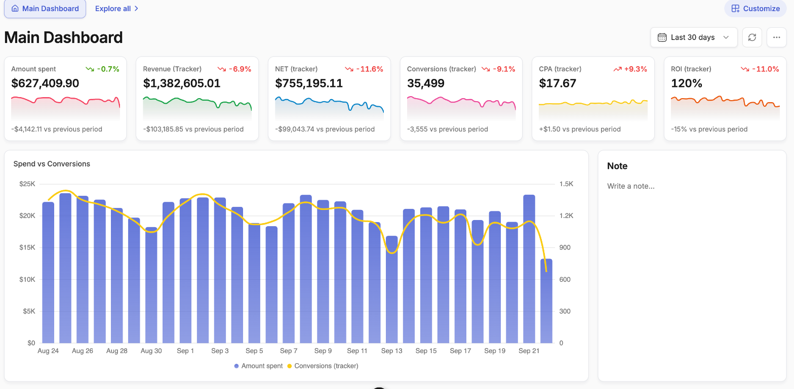
</Frame>

Dashboards are saved to your account, not to your browser, so they follow you to any machine you log in from.

---

## Working with multiple dashboards

Your dashboards appear as tabs along the top of the page. **Explore all** opens the Boards page, which lists every dashboard you have with its badges — **Pinned**, **Default**, **Permanent**.

<Frame>
  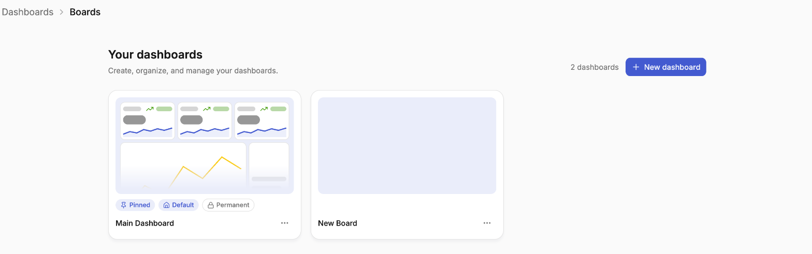
</Frame>

The **⋯** menu — on the board itself, or on any card in that list — holds the board-level actions:

<Frame>
  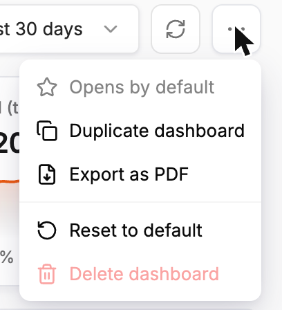
</Frame>

- **Set as default** — the board that opens when you land on the page. On the board that already is, it reads *Opens by default*
- **Duplicate dashboard** — copy a board and adapt it, instead of rebuilding from scratch
- **Export as PDF** — see [Exporting as PDF](#exporting-as-pdf) below
- **Reset to default** — return the board to the layout it started from
- **Delete dashboard** — remove a board you no longer use

To rename a board, click **Customize** and edit the title in place, then **Save**.

<Tip>
  A common setup is one detailed internal board plus a stripped-down duplicate per client, containing only the widgets that client should see. Duplicate the internal board, remove what's not relevant, rename it, and export that one as a PDF.
</Tip>

---

## Starting a new board

Click **+ New dashboard** on the Boards page — or **+** next to the dashboard tabs — to create a board. The **Build your dashboard** screen gives you three ways to start: describe the board to Jade, pick a template, or start from an empty board.

<Frame>
  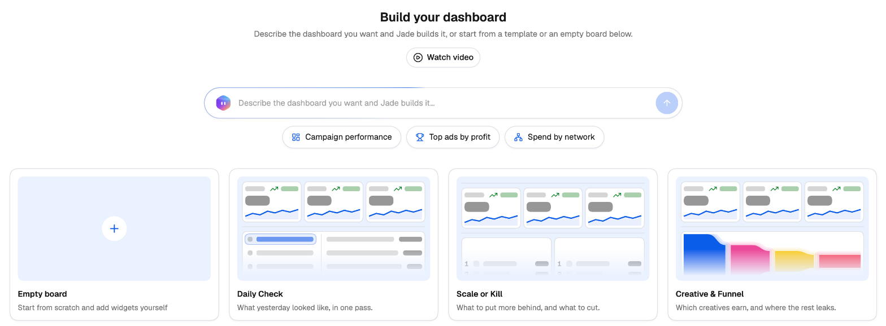
</Frame>

| Template | Built for |
| --- | --- |
| **Daily Check** | What yesterday looked like, in one pass |
| **Scale or Kill** | What to put more behind, and what to cut |
| **Creative & Funnel** | Which creatives earn, and where the rest leaks |
| **Empty board** | Build entirely from scratch |

Templates are a starting point, not a constraint — every widget on them can be edited, moved or removed.

---

## Building a board with Jade

Instead of assembling widgets yourself, describe the board you want and [Jade](/jade/overview) builds it.

<Steps>
  <Step title="Describe the board">
    On the **Build your dashboard** screen, type what you want in the box — for example, *"A morning board for Facebook and TikTok: spend, revenue and ROI against the previous period, ROI by hour of day, and my top 5 ads by profit side by side"* — or click one of the suggestions under it (**Campaign performance**, **Top ads by profit**, **Spend by network**).
  </Step>
  <Step title="Review the preview">
    Jade builds the board and shows it as a preview. Click **Use this board** to keep it, or **Pick another** to go back and try a different description or a template.
  </Step>
</Steps>

Jade picks the widgets that fit what you asked for — KPIs compared with the previous period, heatmaps, funnels, top ads side by side, breakdowns and more — and fills in their metrics, ad networks and date ranges.

You can also ask for a board from any Jade chat, for example *"Build me a dashboard for my Taboola campaigns"*.

### Changing a board with Jade

While you're customizing a board, a prompt bar sits at the bottom of the page. Type what you want changed — *"add a funnel from clicks to conversions"*, *"swap the donut for spend by ad account"*, *"rebuild this for TikTok only"* — and Jade adds, changes or rebuilds widgets for you. The **+** button next to it opens the widget panel if you'd rather add a widget yourself.

<Frame>
  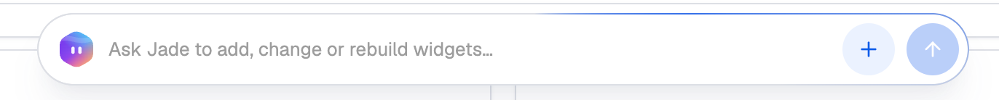
</Frame>

Click **Save** to keep the changes, or **Cancel** to put the board back the way it was.

---

## Building and editing a board

<Steps>
  <Step title="Enter edit mode">
    Click **Customize** on the dashboard you want to change. The header switches to *Customizing this board · Save to keep*.

    <Frame>
      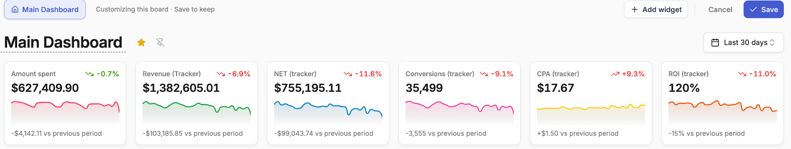
    </Frame>
  </Step>
  <Step title="Add widgets">
    Click **Add widget** to open the widget panel, then drag a widget onto the grid — or click one to place it and go straight into its options. See [Widget Types](/dashboard/widget-types) for what each one does.

    <Frame>
      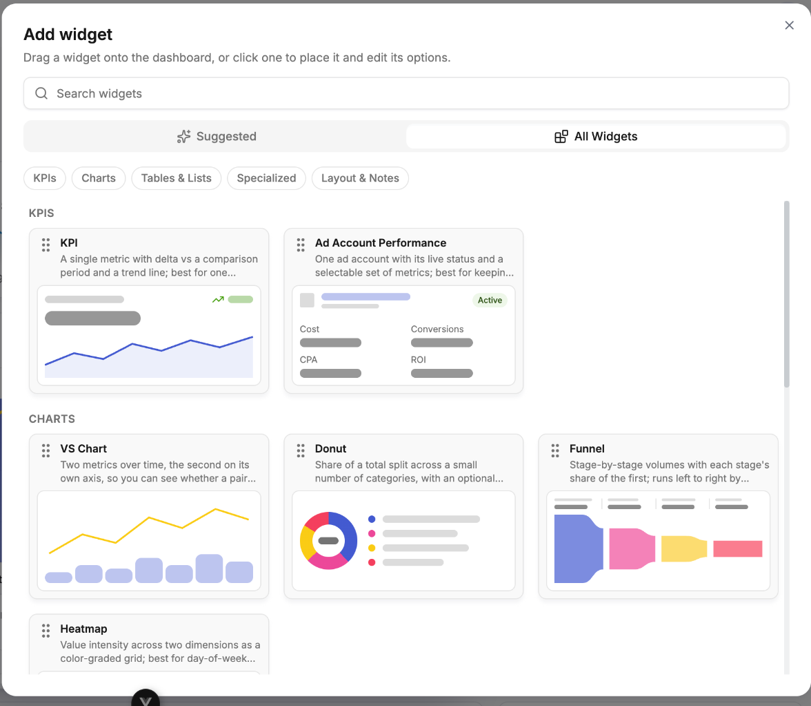
    </Frame>
  </Step>
  <Step title="Configure each widget">
    Set the title, the ad network, the metric and any widget-specific options. Each widget is configured independently.

    <Frame>
      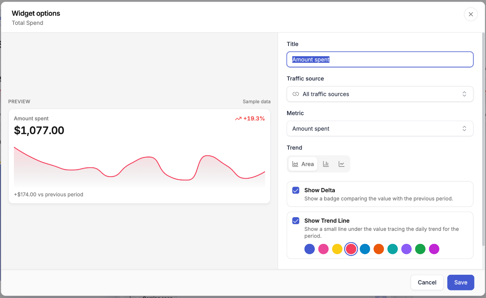
    </Frame>
  </Step>
  <Step title="Arrange the grid">
    Drag widgets to reposition them and drag their edges to resize. Hovering a widget also gives you **Edit**, duplicate and remove.

    <Frame>
      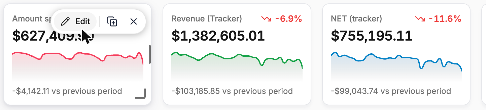
    </Frame>
  </Step>
  <Step title="Save or cancel">
    **Save** commits the whole edit. **Cancel** discards every change you made in this session, not just the last one.
  </Step>
</Steps>

<Note>
  Editing is transactional — save and cancel apply to the entire edit session. If you want to keep some changes and discard others, save first, then make the changes you're unsure about as a second edit.
</Note>

---

## Choosing metrics

The metric picker only offers metrics your **connected** ad networks actually report. The left rail groups them by where they come from — **Traffic Source** for the numbers the networks report themselves, **Tracker** for your tracking platform, **Custom** for your own formulas, plus a group per connected network.

<Frame>
  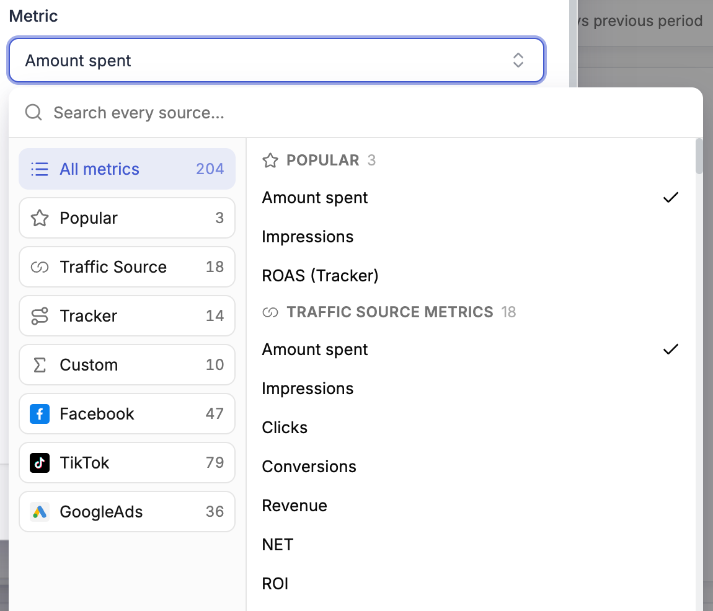
</Frame>

This means the picker never shows you a metric that would render as empty — if it's in the list, your account has data behind it. [Custom metrics](/campaign-manager/custom-metrics) you have defined appear here too.

---

## Per-widget ad network

Each widget can be pinned to a single ad network — Facebook, TikTok, Taboola, Outbrain and so on — or left across all of them. In the widget's options this is the **Traffic source** field; leave it on **All traffic sources** to report across everything.

<Frame>
  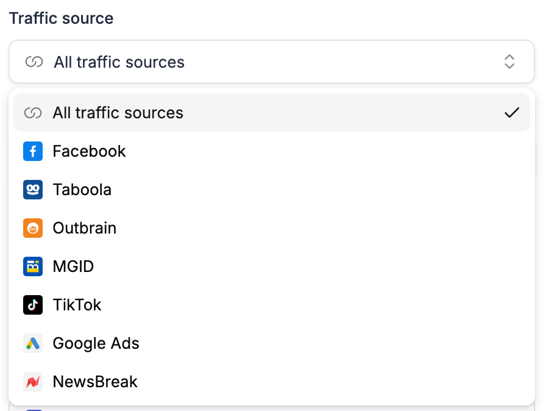
</Frame>

This matters more than it first appears. A Ranked List pinned to Facebook returns a genuine top 5 **of Facebook**. Without it you would get the global top 5, which may happen to contain some Facebook rows but is not the same question. Pin the widget when you want a per-network answer.

---

## Date range and comparison

The dashboard has one date range, set at board level and applied to every widget.

<Frame>
  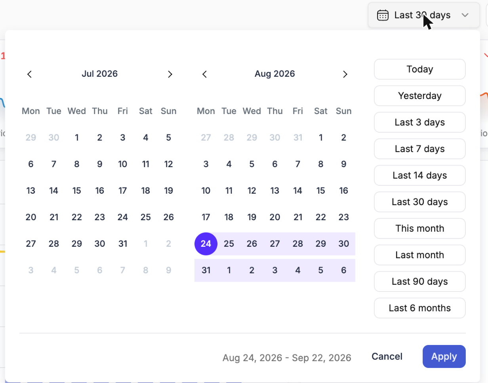
</Frame>

Each widget then displays its own delta against the equivalent stretch of time immediately before it — labelled *vs previous period* — so you can see at a glance which numbers moved and in which direction.

---

## Drilling down

Click a row inside a widget and that campaign opens in place, with its details, linked rules, performance chart and recent events — plus **Performance**, **Logs** and **Manage** tabs.

<Frame>
  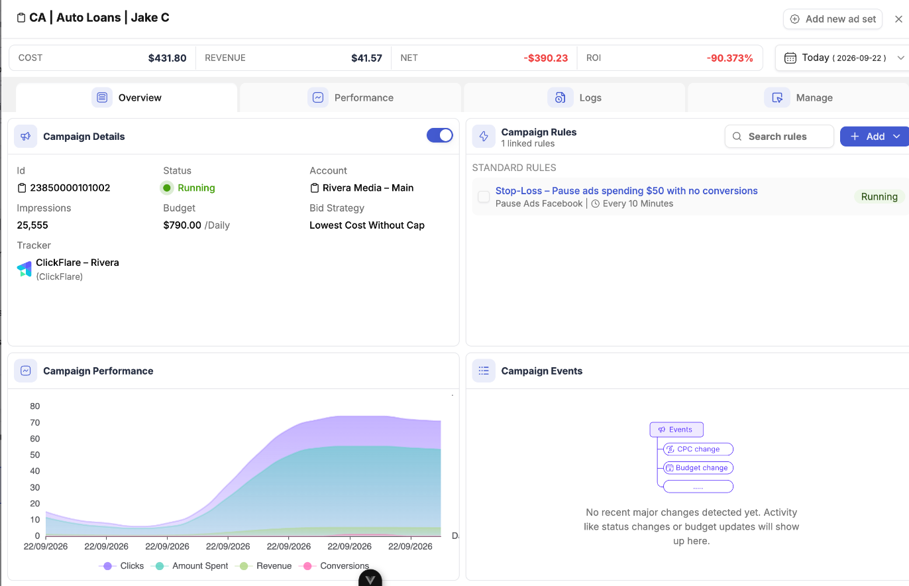
</Frame>

You never leave the dashboard to do it, which is what makes a scale-or-kill decision possible from the board itself rather than from the [Campaign Manager](/campaign-manager/overview).

To move between levels — ad network into its campaigns, an account into its ads — use the [Double Breakdown](/dashboard/widget-types#double-breakdown) widget, which shows one dimension nested inside another side by side.

---

## Filtering a widget

Open a widget's settings and use the **Filters** field to narrow it to exactly the data you need.

- **Find by category:** browse filters under Identifiers, Performance, Conversions and Other, or just start typing.
- **Live preview:** see how the widget looks as you set it up, before saving.

---

## Exporting as PDF

Export the entire board as a paginated PDF for clients and stakeholders from the **⋯** menu. The export reflects the board as configured — its widgets and its date range — so building a client board once replaces rebuilding the same report every month.

---

## Finding the right widget

The **Add widget** panel opens on **Suggested**, a shortlist of ready-made widgets for the questions most boards start with — total spend, net profit, ROI, top spenders, top converting campaigns. Switch to **All Widgets** for the full catalogue grouped by kind, or search by name.

---

## Next steps

<CardGroup cols={2}>
  <Card title="Widget Types" icon="shapes" href="/dashboard/widget-types">
    What each of the thirteen widget types shows and when to reach for it.
  </Card>
  <Card title="Custom Metrics" icon="calculator" href="/campaign-manager/custom-metrics">
    Define your own metric formulas and use them on any widget.
  </Card>
</CardGroup>
