Every dashboard is built from widgets. Each widget is configured independently: its own title, its own ad network, its own metric and its own display options. This page covers what each type does and when to reach for it.

All widgets respect the board-level date range, so each one shows its delta against the previous period.

<Frame>
  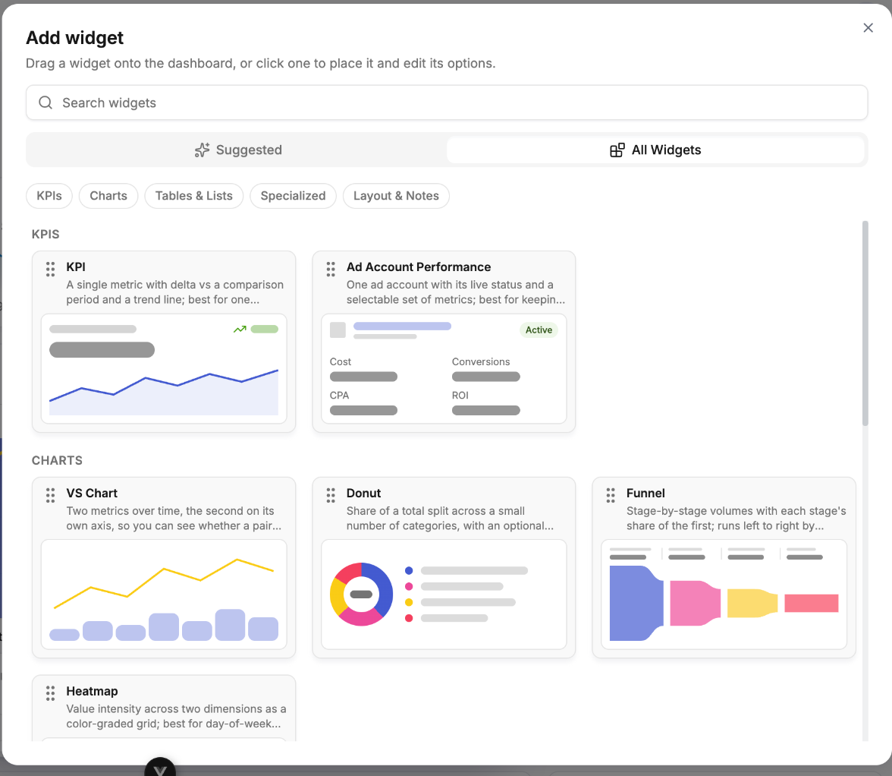
</Frame>

<Frame>
  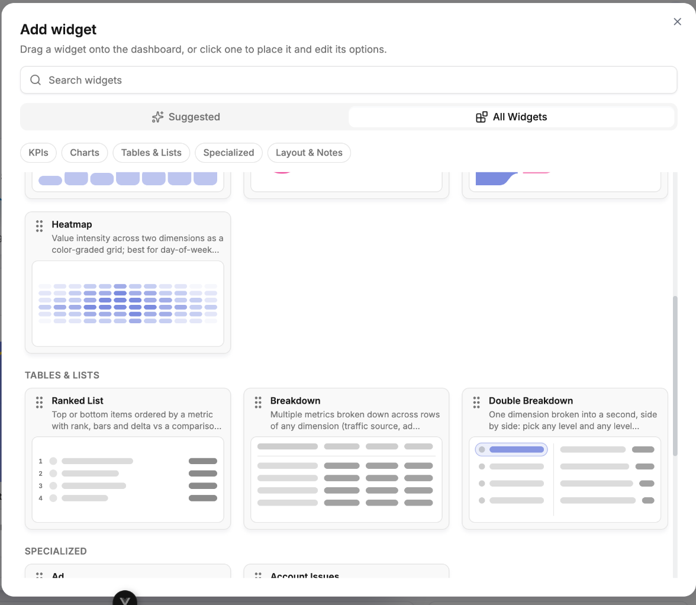
</Frame>

---

## KPIs

### KPI

One headline number with its delta and a trend line. Use it for the figures you want to read without interpreting anything — spend, revenue, ROI, profit.

<Frame>
  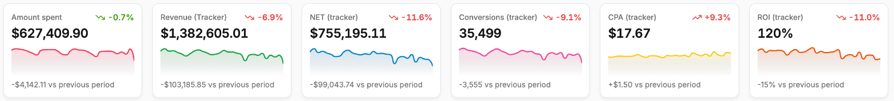
</Frame>

Best at: *"Is today on track?"*

### Ad Account Performance

A single ad account with its live status and a selectable set of metrics. The status is the point — it makes a billing or policy problem obvious before it costs you delivery.

<Frame>
  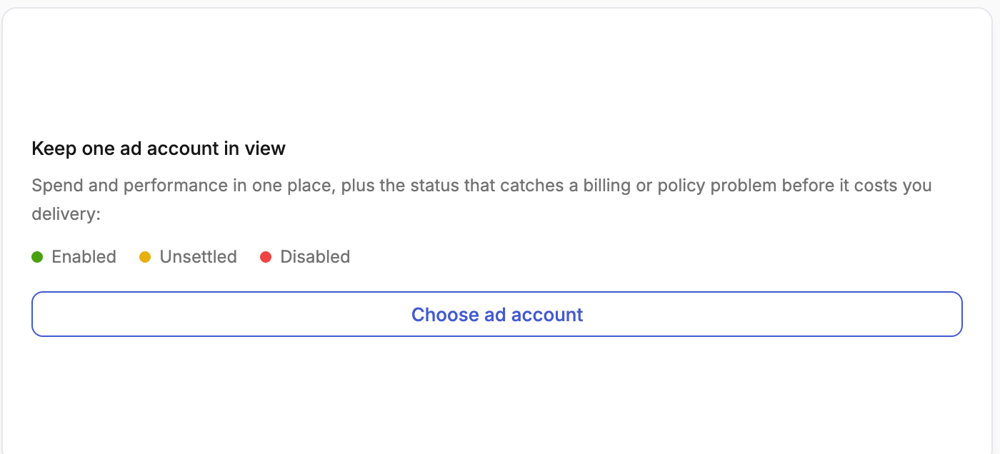
</Frame>

Best at: *"Is this specific account healthy right now?"*

---

## Charts

### VS Chart

Two or more metrics over time, the second on its own axis, so you can see whether a pair moves together or apart. Rendered as bar, stacked bar, stacked 100%, line, area or combo — use stacked variants when you care about composition over time, and combo when you want a rate plotted against a volume.

<Frame>
  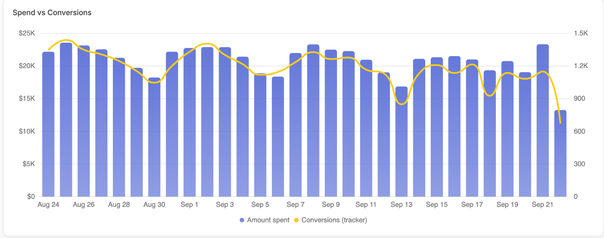
</Frame>

Best at: *"How has this moved over the period?"*

### Donut

Share of a total split across a small number of categories, with an optional centre total — spend or conversion share by channel, platform or campaign type.

<Frame>
  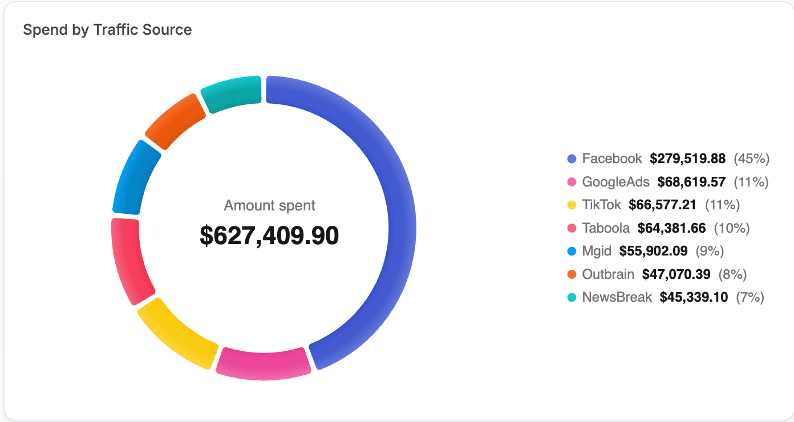
</Frame>

Best at: *"Where is the budget actually going?"*

### Funnel

Stage-by-stage volumes with each stage's share of the first — impressions → clicks → leads → sales. Runs left to right by default, or stacked top to bottom.

<Frame>
  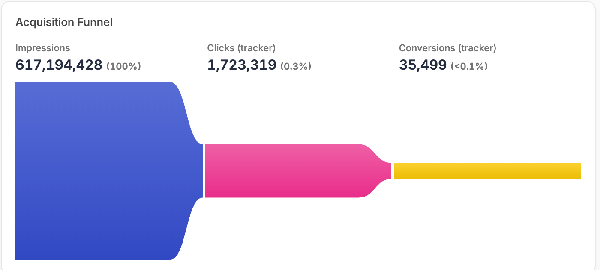
</Frame>

Best at: *"Which step is leaking?"*

### Heatmap

Value intensity across two dimensions as a colour-graded grid — day-of-week against hour-of-day, shaded by intensity.

<Frame>
  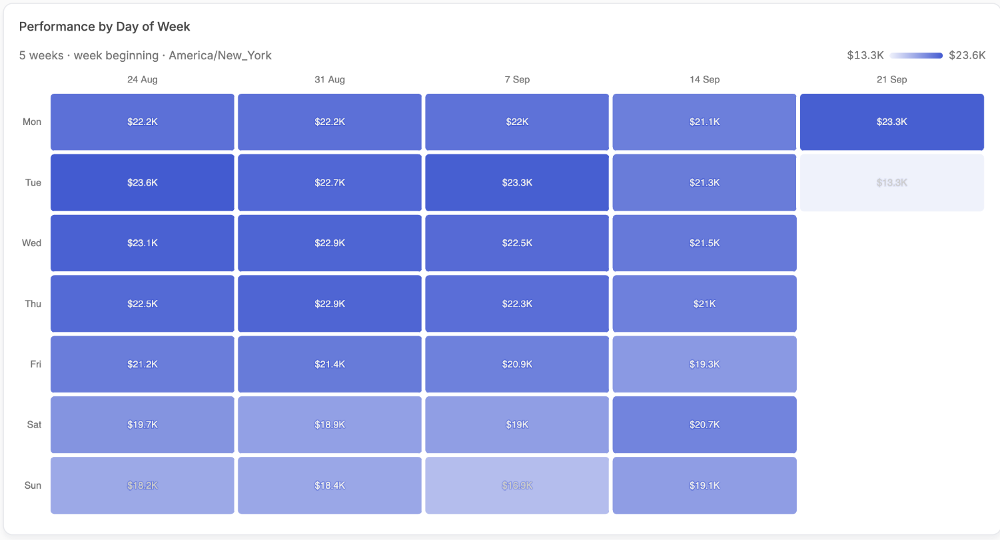
</Frame>

Best at: *"When do conversions actually happen?"* — this is the widget to build a dayparting decision on, because it uses your own curve rather than a rule of thumb.

---

## Tables & Lists

### Ranked List

Top or bottom N rows ordered by a metric, with ranks, inline bars and deltas, and optional further metrics per row.

<Frame>
  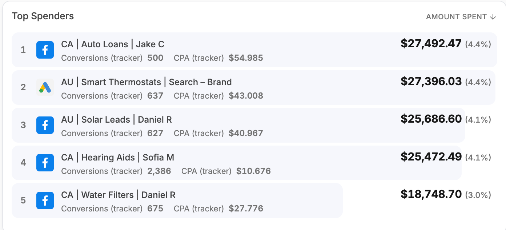
</Frame>

Best at: *"What should I scale, and what should I kill?"*

<Tip>
  Pin a Ranked List to a single ad network. A top 5 pinned to Facebook is a real top 5 of Facebook; unpinned, you get the global top 5 which may simply contain some Facebook rows.
</Tip>

The same widget works on ad accounts rather than campaigns — a quick read of where the money is concentrated:

<Frame>
  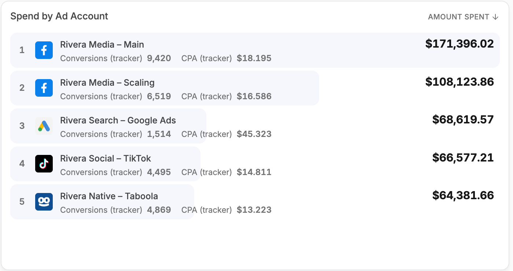
</Frame>

### Breakdown

Many metrics across rows of any dimension — ad network, ad account, campaign — displayed either as a list or as a sortable table with a totals row.

<Frame>
  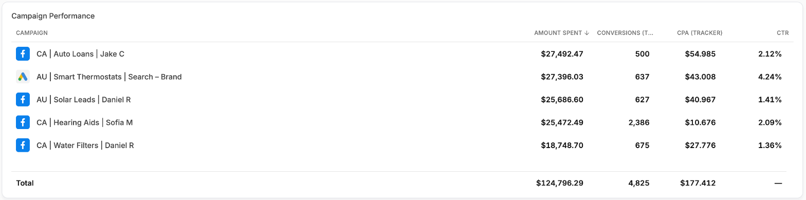
</Frame>

Best at: *"Show me everything about this dimension at once."* For a leaderboard shape with ranks and bars, use the Ranked List instead.

### Double Breakdown

One dimension broken into a second, side by side: pick any level and any level nested inside it — a network into its accounts, campaigns or ads, an account into its campaigns or ads, a campaign into its ads.

<Frame>
  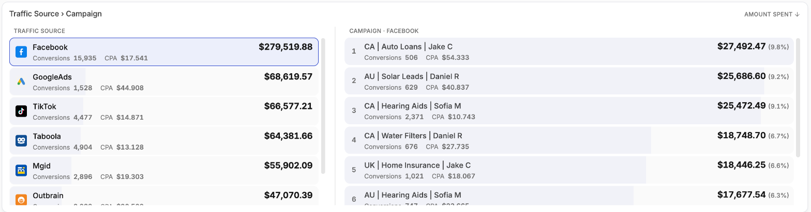
</Frame>

Best at: *"How does this split once I go a level deeper?"*

---

## Specialized

### Ad

The actual creative, drawn in its own platform's chrome — a Facebook post, a TikTok in-feed video, a Google result, a native recommendation — with its metrics alongside. It opens on the best ad by the metric it is sorted on and pages through the rest.

<Frame>
  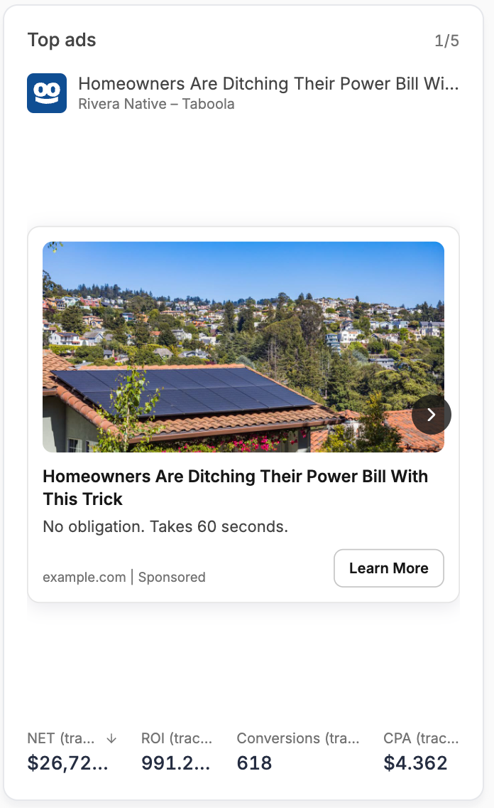
</Frame>

Best at: *"Which creative is carrying this, and what does it look like?"*

### Account Issues

Ad accounts flagged with issues by their own network, each with the network logo, account name and the reported problem. It shows an all-clear state when nothing needs attention.

<Frame>
  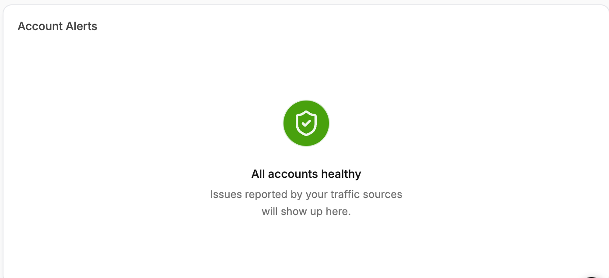
</Frame>

Best at: *"Is anything about to stop spending without telling me?"*

<Note>
  Account Issues reflects what the ad network itself reports. It complements, rather than replaces, the alerts covered in [Notifications](/account-settings/notifications).
</Note>

---

## Layout & Notes

### Text

A freeform block for notes, context or commentary, placed anywhere on the grid. Useful on client boards for explaining what a section means or flagging a known anomaly in the period.

<Frame>
  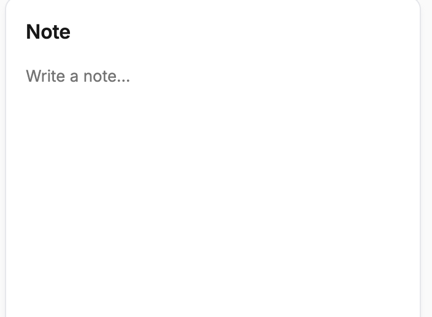
</Frame>

### Section Header

A titled divider that splits a long board into named, readable bands. Rename it in place once it is added.

---

## Choosing between similar widgets

| If you want to… | Use |
| --- | --- |
| Read one number fast | KPI |
| See a number change over time | VS Chart |
| Rank things against each other | Ranked List |
| See composition of a total | Donut |
| Compare many metrics on one dimension | Breakdown |
| Split one dimension by another | Double Breakdown |
| Find the time-of-day pattern | Heatmap |
| Find the drop-off step | Funnel |
| Judge a creative | Ad |
| Watch one account's health | Ad Account Performance |
