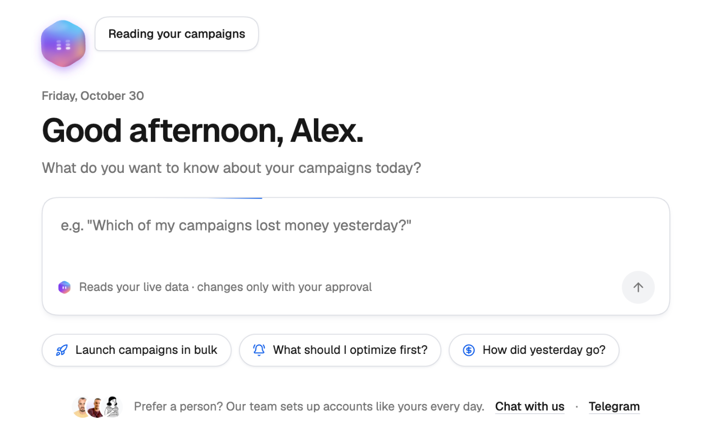
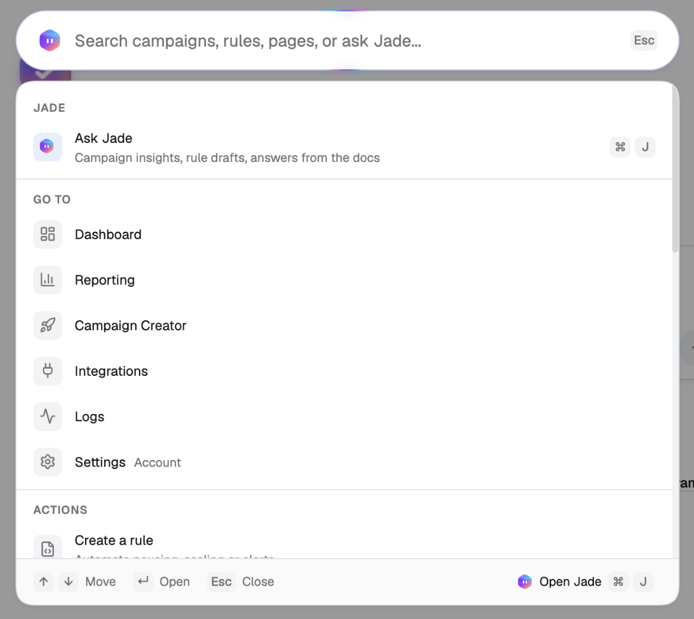
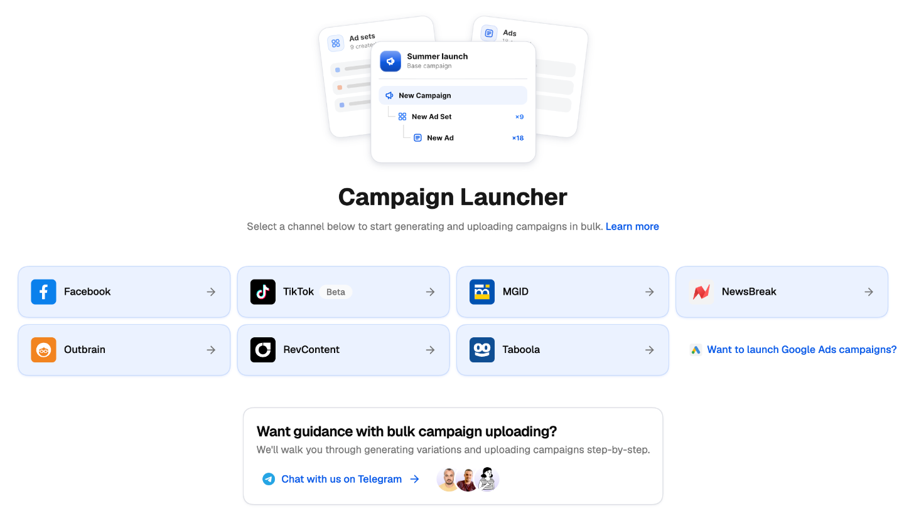
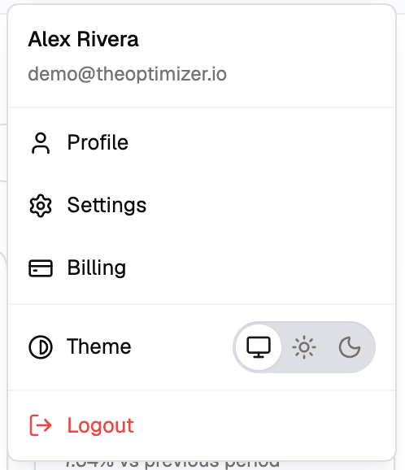
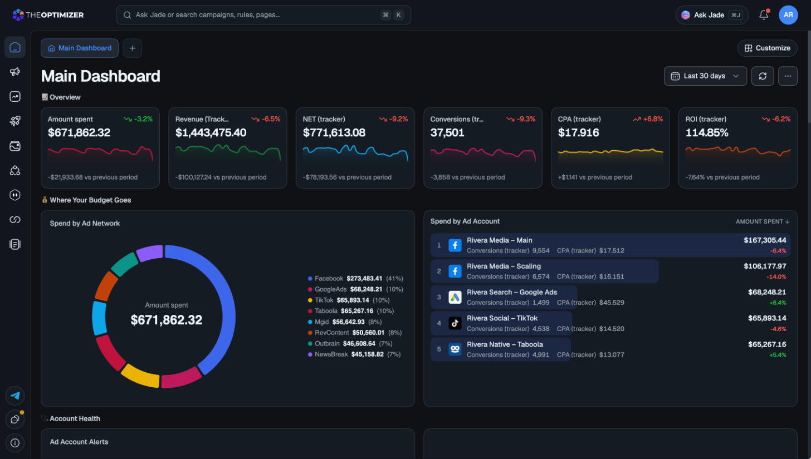

Every section of TheOptimizer shares the same layout: a navigation rail on the left, a top bar with search and **Ask Jade**, and the page itself. This page is a quick tour of the pieces you'll use everywhere.

---

## The Welcome page

After you sign up, you land on the **Welcome** page. It's built around [Jade](/jade/overview), your AI copilot: ask anything about your setup or your campaigns in the box, or start from one of the suggested questions under it — *What should I optimize first?*, *How did yesterday go?*, *Which ads lose money?* Jade reads your live data and changes nothing without your approval.

<Frame>
  
</Frame>

While your setup isn't finished, the Welcome page also shows your next milestones — connect your ad accounts, connect your tracker, create your first rule — and a **Welcome** item in the left navigation shows your progress. Prefer to talk to a person? Use **Chat with us** or **Telegram** at the bottom of the page.

---

## The left navigation

The rail on the left takes you to each section:

| Section | What it's for |
| --- | --- |
| **Dashboard** | Your boards of KPIs and charts. See [Dashboard](/dashboard/overview). |
| **Campaigns** | The Campaign Manager — every campaign, ad set and ad across your ad networks. |
| **Reporting** | Build, save and share reports. See [Reporting](/reports/overview). |
| **Campaign Creator** | Launch campaigns in bulk. See [Campaign Creator](/campaign-creator/overview). |
| **Creative Library** | Every image and video across your accounts. |
| **Automation** | Rules and Smart Lists. See the [Rules guide](/automation/rules-guide). |
| **Jade** | Your chats with Jade, plus **Scheduled** tasks and **Explore** ideas. See [Jade](/jade/overview). |
| **Integrations** | Connect ad networks and trackers. |
| **Logs** | Every change made by you, your rules and Jade. See [Logs](/logs/overview). |

Hover an icon to see its name.

---

## Command palette

Click the search bar at the top of any page, or press **⌘K** (Mac) / **Ctrl+K** (Windows), to open the command palette — a Spotlight-style search for the whole platform.

<Frame>
  
</Frame>

- **Go to** any page, or jump straight to a campaign, rule or smart list by typing part of its name.
- Run an **action**, such as **Create a rule**.
- **Ask Jade** — type a question and press **Enter** when nothing matches, or press **⌘J** to hand what you've typed to Jade.

Use **↑ ↓** to move, **Enter** to open and **Esc** to close. Your recent searches are kept at the top.

<Note>
  In the Campaign Manager, the filter bar has its own shortcut: **⌘G** / **Ctrl+G**. See [Navigate using your keyboard](/campaign-manager/keyboard-navigation).
</Note>

---

## Ask Jade

**Ask Jade** in the top bar — or **⌘J** / **Ctrl+J** from anywhere — opens Jade in a panel on the right, next to whatever you're working on. Jade sees the page you're on, so you can ask about what's in front of you without spelling it out. See [Jade, your AI copilot](/jade/overview).

---

## Empty screens that point to the next step

When a section has nothing in it yet — no rules, no scheduled tasks, no notification channels, no campaigns launched — it doesn't just show an empty table. It explains what the section is for and offers the next step: create your first rule, start from a strategy, describe what you want to Jade, or connect a channel.

<Frame>
  
</Frame>

---

## Light, dark or system theme

TheOptimizer comes in a light and a dark theme. To choose:

<Steps>
  <Step title="Open the profile menu">
    Click your avatar in the top-right corner.
  </Step>
  <Step title="Pick a theme">
    Next to **Theme**, choose **System** (the monitor icon), **Light** (the sun) or **Dark** (the moon). The change applies immediately, and the menu stays open so you can compare.
  </Step>
</Steps>

<Frame>
  
</Frame>

**System** is the default: the app follows your operating system and switches automatically when your OS does. Your choice is remembered in the browser you made it in.

<Frame>
  
</Frame>

---

## On your phone

The platform has proper mobile layouts, in both portrait and landscape. Tables, sheets and dialogs adapt to the smaller screen, and on a phone each page keeps the controls you need most at hand. Some setup-heavy tools — like managing rule groups or browsing the strategies gallery — wait for a larger screen.
