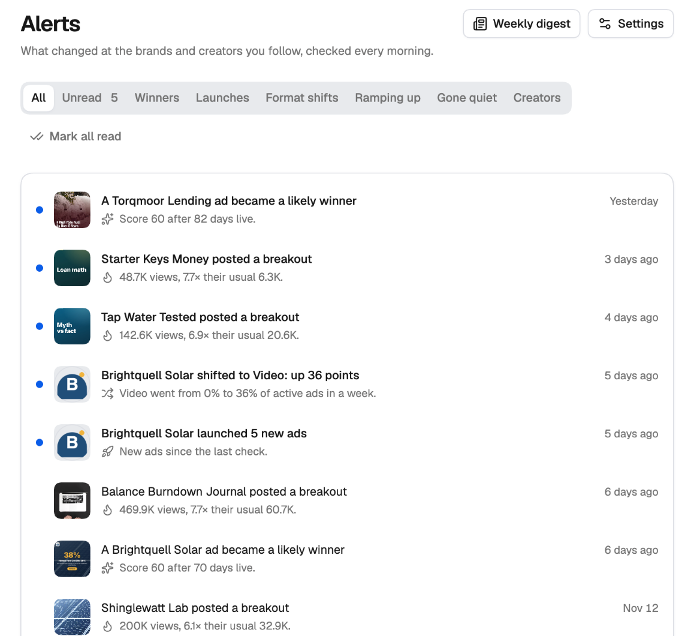

Inspiration checks the brands and creators you follow every morning and tells you what changed, so you don't have to scroll the feed to notice a competitor's new push.

---

## Alerts

Open **Alerts** in the Inspiration sidebar. Each alert says what changed and links to the ads. Filter them by:

| Filter | What it shows |
| --- | --- |
| **All** / **Unread** | Every alert, or the ones you haven't read. **Mark all read** clears the unread count. |
| **Winners** | An ad from a brand you follow became a likely winner. |
| **Launches** | New ads from brands you follow. |
| **Format shifts** | A brand's active ads shifted toward a different visual format within a week. |
| **Ramping up** | A brand's number of active ads jumped within a week. |
| **Gone quiet** | A brand has no active ads anymore. |
| **Creators** | Creators you follow posting far above their usual views. |

Click **Settings** at the top of the page to pick which kinds you get.

<Frame>
  
</Frame>

---

## Weekly digest

Every Monday at 08:00 UTC, the **Weekly digest** sums up what the brands and creators you follow did the week before:

- **Top movers** — brands that launched or stopped the most ads.
- **Format trends** — the share of new ads by format, against the week before.
- **New likely winners** — ads from brands you follow that crossed the winner score.
- **Creator breakouts** — creators you follow who posted far above their usual views.

Open it from **Alerts → Weekly digest**. Before Monday, the page shows the week so far.

---

## Settings

Open **Settings** with the gear icon at the top of the Inspiration sidebar.

| Section | What you set |
| --- | --- |
| **Interests** | **Your industry** — Discover leads with brands like yours and Trending opens on it. **Creator keywords** — what Inspiration searches TikTok and Instagram for each morning to find creators and posts for you; it suggests keywords from your industry, your ads and the brands you follow. |
| **Browser extension** | Install and connect the **Save to Inspo** Chrome extension. See [Boards and saving](/inspiration/boards-and-saving#save-from-the-meta-ad-library-with-the-chrome-extension). |
| **Instagram** | Link Instagram accounts to save posts by DM. See [Boards and saving](/inspiration/boards-and-saving#save-from-instagram-by-dm). |
| **Sharing** | Every board your workspace has opened to people outside it, with options to turn off its link or unpublish it. |
| **Alerts** | **Alert me when** — which alerts you get. **Weekly digest** — read it in Inspiration, and have it emailed to the workspace owner on Monday where email is available for your workspace. **Muted brands** — a muted brand raises no alerts and stays out of the digest, but you keep following it. |
