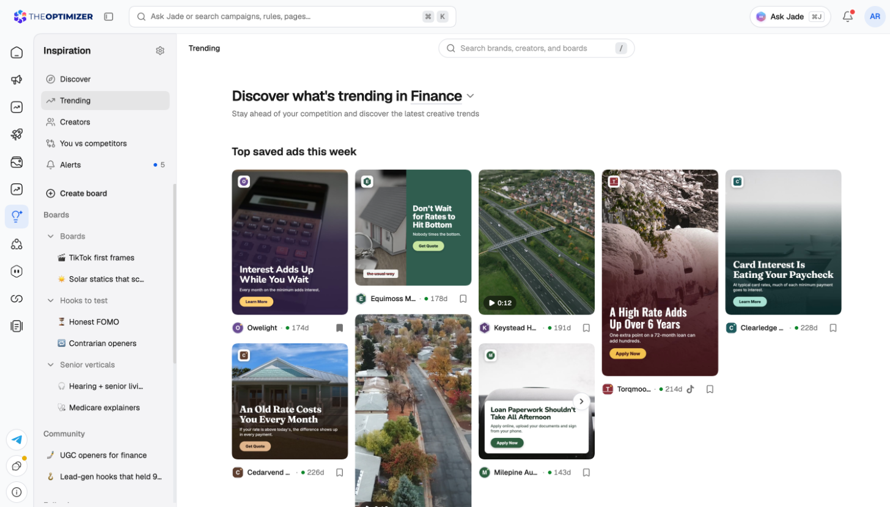
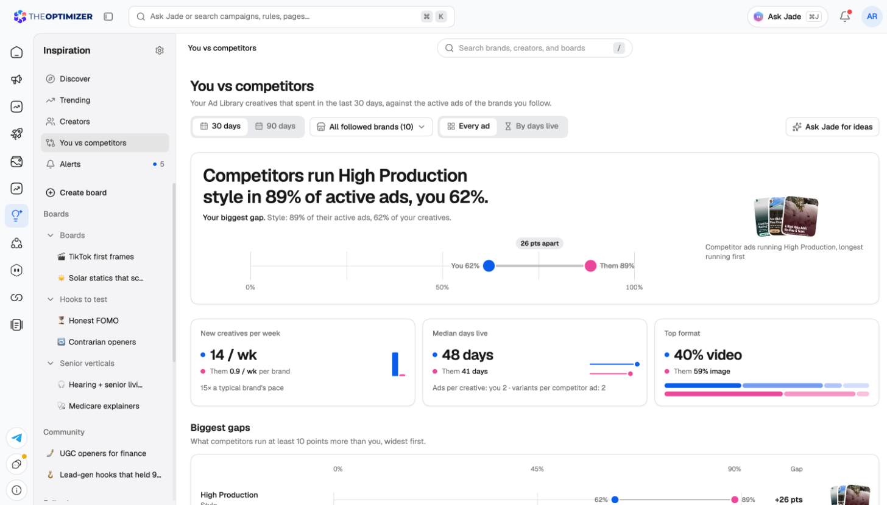

Inspiration is most useful when it watches the brands and creators you care about. This page covers following them, the **Trending** and **Creators** pages, and **You vs competitors**.

---

## Following brands

Click **Follow** on a brand's page, or on any of its ads, to follow it. Inspiration checks each followed brand daily, and its new ads land in **Discover → Following**.

**Don't see a brand?** Follow it by its website: type the site (for example *glossier.com*) in the search at the top, or in **Find brands to follow**, and click **Follow**. Inspiration finds the brand's Meta page from its site and starts collecting its ads. It takes a few minutes, and the brand shows up in **Following** when it's ready.

### A brand's page

A brand's page shows its ads, with the same filters as Discover. **See similar brands** suggests others to follow.

### Brand intel

**Brand intel** lists every brand you follow with its media mix, its visual formats and its landing pages, so you can see at a glance how each competitor builds its ads.

---

## Trending

**Trending** shows what's trending in your industry — pick another industry at the top to look around:

- **Top saved ads** this week in the industry.
- **Brands to Watch** — the brands saved most in your industry, with **Follow brands**.
- **Popular Visual Formats** — the formats predicted to be the biggest trends this quarter. **See every format** opens the full list.

<Frame>
  
</Frame>

### Visual formats

Inspiration tags every ad with the visual format it uses — UGC, meme, and many more. The **Visual formats** page explains what each format means; search it by name.

---

## Creators

**Creators** helps you discover and follow the top creators across your industry.

- **Top creators** ranks creators by category. **Bubbling up** shows smaller creators whose recent top posts pull far more views than they have followers.
- Open a creator to see their **Top posts**, their posts **By views**, **All content**, and their **Partnership ads** — the sponsored ads they've made for brands.
- Click **Follow** to get alerts when a creator posts far above their usual views.
- Can't find someone? Click **Request a creator**.

The **Organic** tab in Discover shows creators' organic posts for your keywords. Set the keywords in **Settings → Interests**.

---

## You vs competitors

**You vs competitors** compares your own creatives — the ones in your [Ad Library](/ad-library/overview) that spent in the last 30 or 90 days — with the active ads of the brands you follow.

<Frame>
  
</Frame>

- **Your biggest gap** at the top, in one sentence — for example *Competitors run High Production style in 89% of active ads, you 62%.* — with the competitor ads behind it.
- **New creatives per week**, **Median days live** and **Top format** — your pace and mix next to theirs.
- **Biggest gaps** — what competitors run at least 10 points more than you, widest first. These are ideas you haven't tested.
- **Where you lead** — what you run at least 10 points more than they do.
- **By dimension** — your share against theirs for each format, call to action, video length, hook, angle, offer, persona, emotion and style.

Choose the window, which brands to compare against (**All followed brands** or a few), and how to count:

- Your side by **creatives** or by **spend**.
- The competitors by **every ad**, or **by days live** — weighting longer-running ads more, since those are usually the ones that work.

**Ask Jade for ideas** sends the gaps to [Jade](/jade/overview) to suggest what to test next.

<Note>
  Format, call to action and video length compare right away. Hook, angle, offer, persona, emotion and style need your own creatives to have AI tags — turn on [auto-tagging](/ad-library/tags-and-settings#auto-tagging) in the Ad Library. Without a connected ad account, you see the competitors' side only.
</Note>
