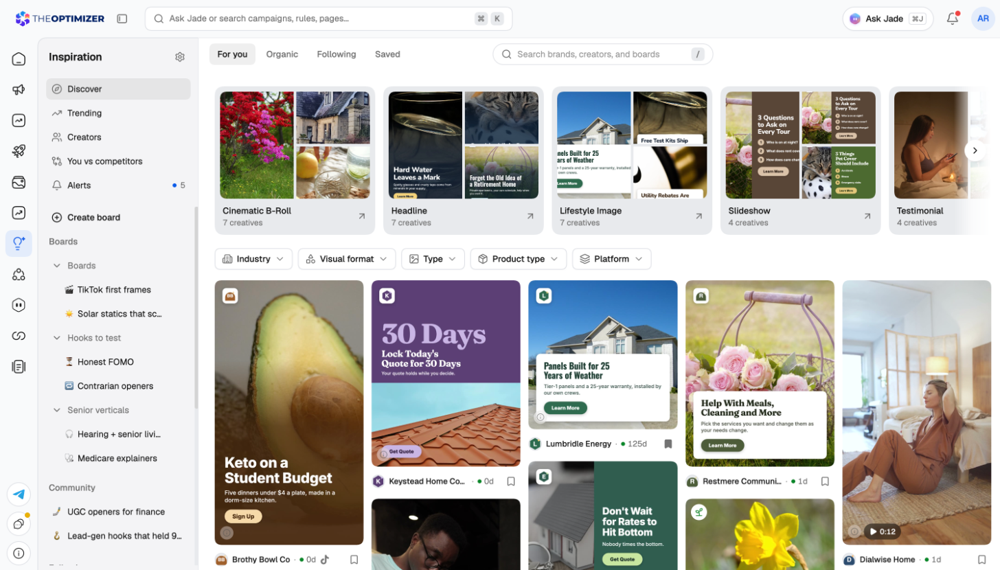
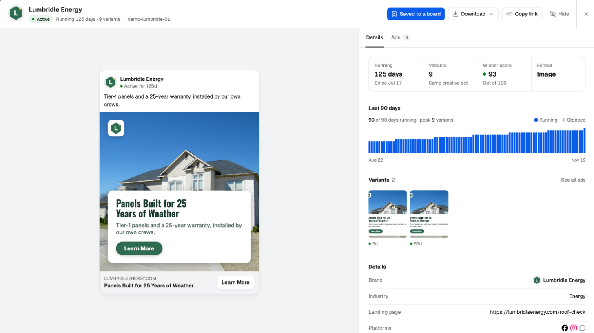

**Inspiration** is a library of other brands' ads and creators' posts, for finding ideas for your next creatives. Where the [Ad Library](/ad-library/overview) shows how **your** ads perform, Inspiration shows what **everyone else** is running: browse a ranked feed, follow the brands you compete with, keep the ads you like on boards, and compare your creative mix with your competitors'.

<Frame>
  
</Frame>

---

## Opening Inspiration

Click **Inspiration** in the left navigation. It opens on **Discover**, with its own sidebar:

| Sidebar item | What it's for |
| --- | --- |
| **Discover** | The ranked feed of ads and posts. See below. |
| **Trending** | What's trending in your industry this week. See [Brands, creators and trends](/inspiration/brands-creators-and-trends#trending). |
| **Creators** | The top creators in your industry. |
| **You vs competitors** | Your creative mix against the brands you follow. |
| **Boards** | Your boards and folders of saved ads. See [Boards and saving](/inspiration/boards-and-saving). |
| **Following** | The brands you follow. |
| **Alerts** | What changed at the brands and creators you follow. See [Alerts and settings](/inspiration/alerts-and-settings). |
| **Settings** | The gear icon at the top: your industry, saving from anywhere, sharing and alerts. |

Use the search at the top to find **brands**, **creators** and **boards** by name or website.

<Tip>
  Set your industry first, in **Settings → Interests**. Discover then leads with brands like yours, Trending opens on your industry, and Inspiration finds creators for you every morning.
</Tip>

---

## Discover

Discover has four tabs:

| Tab | What it shows |
| --- | --- |
| **For you** | The ranked library, with brands like yours first. |
| **Organic** | What's resonating on your audience's organic feeds: creators' posts, grouped by your keywords. |
| **Following** | Everything the brands you follow launch. |
| **Saved** | Every ad saved by your workspace, from every board. |

### Filter and sort

Narrow the feed with filters for **Industry**, **Visual format**, **Type**, **Product type**, **Days active**, **Brand**, **Status**, **Ad length**, **Partnership ads**, **Landing page**, **Platform** and, on saved ads, **Saved by**. Sort by **Newest**, **Longest running** or **Most variants** (saved ads sort by **Latest saves** or **Oldest saves**) — a brand that keeps an ad running for weeks, or makes many versions of it, is usually seeing results.

Hover a video card to preview it.

---

## Ad details

Click an ad to open its details:

- **Details** — how long the ad has been **Running**, its **Variants** (versions of the same creative set), its **Winner score** out of 100 and its format; a chart of the **Last 90 days**, showing when it ran; then the brand, industry, landing page, platforms, call to action and ad copy.
- **Ads** — the brand's other ads that use this creative.
- **Transcript** — for videos, what's said in the ad.
- **Download** the creative, **Copy link** to share the ad with your team, or **Hide** it from your feed.
- **Ask Jade** — ask [Jade](/jade/overview) about the ad, for example to write a brief for your own version of it.

<Frame>
  
</Frame>

Click **Save** on any ad to add it to a board. See [Boards and saving](/inspiration/boards-and-saving).

---

## Next steps

<CardGroup cols={2}>
  <Card title="Brands, creators and trends" icon="arrow-trend-up" href="/inspiration/brands-creators-and-trends">
    Follow brands, find creators, see trends and compare yourself with competitors.
  </Card>
  <Card title="Boards and saving" icon="bookmark" href="/inspiration/boards-and-saving">
    Organize saved ads in boards, and save from the Meta Ad Library or Instagram.
  </Card>
  <Card title="Alerts and settings" icon="bell" href="/inspiration/alerts-and-settings">
    Daily alerts, the weekly digest, and your Inspiration settings.
  </Card>
  <Card title="Ad Library" icon="images" href="/ad-library/overview">
    How your own creatives perform.
  </Card>
</CardGroup>
