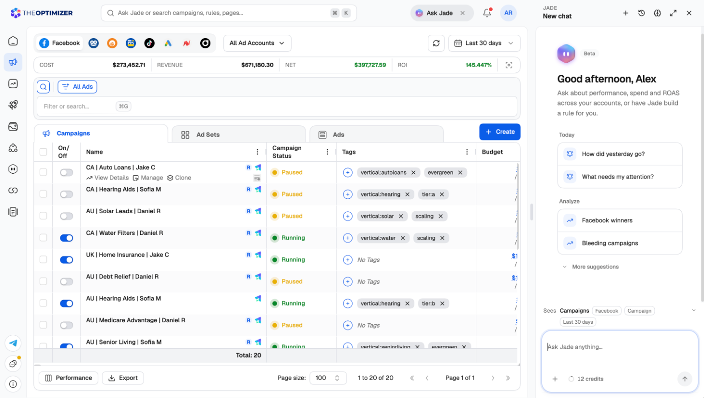
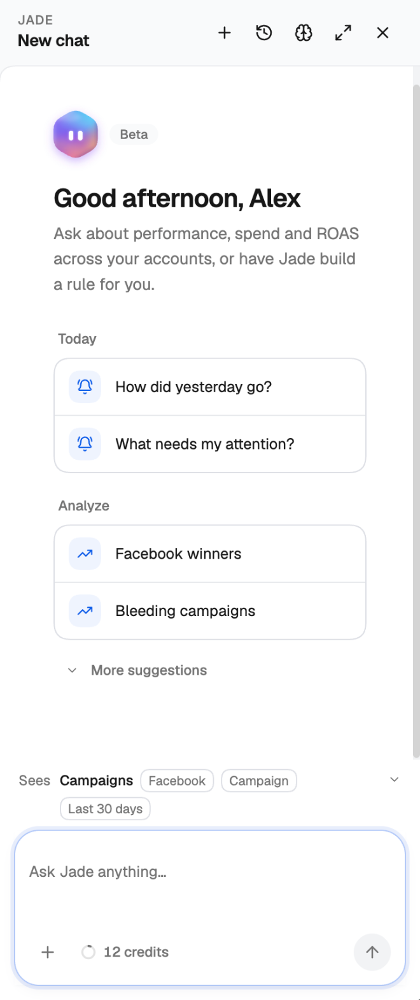
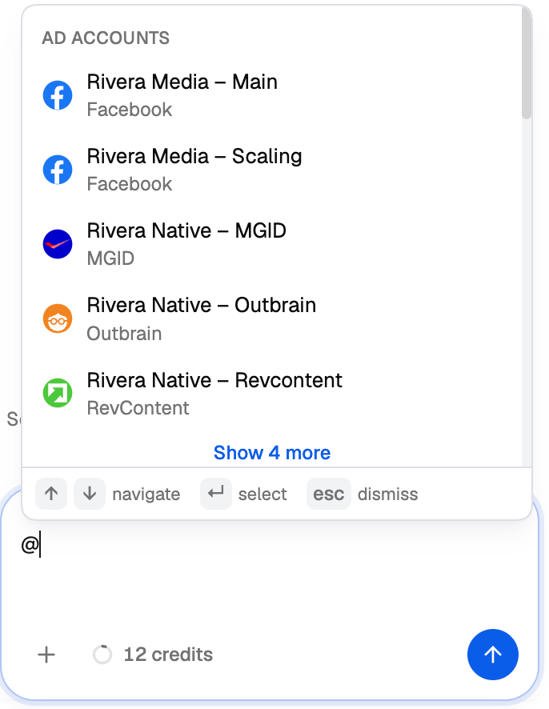
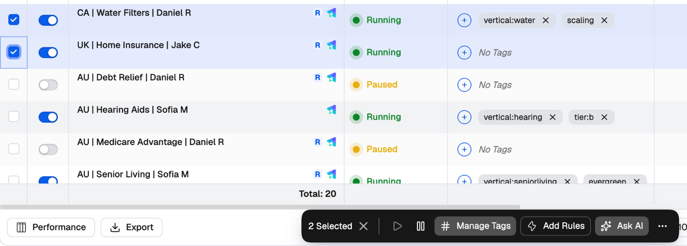
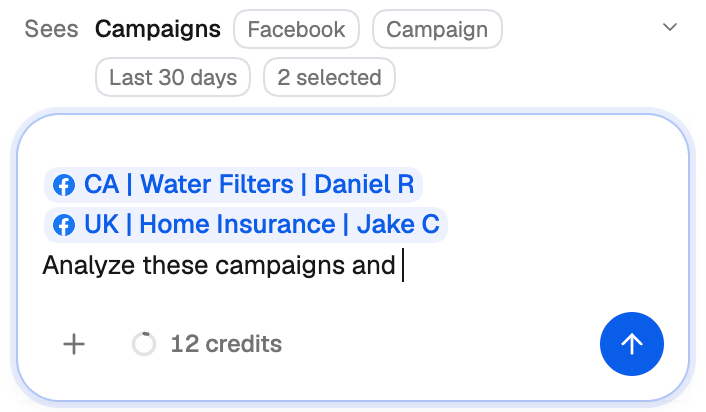
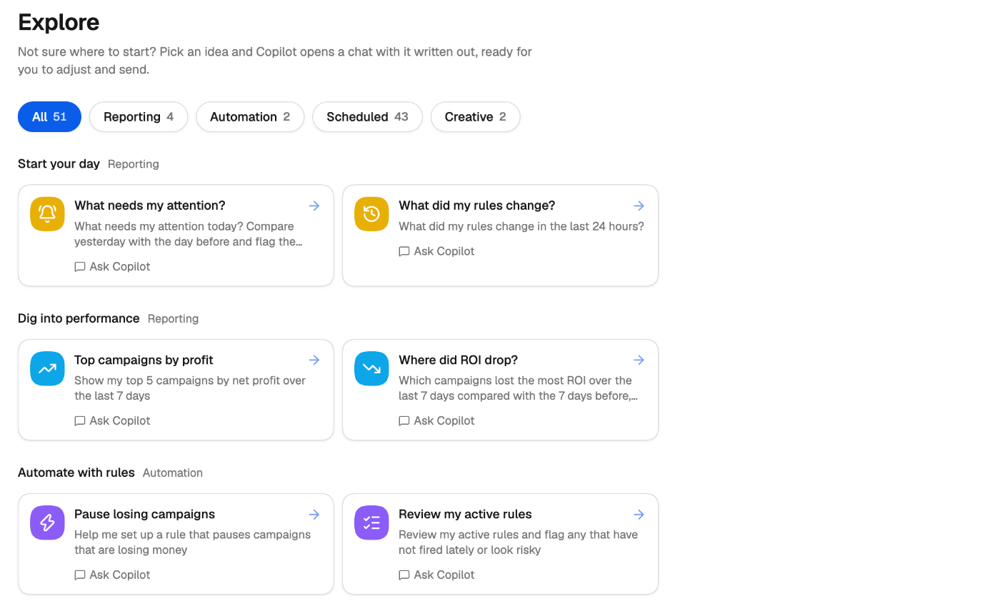
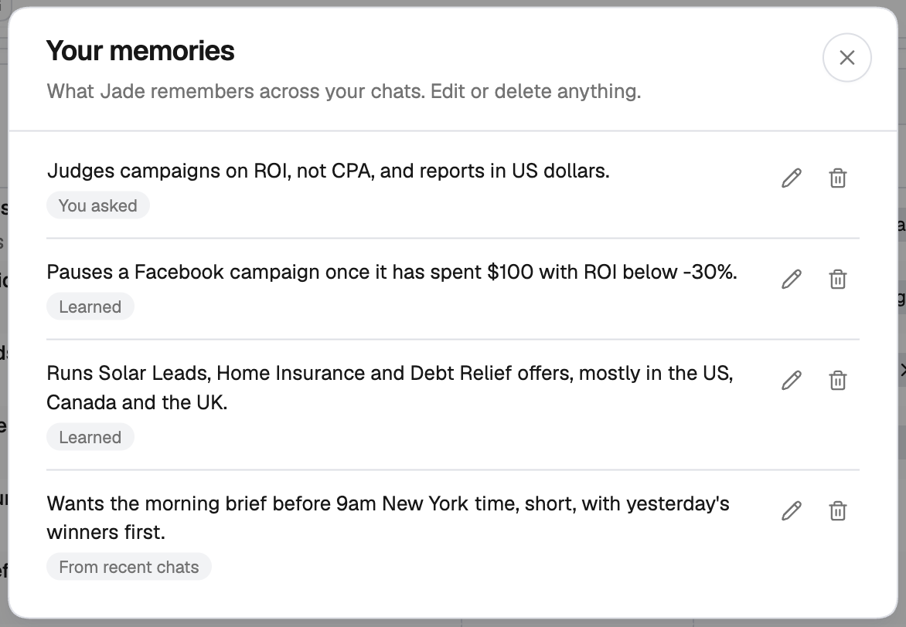
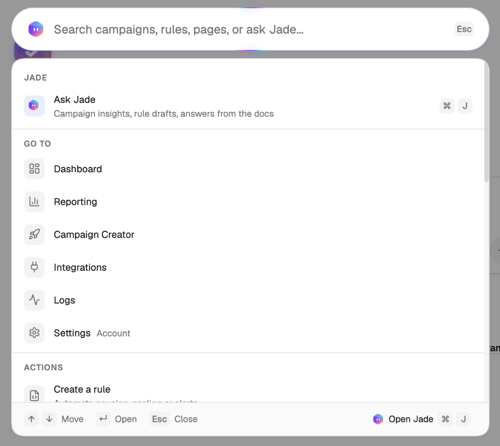

Jade is TheOptimizer's built-in AI copilot. Ask it how your campaigns are performing, why something is or isn't working, or how a part of the platform works. Jade reads your live data, so its answers are about *your* accounts, not generic advice.

Jade can also act for you. It can change campaigns, create rules, build reports and dashboards, and put recurring work on a schedule. **Every change needs your approval first.**

<Frame>
  
</Frame>

---

## Opening Jade

You can reach Jade from anywhere in the platform:

| Where | How |
| --- | --- |
| **Keyboard** | Press **⌘J** (Mac) or **Ctrl+J** (Windows). Press it again, or **Esc**, to close the panel. |
| **Top bar** | Click **Ask Jade**. |
| **Command palette** | Press **⌘K** / **Ctrl+K**, type your question and press **Enter** to send it to Jade. See [Command palette](#command-palette). |
| **Selected campaigns** | Tick one or more campaigns in the Campaign Manager and click **Ask AI**. See [Ask AI about specific campaigns](#ask-ai-about-specific-campaigns). |
| **Welcome page** | Type into the box on the Welcome page, or pick one of the suggested questions. |
| **Left navigation** | Click **Jade** to open the full-page view with your chat history, **Scheduled** tasks and **Explore**. |

Jade opens as a panel on the right side of the page, so you can keep working while you chat. To give a conversation the whole screen, click **Open full page** in the panel header.

<Frame>
  
</Frame>

The buttons in the panel header are:

- **New chat** (**+**) — start a fresh conversation.
- **Chat history** — reopen an earlier conversation.
- **Memories** — review what Jade remembers about you. See [Memory](#memory).
- **Open full page** — move the conversation to the full-page Jade view.
- **Close** — hide the panel. Your conversation is kept.

### Jade sees the page you're on

Above the message box, the **Sees** line shows what Jade is looking at: the page, the ad network, the level, the date range, and any rows you've selected. Ask "why did these drop?" on a filtered Campaigns page and Jade answers about exactly those campaigns, without you naming them.

---

## Mentioning items with @

Type **@** in the message box to point Jade at something specific. A menu opens with matching items, grouped as:

- **Traffic Sources** (ad networks)
- **Ad Accounts**
- **Account Tags**
- **Metrics**
- **Campaigns**
- **Trackers**
- **Rules**
- **Smart Lists**

Keep typing to narrow the list, use **↑ ↓** to move and **Enter** to select. The item is added to your message as a chip, so Jade knows precisely which account, metric or rule you mean.

<Frame>
  
</Frame>

<Tip>
  Mentions are the quickest way to avoid ambiguity. "Compare @ROI on @Rivera Media – Main against last week" leaves Jade nothing to guess.
</Tip>

---

## Ask AI about specific campaigns

<Steps>
  <Step title="Select campaigns">
    In the Campaign Manager, tick the campaigns you want to ask about. The bulk action bar appears at the bottom of the page.

    <Frame>
      
    </Frame>
  </Step>
  <Step title="Click Ask AI">
    Jade opens a new chat with the selected campaigns already mentioned and a prompt that starts "Analyze these campaigns and …".

    <Frame>
      
    </Frame>
  </Step>
  <Step title="Finish the question">
    Complete the sentence with what you want to know — for example, "… tell me which one to scale" — and send it.
  </Step>
</Steps>

If you select more than 10 campaigns, the prompt counts them instead of listing each one. Jade still sees every selected campaign.

---

## What Jade can do

- **Answer questions about performance.** "How did yesterday go?", "Which ads are losing money over the last 7 days?", "Why did ROI drop on TikTok this week?"
- **Answer questions about the platform.** How a feature works, how to connect a tracker, what a rule setting means.
- **Make changes to your campaigns.** Pause, activate, or change budgets and bids — always with your approval. See [Approving changes](#approving-changes).
- **Create rules.** Describe the strategy in plain English and Jade drafts one or more rules to match. Open each draft with **Review and save**, check it and save it. See the [Rules guide](/automation/rules-guide#creating-a-rule-with-jade).
- **Build reports and dashboards.** Ask for a board and Jade builds it — KPIs compared with the previous period, heatmaps, funnels, top ads side by side, and more. See [Building a board with Jade](/dashboard/overview#building-a-board-with-jade).
- **Set up scheduled tasks.** Describe something you want done every day and Jade schedules it. See [Scheduled tasks](/jade/scheduled-tasks).

### Explore: ideas to start from

Not sure what to ask? Click **Explore** in the Jade section of the left navigation. It lists ready-made prompts grouped by topic — reporting, automation, scheduled tasks and creative. Pick one and Jade opens a chat with it written out, ready for you to adjust and send.

<Frame>
  
</Frame>

---

## Approving changes

Jade never changes your campaigns without asking. When it wants to make a change, it shows an approval card in the chat that describes exactly what will happen: which items, what changes, and from what value to what value.

- Click the action button (it names the action, for example **Pause**) to approve, or **Decline** to reject. If you decline, nothing is changed.
- When the change covers several items, you can untick the ones you want to leave alone. The button updates to show how many will be changed, for example *Pause 3 of 5*.
- After you approve, the card shows the outcome for each item, including any that the ad network rejected.

### Undoing changes

Changes Jade makes are recorded in [Logs](/logs/overview) like any other change, so you can always see what happened. For **Facebook** changes made by Jade, you can undo them:

- **From Logs** — select the entries and click **Rollback Activities**. See [Rolling back changes](/logs/overview#rolling-back-changes).
- **From the chat** — ask Jade to undo what it just did. It shows an approval card for the undo, like any other change.

---

## Memory

Jade remembers lasting preferences — like your target CPA, the KPI you judge campaigns by, or the accounts you usually mean — so you don't have to repeat them in every chat. Things you mention for one chat stay in that chat.

When Jade saves something, a short line appears in the conversation (*Saved to memory*, *Updated memory*) with an **Undo** link, so you can take it back on the spot.

To see everything Jade remembers, click **Memories** in the panel header. The **Your memories** list shows each item with where it came from:

| Label | Meaning |
| --- | --- |
| **You asked** | You told Jade to remember it. |
| **Learned** | Jade picked it up from how you work. |
| **From recent chats** | Jade noticed it across several recent conversations. |

Use the pencil to edit an item, or the bin to delete it.

<Frame>
  
</Frame>

---

## Managing your chats

Your conversations are listed in the Jade section of the left navigation, with **Search chats** at the top. From a chat's menu you can rename it, copy a link to it, or delete it.

---

## Command palette

Press **⌘K** / **Ctrl+K**, or click the search bar at the top of every page, to open the command palette. It does two jobs:

- **Search and jump** — find campaigns, rules, smart lists and pages, or run an action such as **Create a rule**. Use **↑ ↓** to move and **Enter** to open.
- **Ask Jade** — type a question and press **Enter** when nothing matches, or press **⌘J** to send what you've typed straight to Jade.

<Frame>
  
</Frame>

---

## Related

- [Scheduled tasks](/jade/scheduled-tasks) — put recurring checks and actions on a schedule.
- [Rules guide](/automation/rules-guide) — build rules yourself or with Jade.
- [Dashboard](/dashboard/overview) — let Jade build a board for you.
