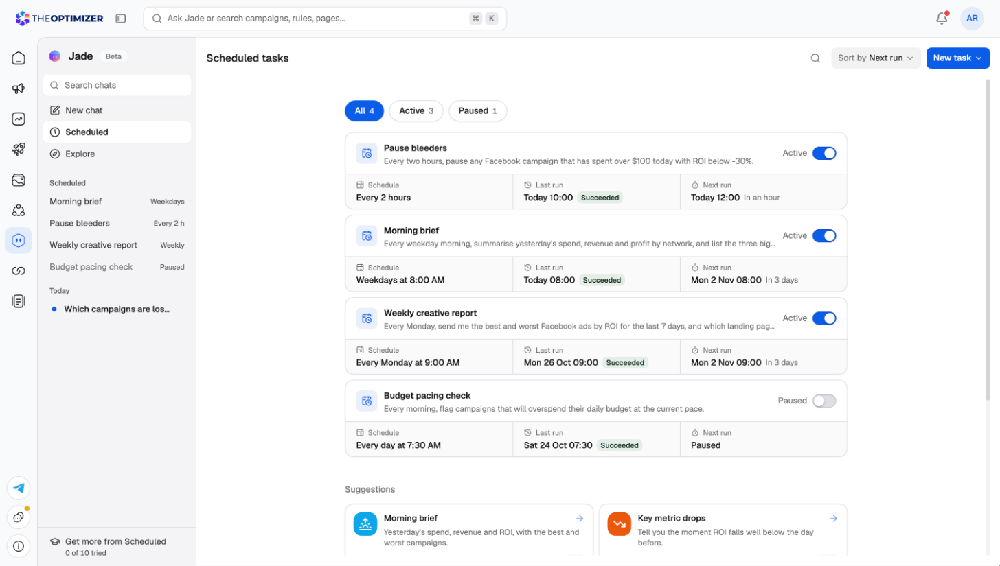
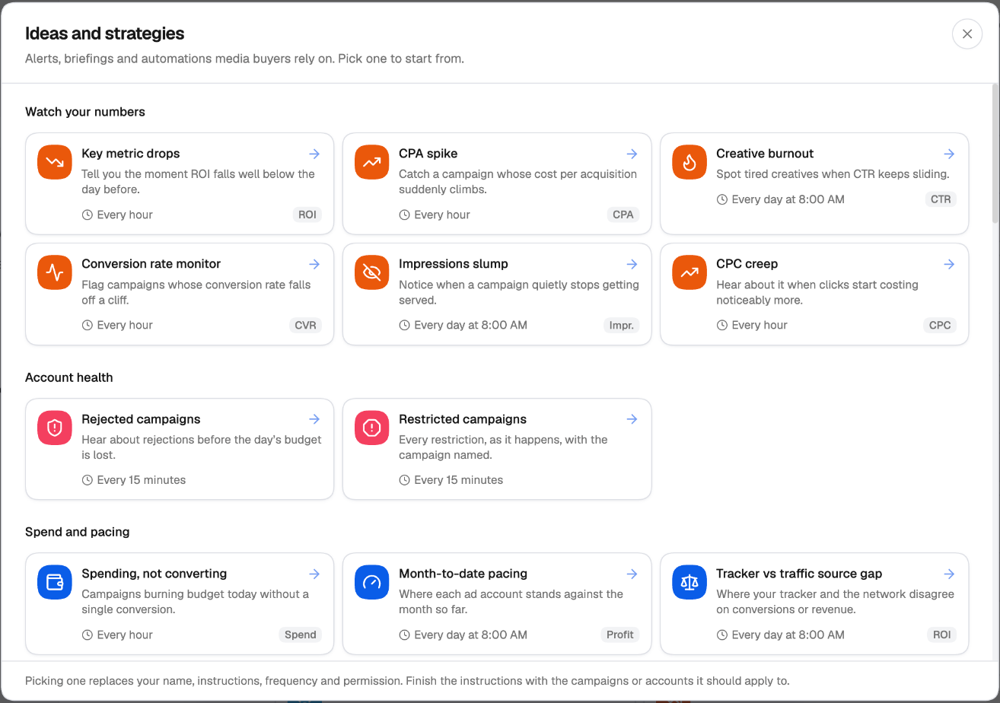
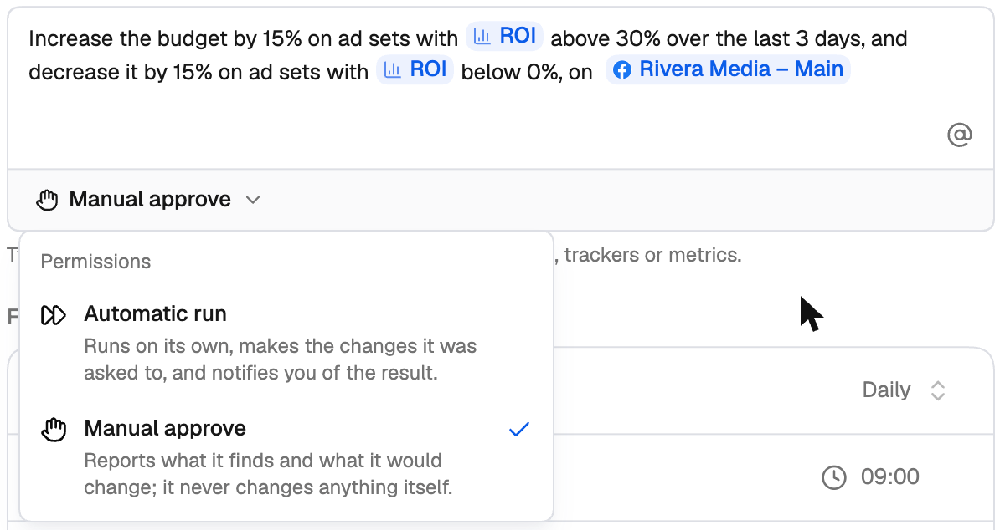
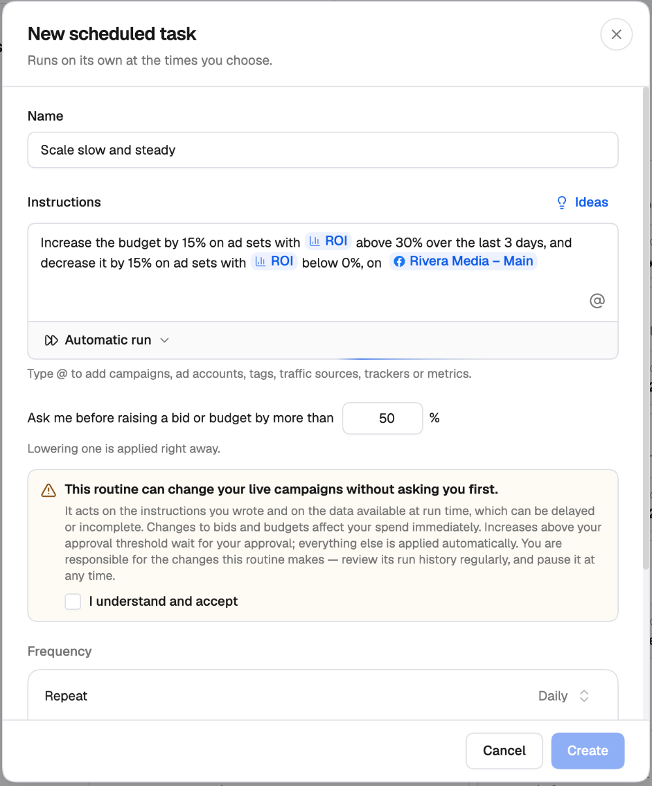
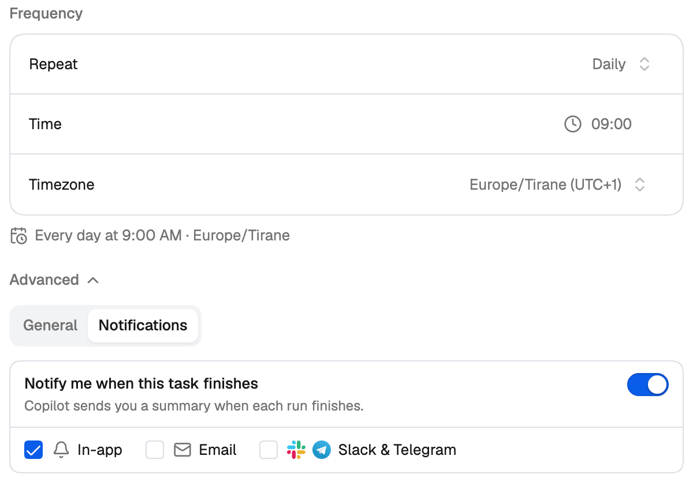
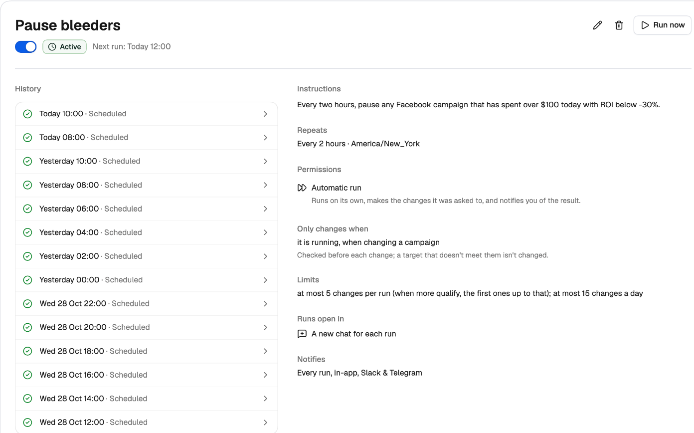
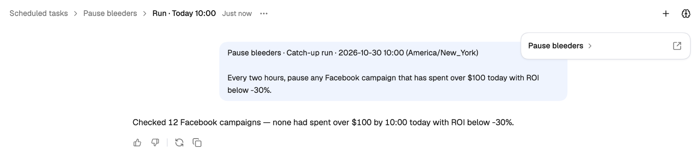

Scheduled tasks put the checks and changes you'd otherwise do by hand on a schedule. A morning performance brief, an hourly stop-loss, a weekly creative report, a budget nudge for yesterday's winners — write it once in plain English, choose when it runs, and [Jade](/jade/overview) carries it out on time.

For each task you choose whether it can **make changes** or should only **report back**, and where the summary of each run is sent: **in the app**, by **email**, or to **Slack and Telegram**.

<Frame>
  
</Frame>

---

## Where to find them

Click **Jade** in the left navigation, then **Scheduled**. The page lists every task with its schedule, its last run and its result, and when it runs next. Use the toggle on a card to pause or resume a task.

- Filter the list with **All**, **Active** and **Paused** (and **Needs you** / **Completed** when a task is in that state).
- **Sort by** next run, last run or name, and use the search icon to find a task by name.
- Under your tasks, **Suggestions** offers ready-made ideas to start from.

Your tasks are also listed in the Jade navigation panel under **Scheduled**, so you can jump to one from any page.

---

## Creating a task

Click **New task** at the top right of the page and choose how to start:

- **Create with AI** — describe what you want and Jade drafts the task for you.
- **Set up manually** — fill in the form yourself.

You can also just ask Jade in any chat — for example, *"Every weekday at 8am, send me yesterday's spend and ROI by ad network on Slack"* — and it sets the task up. Before it creates the task, Jade shows you the details to approve, like any other change.

### Setting up a task manually

<Steps>
  <Step title="Name the task">
    Give it a name you'll recognise in the list, such as *Morning performance brief*.
  </Step>
  <Step title="Write the instructions">
    Describe what the task should do, in plain English. Type **@** to add campaigns, ad accounts, tags, traffic sources, trackers or metrics as chips — this keeps the task to exactly the items you name. A task that names none can reach all of your accounts.

    Not sure what to write? Click **Ideas** to pick from a library of alerts, briefings and automations media buyers rely on. Picking one fills in the name, instructions, frequency and permission for you; finish the instructions with the campaigns or accounts it should apply to.

    <Frame>
      
    </Frame>
  </Step>
  <Step title="Choose the permission">
    Under the instructions, choose what the task is allowed to do. See [Permissions](#permissions) below.
  </Step>
  <Step title="Set the frequency">
    Choose how often it repeats — **Manual**, **Interval**, **Daily**, **Weekdays**, **Weekly** or **Custom** — then the time and timezone. A line under the fields reads the schedule back to you in words, for example *Every day at 9:00 AM · Europe/Tirane*. **Manual** tasks run only when you click **Run now**.
  </Step>
  <Step title="Choose notifications (optional)">
    Open **Advanced** → **Notifications** to choose where the summary of each run is sent. See [Notifications](#notifications).
  </Step>
  <Step title="Create">
    Click **Create**. The task runs at its next scheduled time.
  </Step>
</Steps>

---

## Permissions

Every task runs with one of two permissions:

<Frame>
  
</Frame>

| Permission | What it does |
| --- | --- |
| **Manual approve** | Reports what it finds and what it would change. It never changes anything itself. This is the default. |
| **Automatic run** | Runs on its own, makes the changes it was asked to, and notifies you of the result. |

<Tip>
  Start new tasks on **Manual approve**. Once a few runs have shown you exactly what the task would do, switch it to **Automatic run**.
</Tip>

### Approving bid and budget increases

When you choose **Automatic run**, two more settings appear:

- **Ask me before raising a bid or budget by more than … %** — any raise above this threshold is held for your approval instead of being applied. Lowering a bid or budget is applied right away.
- A notice explaining that the task can change your live campaigns without asking you first. Tick **I understand and accept** to save the task.

<Frame>
  
</Frame>

Held raises appear at the top of the Scheduled page under **Needs your approval**, one line per change — for example *Ad set Summer US: bid 0.80 → 2.40 (+200%)*. Click **Approve** or **Reject** on each one. Nothing changes until you approve, and a held change that isn't decided in time expires — each line shows when.

<Warning>
  An **Automatic run** task acts on the data available when it runs, which can be delayed or incomplete. You're responsible for the changes it makes, so review its run history regularly and pause it if something looks wrong.
</Warning>

---

## Notifications

Open **Advanced** → **Notifications** in the task form and turn on **Notify me when this task finishes** to get a summary each time a run completes. Choose one or more channels:

- **In-app**
- **Email**
- **Slack & Telegram** — sent to the channels you've connected under **Settings → Notifications**. See [Notifications](/account-settings/notifications).

Turn the toggle off and nothing is sent for the task, not even when a run fails.

<Frame>
  
</Frame>

### One ongoing chat, or a new chat per run

Every run is a conversation with Jade that you can open and read. Under **Advanced** → **General**, **Start each run in a new chat** decides how runs are grouped:

- **On** — every run opens as its own conversation.
- **Off** — every run continues one conversation, so Jade can compare each run with the ones before it.

---

## Run history

Click a task to open it. The top shows its status, the next run, and the **Edit**, **Delete** and **Run now** buttons. Below:

- **History** lists every run with its time, how it started (*Scheduled* or *Run now*) and its result — succeeded, partly succeeded, failed, skipped, waiting for approval, and so on.
- The right-hand side summarises the task: its instructions, schedule, permission, limits, and where it notifies you.

<Frame>
  
</Frame>

Click any run to open it as a chat and see exactly what the task checked and changed. You can keep the conversation going from there — ask why it did something, or ask Jade to undo a change the run made (you approve the undo before anything is sent).

<Frame>
  
</Frame>

---

## Things to try

Ask Jade for any of these in a chat:

- **A dry run** — *"Do a dry run of my scheduled task 'Pause bleeders': tell me what it would change, without changing anything."*
- **Only hear about problems** — *"Check my campaigns every weekday at 9am and tell me only if something looks wrong. Email me as well."*
- **A cap on changes** — *"Pause ads with more than $50 spend and no conversions every 2 hours, but never change more than 10 ads in one run."*
- **What changed since last time** — each run receives the previous run's summary, so a task can report only what's new.
- **A one-off** — *"Tomorrow at 8am, send me last week's ROI by ad account. Just once."* The task runs once, then pauses itself.
- **A CSV** — *"Every Monday at 8am, pull last week's spend, revenue and ROI by campaign and attach it as a CSV."*

---

## Related

- [Jade, your AI copilot](/jade/overview)
- [Rules guide](/automation/rules-guide) — rules evaluate conditions on a fixed schedule; scheduled tasks follow written instructions and can combine several steps.
- [Notifications](/account-settings/notifications) — connect Slack and Telegram.
