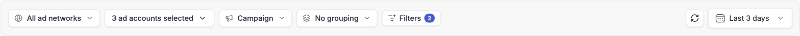
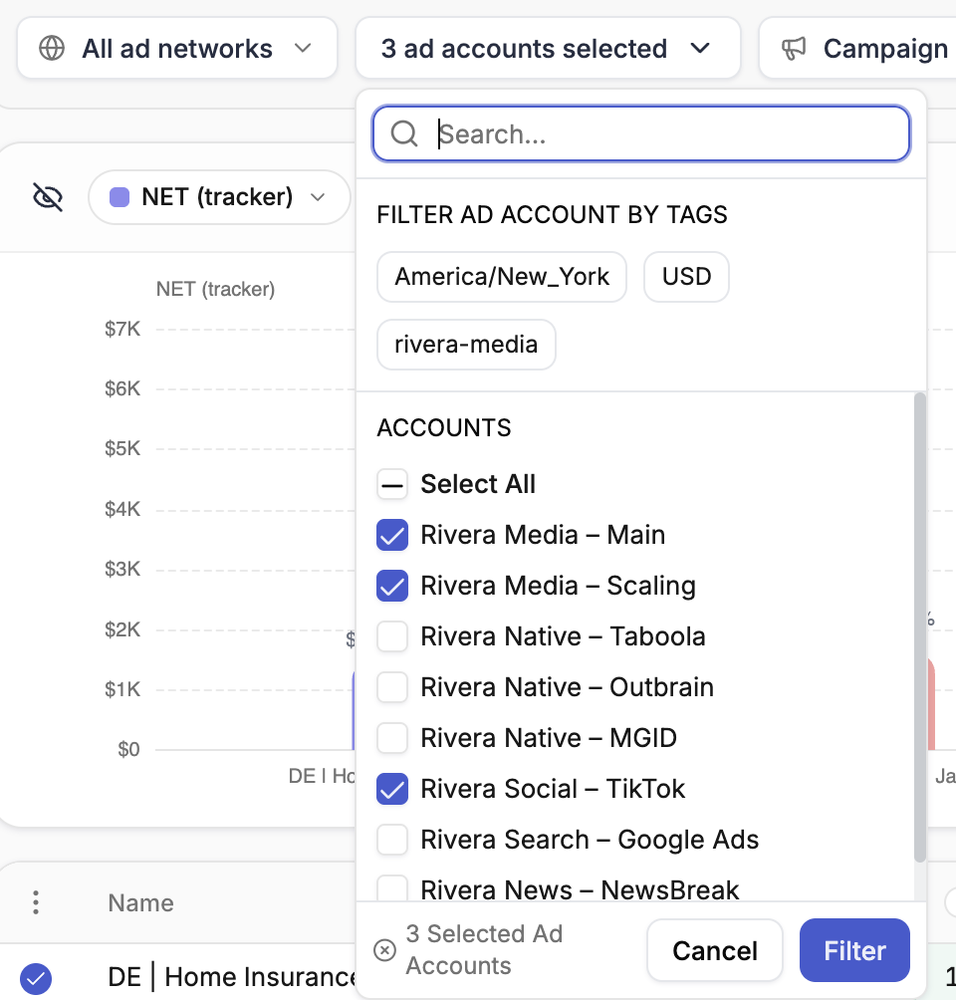
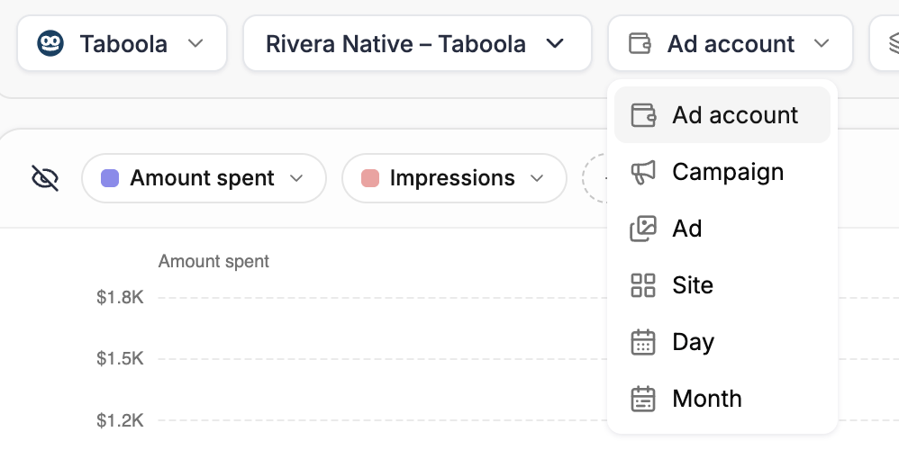
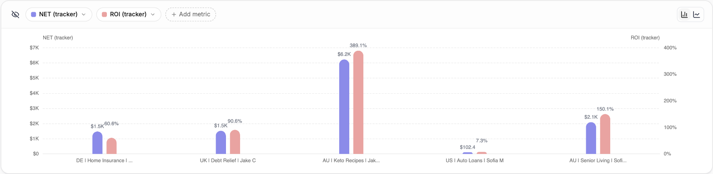
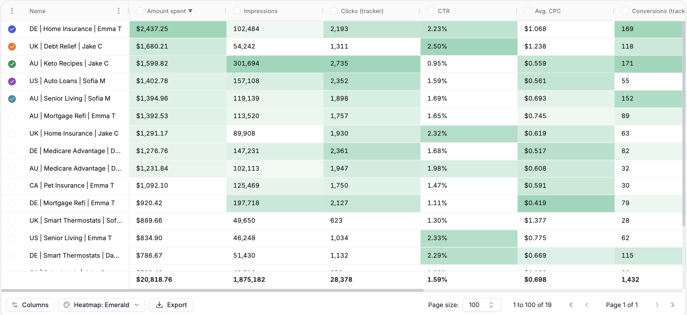
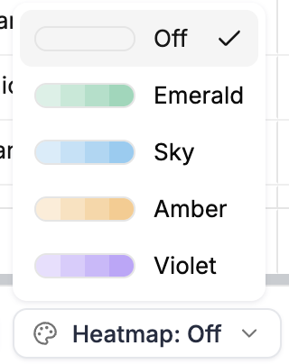
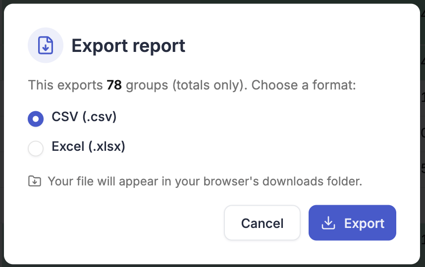

Every report is built from the same toolbar, read from left to right: **ad network**, **ad accounts**, **breakdown**, **group by** and **filters**, then on the right the **currency** (when your accounts use more than one), a refresh button and the **date range**. The chart and the table below it update as soon as you change any of them.

<Frame>
  
</Frame>

---

## Ad network

The first control on the toolbar picks the ad network. Choose **All ad networks** to report across every connected ad network at once, or pick a single network to report on it alone.

A single network unlocks that network's own levels — ad sets, ads, sites, widgets and so on — as breakdowns. **All ad networks** keeps to what every network has in common: ad networks, ad accounts, campaigns and time.

Changing the network resets the breakdown to its starting point: **Ad network** for *All ad networks*, **Ad account** for a single network.

If you haven't connected an ad network yet, the page asks you to connect one and links to **Integrations**.

---

## Ad accounts

Next to the ad network, the ad account picker narrows the report to the accounts you choose. It's the same picker as the [Ad Accounts filter](/campaign-manager/navigation-and-filtering#ad-accounts-filter) in the Campaign Manager:

<Frame>
  
</Frame>

- Search for accounts by name and tick the ones you want, or tick **Select All**
- Under **Filter ad account by tags**, pick a tag to select every account that carries it — including the currency and timezone tags every account gets automatically
- Click **Filter** to apply

The picker only lists the accounts of the ad network you picked, or every account with **All ad networks**. It reads **All Ad Accounts** when nothing is narrowed, the account's name when you picked one (or when the network has only one account), and *N ad accounts selected* otherwise. To go back to every account, hover the picker and click its **×**.

The account selection is saved with the report. If you switch to another ad network, accounts that don't belong to it drop out of the selection. If an account is removed from TheOptimizer later, it's dropped the next time you open the report.

<Tip>
  Building a report for one client? Pick only that client's accounts before you [share the report](/reports/sharing) — the share link then covers just those accounts.
</Tip>

---

## Breakdown

The breakdown decides what each row of the report is.

| Breakdown | Each row is | Available with |
| --- | --- | --- |
| **Ad network** | One ad network | *All ad networks* |
| **Ad account** | One ad account | *All ad networks* and single networks |
| **Campaign** | One campaign | *All ad networks* and single networks |
| **The network's own levels** | An ad set, an ad, a site, a widget and so on, named the way that network names them | Single networks |
| **Day** | One day of the date range | *All ad networks* and single networks |
| **Month** | One month of the date range | *All ad networks* and single networks |

<Frame>
  
</Frame>

<Tip>
  To see how a native campaign performs site by site, pick the network, choose the **Campaign** breakdown, then group by the network's placement level (for example **Site** on Taboola). See [Group by placement](/reports/grouping#group-by-placement).
</Tip>

---

## Group by

Grouping buckets the rows into expandable groups, each with its own subtotal. The options depend on the breakdown — for example, you can group campaigns by **Ad account**, **Status** or **Tag**, or group days by **Ad account** to get one daily trend per account.

Grouping has its own page: [Group rows](/reports/grouping).

---

## Filters

Click **Add filter** to open the filter bar under the toolbar, then type in **Filter or search…** to add conditions. It's the same filter builder you use in the Campaign Manager — see [Navigation and filtering](/campaign-manager/navigation-and-filtering) for how conditions work. Click **Done** to close it.

Once a report has filters, the button reads **Filters** with a count of how many apply. Click it to see, change or remove them.

---

## Date range

Use the date picker on the right of the toolbar to set the period the report covers. The refresh button next to it reloads the numbers without changing anything else. When you save a report with a relative range such as *Last 14 days*, it stays relative — the report always shows the latest 14 days when you open it. A custom range stays fixed to the dates you picked.

---

## Currency

If your ad accounts and connected trackers use more than one currency, a currency control appears next to the date range and reads **Mixed currencies**. Under **Show amounts in**, pick a currency to convert every spend and revenue amount in the report into it — the control then reads, for example, **In USD**. Conversions use today's exchange rate for every day in the range. Pick **Each ad account's own currency** to go back.

While amounts stay in each account's own currency, totals that add up different currencies are marked with **\***.

The control only lists the currencies your own accounts and trackers use. If everything you have is in one currency, it doesn't appear at all. See [Multiple currencies](/campaign-manager/multiple-currencies) for how currencies work elsewhere in TheOptimizer.

---

## The chart

The chart sits above the table and compares the rows you pick.

<Frame>
  
</Frame>

- **Pick rows** — tick the checkbox on a table row to add it to the chart. The first five rows are picked for you when the report loads, and you can chart up to five at a time
- **Pick metrics** — click a metric chip at the top of the chart to swap it for another metric — you can search the list — or choose **None** to remove it. Click **+ Add metric** to add one. You can also click the circle in a metric's column header: it turns into the metric's number on the chart. New reports start with **Amount spent** and **Impressions**
- **Bar chart** — the default, picked with the icons at the top-right of the chart. Compares the picked rows side by side, with up to four metrics
- **Line chart** — plots each picked row day by day across the date range, with up to two metrics
- **Hide the chart** — click the eye icon at the top-left of the chart to collapse it and give the table more room. Click **Show chart** to bring it back

With a **Day** or **Month** breakdown, the chart plots the rows along a time axis instead.

---

## The table

The table shows one row per breakdown item — or one row per group, when a grouping is active — with a pinned totals row at the bottom. The first column stays in place while you scroll sideways.

<Frame>
  
</Frame>

When there's nothing to show, the table tells you why and offers the fix:

- **No rows match your filters** — click **Clear filters** to remove them, or **Edit filters** to adjust them
- **Nothing to report for these dates** — click **Show last 30 days** (or **Show last 90 days**) to widen the date range in one step

If the data can't load — a connection problem, or a report that takes too long — the table says so and offers to try again. For a slow report, try a shorter date range or fewer columns.

- **Sort** — click a column header to sort by it, and again to reverse the order
- **Expand groups** — click the arrow on a group row to show the rows inside it
- **Ad previews** — at ad level, rows and chart labels show the ad's thumbnail. Hover a thumbnail in the table to preview the full ad. Ads without an image show a placeholder

<Frame>
  
</Frame>

The table footer holds three more controls.

### Columns

Click **Columns** to choose which metrics appear and in what order. Metrics are grouped into **Traffic Source Metrics**, **Tracker Metrics** and **Custom Metrics** — tick the ones you want, drag them into order under **Columns Order**, then click **Apply**. The choice is saved with the report, and any [custom metrics](/campaign-manager/custom-metrics) you've defined are available here too.

### Heatmap

**Heatmap** shades every value that beats its column's average — the further past it, the stronger the shade — so outliers stand out at a glance. For most metrics that means higher than average. For cost-per metrics such as CPA, CPC and CPM it means lower, since a cheaper result is the better one. Spend columns shade by size, to show where the money goes. It starts on **Emerald**. Choose another color (**Sky**, **Amber** or **Violet**), or **Off** to turn it off — the menu previews each color's shades.

<Frame>
  
</Frame>

The heatmap color is remembered in your browser and applies to every report you open there. It isn't saved with a report.

### Export

Click **Export**, choose **CSV (.csv)** or **Excel (.xlsx)**, then click **Export** again. The dialog shows how many rows the file will contain, and the file lands in your browser's downloads folder, named after the report and the day you exported it. You can also export from the arrow next to the **Save** button, under **Export…**.

<Frame>
  
</Frame>

The export contains what the table shows at the top level — the group rows when a grouping is active (the dialog then says it exports groups, totals only), otherwise the breakdown rows — in the table's current sort order, with the columns you have visible and a final **Total** row.

---

## Related

<CardGroup cols={2}>
  <Card title="Group rows" icon="layer-group" href="/reports/grouping">
    Group by tags, ad account attributes, or your own custom groups.
  </Card>
  <Card title="Save and manage reports" icon="floppy-disk" href="/reports/save-and-manage">
    Save what you've built and come back to it later.
  </Card>
</CardGroup>
