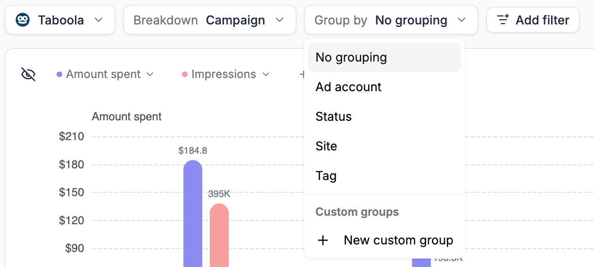
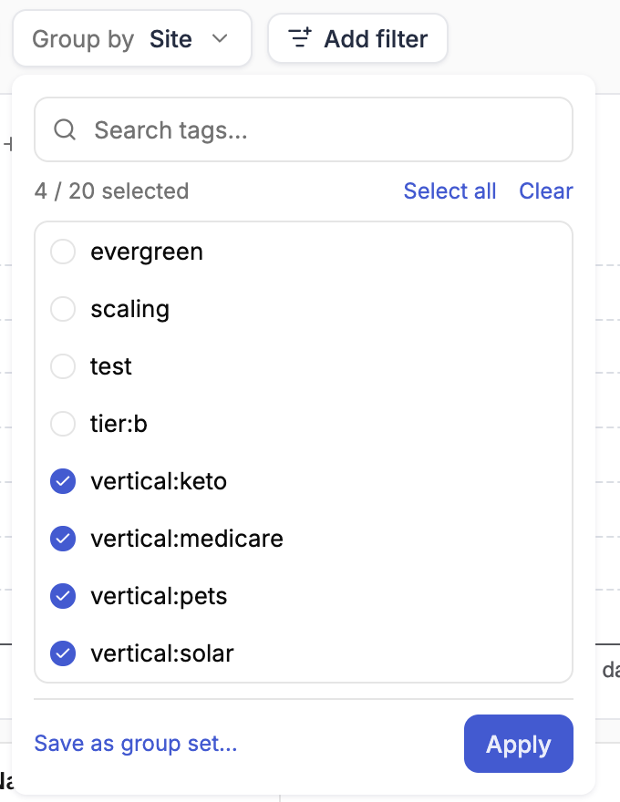
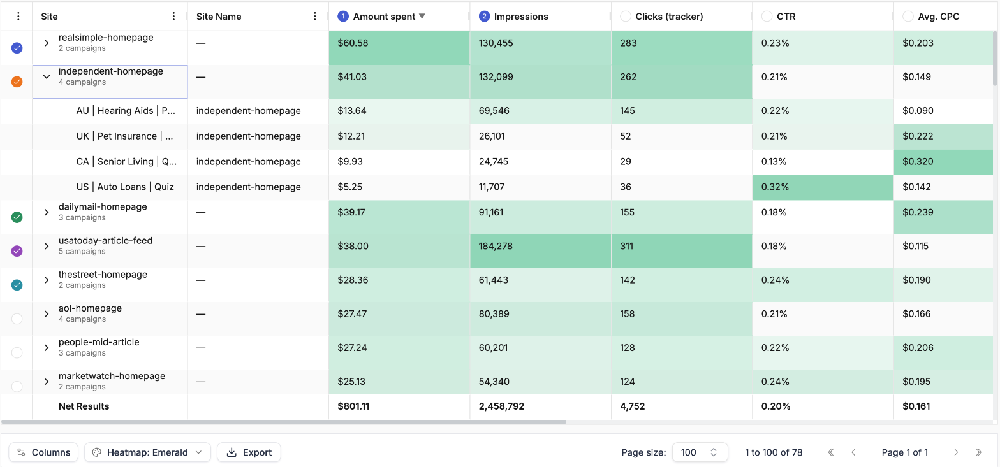
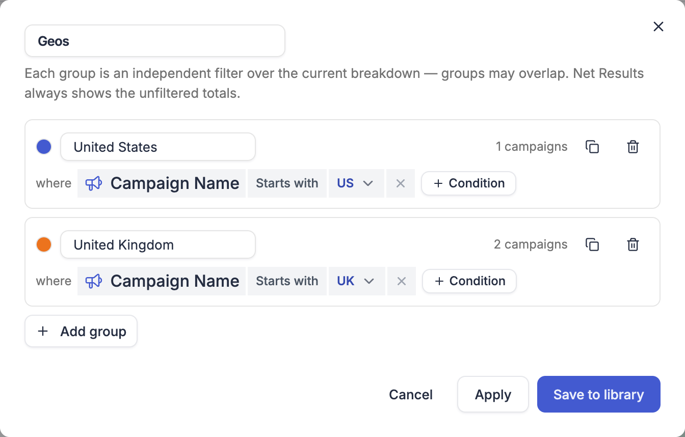

Grouping buckets the rows of a report into groups. Each group row carries the subtotal for everything inside it, and you can expand it to see its rows. Choose a grouping from the **Group by** control on the toolbar.

<Frame>
  
</Frame>

---

## What you can group by

The options depend on the [breakdown](/reports/build-a-report#breakdown) — each one only offers the groupings that make sense for its rows.

| Breakdown | Group by options |
| --- | --- |
| **Campaign**, and a network's own levels | **Traffic source** (all networks only), **Ad account**, **Status**, **Tag**, and custom groups — plus the extra options below |
| **Ad account** | **Traffic source** (all networks only), **Tag** (ad account tags), **Team member**, **Currency**, **Timezone**, and custom groups |
| **Day** or **Month** | **Traffic source** (all networks only), **Ad account**, **Team member**, **Currency**, **Timezone** |
| **Ad network** | No grouping |

Some breakdowns add options of their own:

- **Ad level** — **Landing page** groups ads that point to the same URL. On Facebook, **Ad name** groups ads that share a name, so you can see how one creative performs across every ad set it runs in
- **Any level below campaign** — **Campaign** rolls ad sets, ads, sites or widgets up into the campaign they belong to
- **Campaign on a native network** — the network's placement level, such as **Site** on Taboola. See [Group by placement](#group-by-placement)

Pick **No grouping** to go back to a flat list.

**Traffic source** groups rows by the ad network they come from. It's only offered with **All networks** selected, since a single-network report has just one.

<Note>
  **Team member** appears only when your plan includes [team members](/account-settings/team-members). It groups ad accounts by the team members who have access to them — an account several members share appears in each of their groups.
</Note>

---

## Group by tag

Choosing **Tag** opens a picker listing every tag in use at the current breakdown — campaign tags for campaigns, ad account tags for ad accounts, and so on. Each tag you select becomes one group.

<Frame>
  
</Frame>

- Search the list, or use **Select all** and **Clear**
- Select up to 20 tags. The counter at the top shows how many you've picked
- Click **Apply** to group the report

A row with several tags appears in the group of each selected tag, so groups can overlap.

**Team member**, **Currency** and **Timezone** open the same kind of picker, so you can group by only the members, currencies or timezones you care about.

<Tip>
  Grouping by the same tags again and again? Click **Save as group set…** in the tag picker to save your selection as a [custom group set](#custom-groups), with one group per tag. It then appears in the **Group by** menu for every report.
</Tip>

---

## Group by placement

On native networks, a campaign's traffic comes from sites, publishers or widgets — whatever the network calls its placements. To see which placements carry your campaigns:

<Steps>
  <Step title="Pick a single native network">
    Choose the network, for example Taboola, from the network control.
  </Step>
  <Step title="Choose the Campaign breakdown">
    Set **Breakdown** to **Campaign**.
  </Step>
  <Step title="Group by the placement level">
    Open **Group by** and choose the network's placement level, for example **Site**.
  </Step>
</Steps>

Each group is now one site, with its total across every campaign it runs in and a count such as *4 campaigns* underneath. Click the arrow on a site to see the campaigns it appears in, and what it delivered for each one.

<Frame>
  
</Frame>

---

## Custom groups

Custom groups let you define your own buckets with conditions, for when tags or statuses don't match how you think about your campaigns. Typical examples are funnel stages, verticals, geos taken from your naming convention, or *testing* versus *scaling* campaigns.

A set of custom groups is called a **group set**. Group sets are available on the **Campaign** breakdown, a network's own levels, and the **Ad account** breakdown.

### Create a group set

<Steps>
  <Step title="Open the group builder">
    Open **Group by** and choose **New custom group** under **Custom groups**.

  </Step>
  <Step title="Name the set">
    Type a name for the group set at the top of the dialog, for example *Funnel stages*.
  </Step>
  <Step title="Define each group">
    For each group, give it a name and a color, then click **+ Condition** to add the rules a row must match. Conditions can use a row's **Name**, its **Status** or its **Tags** — for example *Campaign Name starts with US*. The count on the right, such as *2 campaigns*, shows how many rows the group matches right now.

    <Frame>
      
    </Frame>
  </Step>
  <Step title="Add more groups">
    Click **Add group** for each additional bucket, up to 20. Use the duplicate icon to copy a group and adjust it.
  </Step>
  <Step title="Apply or save">
    Click **Apply** to use the groups in this report right away without keeping them, or **Save to library** to keep the set and reuse it in any report.
  </Step>
</Steps>

<Note>
  Each group is an independent filter over the report's rows, so groups can overlap — a row that matches two groups is counted in both. **Net Results** always shows the unfiltered totals, not the sum of the groups.
</Note>

### Manage saved group sets

Saved group sets are listed under **Custom groups** in the **Group by** menu. Hover a set to reveal its actions:

- **Edit** — change the set's groups. Every report using the set picks up the change
- **Duplicate** — copy the set as the starting point for a new one
- **Delete** — remove the set. Reports that use it fall back to no grouping

A group set built on a single network is only offered on that network. A set built with **All networks** selected is offered everywhere.

While you're using groups you applied but didn't save, **Group by** reads **Custom**, and the menu lists them as **Custom** with an edit icon. Finish or save those groups before starting a new set.

---

## Related

<CardGroup cols={2}>
  <Card title="Build a report" icon="table" href="/reports/build-a-report">
    Network, breakdown, filters, dates, currency, chart, columns and export.
  </Card>
  <Card title="Share reports" icon="share-nodes" href="/reports/sharing">
    Which groupings a shared link can show.
  </Card>
</CardGroup>
