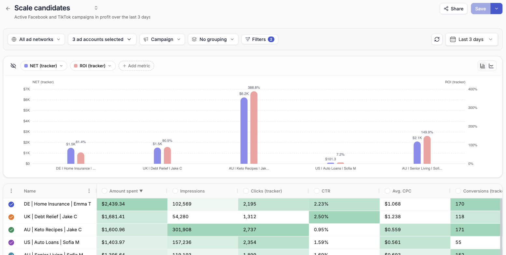
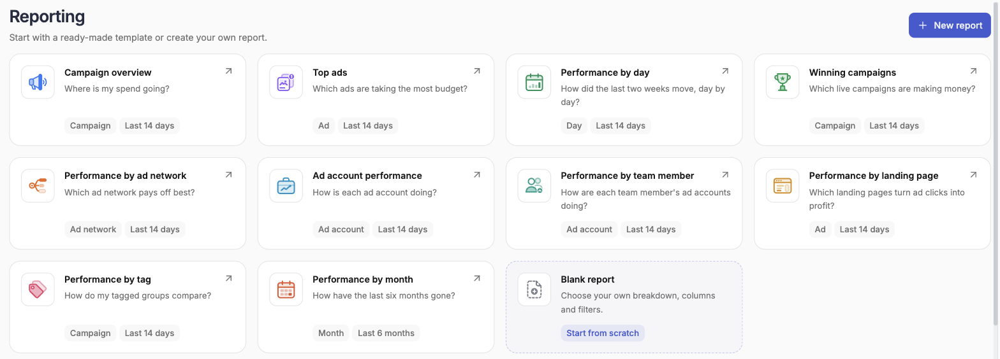
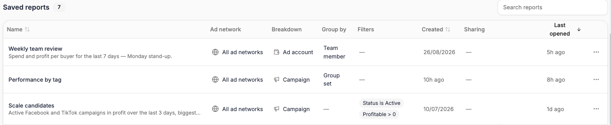

Reporting is where you build the views you keep coming back to: which campaigns are in profit this week, how each ad account is trending month over month, which sites carry your native campaigns, or how every team member's accounts are performing.

A report is a table and a chart built from a few choices — which ad network and ad accounts, what each row is (the breakdown), how rows are bucketed (the grouping), which filters apply and which date range to cover. Save it once and it's one click away from then on. Share it as a link and anyone can open a view-only copy without a TheOptimizer account.

<Frame>
  
</Frame>

---

## The Reporting home page

Click **Reporting** in the left sidebar to open the Reporting home page. It has two parts: template cards to start from, and the list of reports you have saved.

<Frame>
  
</Frame>

### Starting from a template

Each template card names the question it answers — *Where is my spend going?*, *Which ads are taking the most budget?* — and shows its breakdown and date range underneath. Click a card to open the template as a new, unsaved report. Adjust anything you like, then save it under your own name.

| Template | What it shows |
| --- | --- |
| **Campaign overview** | Every campaign across all your ad networks, highest spend first |
| **Top ads** | Every ad, highest spend first |
| **Performance by day** | One row per day, so the trend is easy to read |
| **Winning campaigns** | Active campaigns that are currently profitable |
| **Performance by ad network** | Each ad network side by side |
| **Ad account performance** | Every ad account side by side |
| **Performance by team member** | The ad accounts each team member manages |
| **Performance by landing page** | Ads grouped by the landing page they send traffic to, so you can see which pages turn clicks into profit |
| **Performance by tag** | Campaigns grouped by the tags you've assigned |
| **Performance by month** | The last six months, one row per month |
| **Blank report** | Your own breakdown, columns and filters, from scratch |

Templates cover the last 14 days, except **Performance by month**, which covers the last six months.

The gallery only offers templates that work with what you have connected:

- **Top ads** and **Performance by landing page** open on the first connected ad network that has an ad level, since ads can only be reported one network at a time. They're hidden when none of your networks has one
- **Performance by team member** only appears when your plan includes [team members](/account-settings/team-members)

<Tip>
  **Winning campaigns** is the one template that ships with filters already set — *Active* and *Profitable*. Open it to see how filters work in a report, then change them to match your own definition of a winner.
</Tip>

You can also click **New report** in the top-right corner to open a blank report. A blank report starts on **All ad networks** and **All Ad Accounts**, broken down by **Ad network**, for today.

### Saved reports

**Saved reports** lists every report you've saved, with a summary of how each one is built. Until you save your first report, this section tells you where your saved reports will appear and offers **Start a blank report**.

<Frame>
  
</Frame>

| Column | What it shows |
| --- | --- |
| **Name** | The report's name and description |
| **Ad network** | The ad network the report covers, or *All ad networks* |
| **Breakdown** | What each row of the report is — campaign, ad account, day and so on |
| **Group by** | How rows are bucketed, if at all. Reports grouped by a group set show *Group set* |
| **Filters** | The report's filters — the first few are shown, and **+N** lists the rest on hover |
| **Created** | When the report was first saved |
| **Sharing** | Whether the report has a live share link, and when it expires |
| **Last opened** | When you last opened the report |

Click a row to open the report, or open its name in a new tab with your browser's usual shortcut. Use **Search reports** to find one by name, and click the **Name**, **Created** or **Last opened** headers to sort.

The **⋯** menu at the end of each row holds:

- **Share…** — create or manage the report's share link. See [Sharing reports](/reports/sharing)
- **Duplicate** — copy the report, to build a variation without touching the original
- **Delete** — remove the report permanently. This can't be undone, and if the report is shared, its link stops working for everyone who has it

When a report is shared, a copy icon next to its sharing status copies the link without opening the report.

---

## How a report is built

Every report is the same set of controls along the top of the page, applied from left to right:

<Steps>
  <Step title="Ad network and ad accounts">
    **All ad networks**, or one connected ad network — then all of its ad accounts, or only the ones you pick.
  </Step>
  <Step title="Breakdown">
    What each row is — an ad network, an ad account, a campaign (or an ad set, ad or site on a single network), a day or a month.
  </Step>
  <Step title="Group by">
    Optionally bucket the rows — by ad account, status, tag, team member, a set of custom groups and more.
  </Step>
  <Step title="Filters and date range">
    Narrow the rows down and choose the period the numbers cover.
  </Step>
</Steps>

Below the controls, a chart compares the rows you pick, and the table shows the numbers with a totals row at the bottom.

<CardGroup cols={2}>
  <Card title="Build a report" icon="table" href="/reports/build-a-report">
    Ad network, ad accounts, breakdown, grouping, filters, dates, currency, chart, columns and export.
  </Card>
  <Card title="Group rows" icon="layer-group" href="/reports/grouping">
    Group by tags, ad account attributes, or your own custom groups.
  </Card>
  <Card title="Save and manage reports" icon="floppy-disk" href="/reports/save-and-manage">
    Save, copy, rename and switch between reports.
  </Card>
  <Card title="Share reports" icon="share-nodes" href="/reports/sharing">
    Send a view-only link to a client or colleague — no login needed.
  </Card>
</CardGroup>

---

## Reporting and the Dashboard

The [Dashboard](/dashboard/overview) and Reporting answer different questions. The Dashboard is a board of widgets you glance at — a KPI here, a top-5 there — each with its own metric and ad network. A report is one question answered in depth: a full table you can break down, group, filter, chart and export row by row.

A common setup is a Dashboard for the morning check, and a handful of saved reports for the questions it raises.
