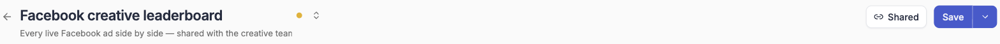
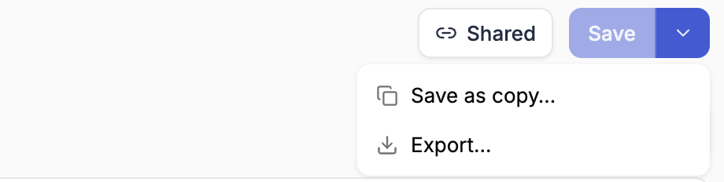
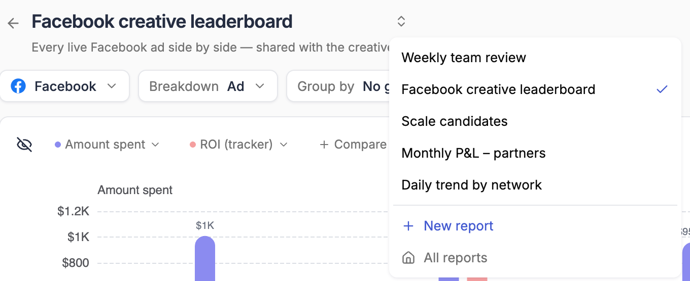
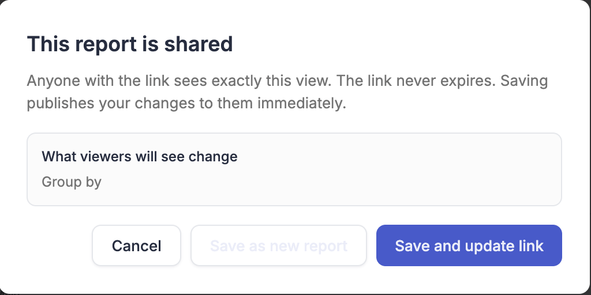

A report you build stays a draft until you save it. Once saved, it appears under **Saved reports** on the [Reporting home page](/reports/overview#saved-reports), and opening it restores exactly the setup you saved.

---

## Save a report

<Steps>
  <Step title="Name the report">
    Click the name at the top of the page — it reads *Untitled* on a new report — and type a name. A report can't be saved without one.

    Optionally, hover under the name and click **+ Description** to add one. It appears under the name in the list of reports and on the shared version.
  </Step>
  <Step title="Save">
    Click **Save report**. A confirmation tells you the report was added to your reports.
  </Step>
</Steps>

After the first save, the button reads **Save**. It stays disabled until you change something, and an amber dot appears next to the report's name as soon as you do — hover it to see *Unsaved changes*.

<Frame>
  
</Frame>

### Leaving with unsaved changes

If you try to leave a report — another page, another report, or **All reports** — while it has unsaved changes, TheOptimizer asks whether to **Discard changes** or **Keep editing**, so you don't lose work by accident. Closing or reloading the browser tab triggers your browser's own leave-page warning too.

### What a saved report remembers

- The ad network and the ad accounts you picked
- The breakdown and grouping — including tag selections and group sets
- The filters
- The date range. A relative range, such as *Last 14 days*, keeps rolling forward
- The table columns
- The chart's metrics, and whether the chart is shown or hidden
- The display currency, if you picked one

The heatmap color isn't part of the report. It's remembered by your browser and applies to every report you open there.

---

## Save a copy

<Frame>
  
</Frame>

To keep the original and save your changes as a new report, click the arrow next to **Save** and choose **Save as copy…**. Give the copy a name and click **Save copy**. The original keeps its last saved state.

The same menu holds **Export…**. See [Export](/reports/build-a-report#export).

To copy a report without opening it, use **Duplicate** in its **⋯** menu on the Reporting home page.

---

## Switch between reports

Click the arrows next to the report's name to open the report switcher. It lists your saved reports, with a check next to the one that's open, plus:

- **New report** — start a blank report
- **All reports** — go back to the Reporting home page

The back arrow to the left of the name also takes you back to the Reporting home page.

<Frame>
  
</Frame>

---

## Saving a report that's shared

If a report has a share link, saving it publishes your changes to everyone who has the link. Before it saves, TheOptimizer asks you to confirm and lists what viewers will see change.

<Frame>
  
</Frame>

- Click **Save and update link** to publish the changes
- Click **Save as new report** to keep your changes in a new report and leave the shared link on its last saved version
- Click **Cancel** to go back without saving

Saving a shared report also refreshes the ad accounts the link covers, so accounts you've connected since it was last saved are picked up.

See [Share reports](/reports/sharing) for everything about share links.

---

## Delete a report

On the Reporting home page, open the report's **⋯** menu and choose **Delete**. Deleting is permanent, and if the report is shared, the confirmation reminds you that its link will stop working for everyone who has it.
