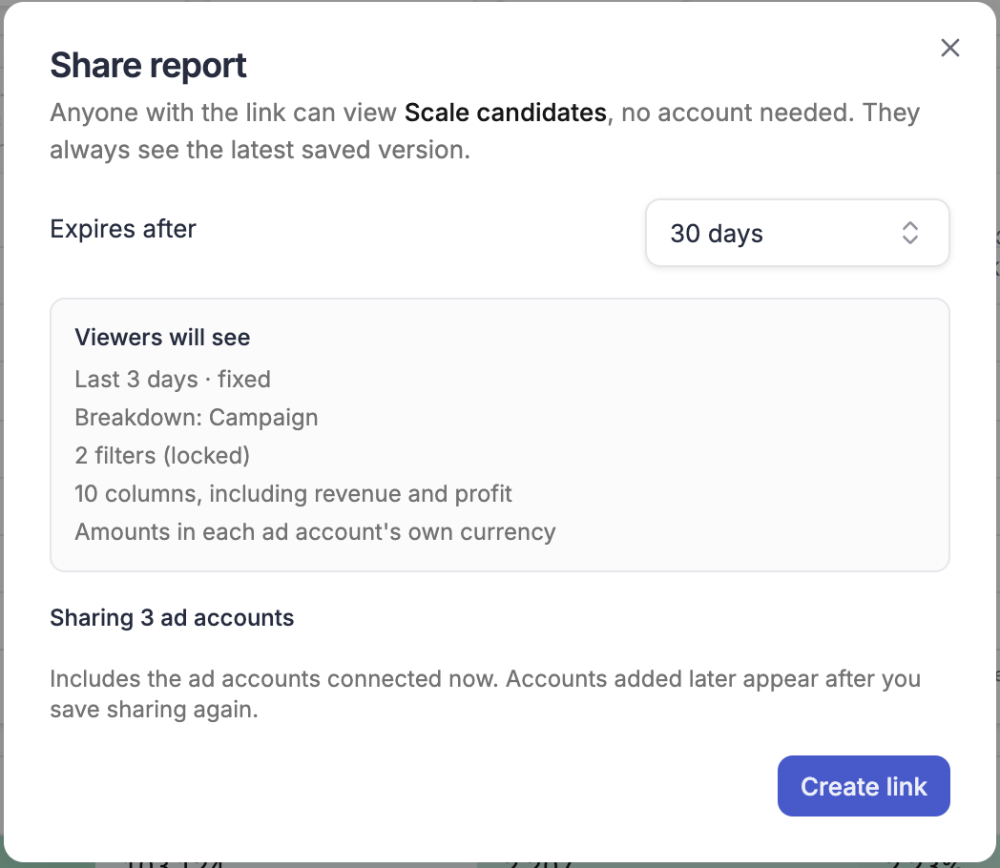
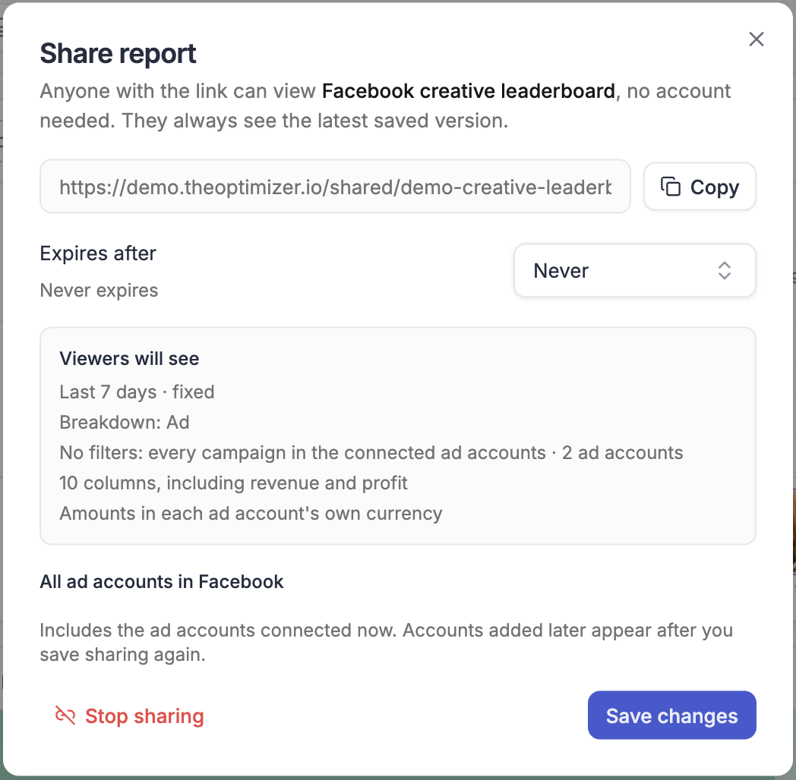
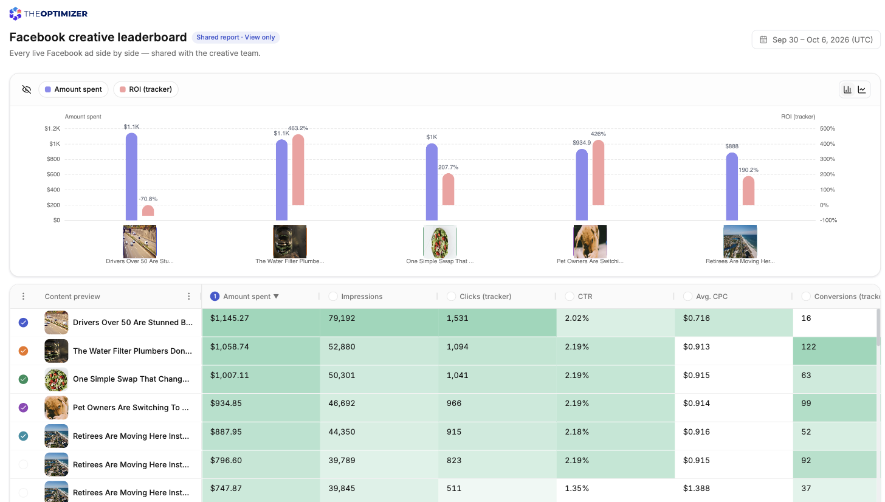

Any saved report can be shared as a link. Anyone who opens the link sees a view-only copy of the report — the same chart and table you see, under your report's name — without needing a TheOptimizer account. It's the quickest way to keep a client, a partner or a colleague outside your workspace up to date.

A shared report is always locked: viewers see exactly the report you saved, and can't change its date range, filters, breakdown, grouping or columns.

---

## Before you share: pick the ad accounts

A share link covers the ad accounts the report covers. Before you share, check the [ad account picker](/reports/build-a-report#ad-accounts) on the toolbar:

- **All Ad Accounts** — the link covers every ad account you have connected for the report's ad network, or for every network with **All ad networks**
- **Some ad accounts** — the link covers only the accounts you picked. Use this to share one client's numbers without exposing the rest of your accounts

Save the report after changing the accounts. The link always follows the saved report.

---

## Create a share link

<Steps>
  <Step title="Save the report">
    Only saved reports can be shared, so the **Share** button stays disabled until you've saved — its tooltip reads *Save this report to share it*.
  </Step>
  <Step title="Open the share settings">
    Click **Share** at the top of the report. You can also choose **Share…** from the report's **⋯** menu on the Reporting home page.

    <Frame>
      
    </Frame>
  </Step>
  <Step title="Choose when the link expires">
    Under **Expires after**, pick **7 days**, **30 days**, **90 days** or **Never**. New links expire after 30 days unless you change it.
  </Step>
  <Step title="Check what viewers will see">
    Under **Viewers will see**, the dialog sums up what the link shows. See [What the summary tells you](#what-the-summary-tells-you).
  </Step>
  <Step title="Create and copy the link">
    Click **Create link**, then **Copy**, and send the link to whoever should see the report.
  </Step>
</Steps>

<Frame>
  
</Frame>

Once a report is shared, its button reads **Shared**, and the dialog shows the link with its expiry date — for example *Expires Dec 18, 2026*, or *Never expires*. The **Sharing** column on the Reporting home page shows the link's status — *Shared*, *Shared · expires in 5d*, *Shared · expires Dec 18*, or *Expired*. Click the copy icon next to the status to copy the link again.

### What the summary tells you

The **Viewers will see** box lists, line by line:

- **The dates** — the report's date range, marked *fixed* because viewers can't change it, for example *Last 7 days · fixed*
- **The rows** — the breakdown and grouping, for example *Breakdown: Campaign · Group by: Tag*
- **The filters** — how many filters apply, all locked. A report with no filters says it shows every campaign in the connected ad accounts, and how many accounts that is
- **The columns** — how many columns the table has, and whether they include revenue and profit
- **The currency** — the currency amounts are shown in, or each ad account's own currency

Under the summary, the dialog says which ad accounts the link covers — *Sharing 3 ad accounts*, *All ad accounts in Taboola* or *All ad accounts*.

<Tip>
  Read the summary before you send a link to a client. If it says *including revenue and profit* and the client should only see spend, remove those columns and save the report first.
</Tip>

---

## What viewers see

The shared page shows the TheOptimizer logo, the report's name, its description, a **Shared report · View only** badge and the date range, followed by the chart and the table.

- **The latest saved version** — viewers see the report as it was last saved. Unsaved changes on your side stay private until you save
- **Fixed dates** — the page shows the actual dates, in UTC, for example *Sep 30 – Oct 6, 2026 (UTC)*. A relative range such as *Last 7 days* still rolls forward each day, but viewers can't pick another range
- **Ad account names** — rows and groups by ad account show the account's name, just as they do for you
- **Your currency choice** — if the report converts amounts to one currency, the page says so, for example *All amounts in USD (today's rate)*
- **The chart, view only** — viewers can pick which table rows the chart compares and switch between bar and line, but the chart's metrics are the ones you saved
- **Plain ad thumbnails** — ad previews on hover are only available inside TheOptimizer

Viewers can't export the report, change its columns, or see its filter conditions.

If the link has expired, viewers see *This shared report has expired* and are asked to request a fresh link. If sharing was stopped or the link is wrong, they see *This report link is not available*. If the report can't be shown — for example because a group set it uses was deleted — they see *This report can't be shown right now*.

<Frame>
  
</Frame>

---

## Which ad accounts a link covers

The ad accounts are fixed when you create the link or save it again — the dialog reminds you that it *includes the ad accounts connected now*.

- **Accounts you connect later** appear on the link after you save the report or the share settings again
- **Narrowing the accounts** on a shared report and saving it narrows the link straight away
- **No matching accounts** — if none of the report's ad accounts are connected to your profile, TheOptimizer refuses to create the link, since it would show no data. Adjust the account filter, save the report and try again

---

## Change, renew or stop sharing

Open **Share** on the report at any time to change the expiration, then click **Save changes**. The link itself stays the same.

- **Renew an expired link** — pick a new expiration and save. The link works again at the same address
- **Stop sharing** — click **Stop sharing** and confirm. The link stops working immediately. Sharing the report again creates a new link, so the old one can't be revived

When you save changes to a shared report, the changes reach viewers straight away. See [Saving a report that's shared](/reports/save-and-manage#saving-a-report-thats-shared).

---

## What can't be shared yet

- **Team member, Currency and Timezone grouping** — a report grouped this way can't be shared yet. Change the group by and save the report before creating a link. If you add one of these groupings to a report that's already shared, TheOptimizer asks you to save it as a new report instead, so the shared link keeps working

<Warning>
  A share link works for anyone who has it. Treat it like a password: send it only to people who should see the numbers, give it an expiration, and stop sharing when it's no longer needed.
</Warning>
